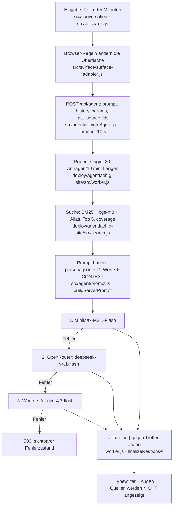

# Website-Agent: wie er heute arbeitet und wohin er soll

Stand: 26.11.2026 · Branch `integration/spatial-depth-error-state`, HEAD `c596f7f` ·
HAI-Mission `M-20261126T164717-a52555eb`. Beschreibung, kein Plan und keine Entscheidung.

**Etiketten:** **VERIFIED** = heute im Code gelesen oder selbst ausgeführt ·
**DOCUMENTED** = steht in einer Datei, heute nicht nachgeprüft ·
**UNVERIFIED** = kein Beleg gefunden. Die Live-Seite wurde heute **nicht** aufgerufen.

## In drei Sätzen

Der Agent ist heute **ein einziger LLM-Aufruf pro Nachricht**, vor dem der Server selbst
in freigegebenen Wissensstücken sucht. Er entscheidet nichts selbst, ruft keine Werkzeuge
auf und merkt sich nichts über einen Reload hinaus. Die Seite verändert sich vor allem durch
**feste Regeln im Browser**, nicht durch das Modell.

## Der Weg einer Frage

Zeitgrenzen im Worker: 4 s je Anbieter, 9 s gesamt, 1,5 s für das Embedding.

## Ist

| # | Aussage | Etikett | Beleg |
|---|---|---|---|
| I1 | Ein LLM-Aufruf je Nachricht (bei Fehler der nächste Anbieter), kein Tool-Calling | VERIFIED | `worker.js` `handleAgent` |
| I2 | Wissen: 125 Stücke mit 125 Embeddings (86 GitHub, 20 Legacy `kj-`, 18 Web, 1 über Samuel) | VERIFIED | `deploy/agentfaehig-site/src/knowledge/` |
| I3 | `coverage` = Alias-Treffer oder Ähnlichkeit ≥ 0,56; die Treffer gehen immer in den Prompt | VERIFIED | `search.js`, `coverage.json` |
| I4 | Bei der Kalibrierung: 42 von 50 richtig, 2 fälschlich „gedeckt" | DOCUMENTED | `coverage.json` |
| I5 | Gedächtnis: die letzten 3 Wechsel im Browser, nach Reload weg | VERIFIED | `remoteAgent.js` |
| I6 | Kein Serverzustand: kein Durable Object, kein Agents SDK | VERIFIED | `wrangler.jsonc`, `worker.js` |
| I7 | Oberfläche: Regex-Regeln und „Welten" im Browser reagieren auf den Wortlaut | VERIFIED | `surface-adapter.js` `createAdaptiveAgent` |
| I8 | In Produktion bekommt das Modell die 12 Werte als Ton-Vorgabe, aber keine Anweisung, die Oberfläche selbst zu ändern (lokal mit Ollama schon; der Browser liest ein `<surface>` im Antworttext weiterhin aus) | VERIFIED | `prompt.js` `buildServerPrompt`, `main.js` `getSystem`, `surface-adapter.js` |
| I9 | Server liefert `sources`, `contact_card`, `coverage`; keine Stelle der Oberfläche zeigt sie an | VERIFIED | Suche in `src/`; `remoteAgent.js` reicht sie nur durch |
| I10 | Kontakt-Karte ist zusätzlich abgeschaltet (`approved: false`, keine Adresse) | VERIFIED | `site-config.json` |
| I11 | Stimme: nur Eingabe, über die Spracherkennung des Browsers, `en-US`; keine Ausgabe | VERIFIED | `src/voice/mic.js` |
| I12 | Prompt sagt „Language: English only", der Agent antwortet laut Eval trotzdem deutsch | VERIFIED (Prompt) · DOCUMENTED (Antworten) | `prompt.js`: `buildSystemPrompt` verlangt Englisch, `buildServerPrompt` beim Fallback die Sprache des Besuchers; `evals/answers-report.json` |
| I13 | Produktion fragt nur den echten Endpoint; lokal antwortet ein Dev-Agent (oder Ollama) | VERIFIED | `src/main.js` |
| I14 | `npm test`: 301 von 301 grün | VERIFIED | Lauf am 26.11.2026 |
| I15 | Antwort-Eval gegen Live am 25.11.: **11 von 14** | DOCUMENTED | `evals/answers-report.json`, `c596f7f` |
| I16 | Die drei Fehler: zweimal fehlende Quelle (`a-bafoeg`, `a-followup`), einmal fehlte eine Verneinung (`a-future`) | DOCUMENTED | ebd. |
| I17 | `build.sh` kopiert Worker-Quelltext und Wissen in das öffentliche Verzeichnis | VERIFIED (Skript) · DOCUMENTED (öffentlich abrufbar) | `build.sh`, `RAG-RUNBOOK.md` §3 Nr. 9 |
| I18 | Welche Version heute live läuft | UNVERIFIED | zuletzt belegt: `ac1e9d41` am 25.11. (`RAG-RUNBOOK.md`) |
| I19 | Die Persona steht auf `DRAFT — needs Samuel's approval before publication` und geht trotzdem in jeden Server-Prompt | VERIFIED (Code) | `persona.json` `status`, `worker.js` `buildAgentMessages` |

`README.md` und `PROJECT.md` beschreiben den Stand vor dem Wissens-Umbau (279 Tests).

## Soll gegen Ist

| Ziel | Quelle | Ist | Abstand |
|---|---|---|---|
| Die Seite **ist** der Agent, kein Chatfenster | `VISION-samuel.md` „Was ich will" | Augen, Typewriter, veränderliche Fläche (I7) | teilweise; Wirkung auf Fremde ungeprüft |
| Der Agent **fragt, wie er aussehen soll**, und die Seite ändert sich | `VISION-samuel.md` „Was das concret heißt"; Vertrag F3 | Besucher kann es per Wortlaut oder Regler auslösen; nichts im Server-Prompt weist den Agenten an, danach zu fragen (I7, I8) | **groß** |
| Genau ein Regler, der im Gespräch entsteht, Aussehen **und** Haltung | Vertrag F3, T3 | Regler und 12 Werte vorhanden (I8) | Wirkung auf die Haltung nicht nachgewiesen |
| Schneller Front-Agent, dahinter **stille Hintergrund-Agenten** | `VISION-samuel.md` „Was im Hintergrund passiert"; Vertrag F4, T4 | ein Aufruf (I1) | **fehlt** |
| Agent spricht von sich aus weiter | `VISION-samuel.md`; Vertrag 2.3 | nicht gebaut | nach V1 verschoben |
| Geführtes Gespräch: Pathways bis zu festen Endpunkten, höchstens eine Waypoint-Karte zur Zeit | `DESIGN-DECISIONS.md` „Pathways-Architektur“, „Gesprächsführung“ | Pathways nur in Dev-Replay und Tests, Endpunkte nicht gebaut, Kontakt-Karte aus (`RAG-RUNBOOK.md` §5, I10) | **fehlt** (DOCUMENTED) |
| Voice rein **und raus**, Antwort unter 1 s | Vertrag F5, T5; `VISION-samuel.md` | nur Eingabe (I11); keine 20-Wechsel-Messung | **fehlt** |
| Zustand liegt beim Agenten, überlebt Reload, gleich in zwei Tabs | Vertrag Q2, T6 | kein Serverzustand (I6) | **fehlt** (Gespräch); Oberfläche nicht geprüft |
| „Bestmöglicher Cloudflare Agent" mit Context und Skills | `VISION-samuel.md` | Worker mit Suche; Context ja, Skills nein (I6) | **groß** |
| Belegte Antworten mit Quellen und Weg zum Menschen | ADR-0007 Nr. 5; Plan-Linie K1 | Suche und Prüfung ja, Anzeige nein (I9, I10) | Phase D offen |
| Deterministische Suche mit Offline-Gate | ADR-0007 Nr. 4 und 6 | `search.js`, `tests/retrieval.test.js` in `npm test` | erreicht |
| Ein Fremder testet 20 s ohne Anleitung | Vertrag F7, ADR-0005 | 0 Tests (`PROJECT.md`) | **fehlt** (DOCUMENTED) |
| Unabhängiger ACCEPT-Report vor Deploy der Wissens-Linie | ADR-0007 „Offen" | kein Report gefunden, laut Eval trotzdem live | offene Gate-Schuld (UNVERIFIED) |

## Wie verbindlich ist das Soll?

- `PROJECT_CONTRACT.md` ist ein **nicht genehmigter Entwurf** (19.11.).
- Der Gesamtplan in `EXECUTION_PLAN-M0-M5.md` ist ein **Vorschlag**; Ratifizierung offen.
  Er nennt als Nächstes: R2 (ein räumlicher Ausbauschritt), parallel K1 (Wissen), danach
  R3 (Fremdtest) und R4 (Voice, Hintergrund-Agenten).
- Widerspruch bei Pathways: der Vertrag (2.3) schließt sie aus V1 aus, `DESIGN-DECISIONS.md`
  plant als Slice 1 einen Pathway mit drei Waypoints.
- Die Persona, die live mitläuft, ist selbst noch ein Entwurf (I19).
- Fest steht ADR-0007 (angenommen am 25.11.).

## Offene Fragen, die nur Samuel beantworten kann

1. Gilt die Vision mit Hintergrund-Agenten noch, oder ist „ein guter Aufruf mit guter
   Suche" jetzt das Ziel? ADR-0007 sagt Letzteres nur für **Wissensfragen**.
2. Welche Sprache spricht der Agent im Text: Englisch (Prompt) oder die des Besuchers
   (Verhalten)?
3. Sind R2 (Raumtiefe) und der Plan dahinter wirklich wichtiger als die Kernidee
   „der Agent fragt nach seinem Aussehen"?
