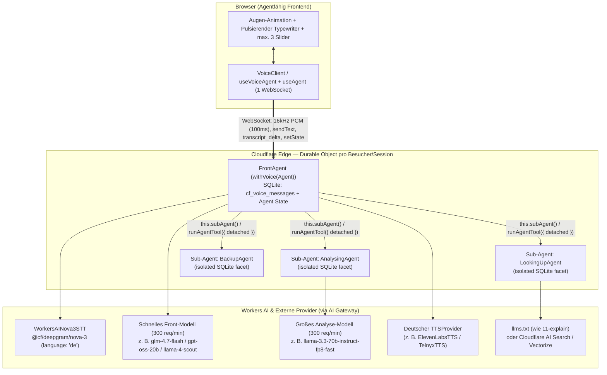

# Cloudflare-Machbarkeit für Agentfähig — Prüfbericht mit Nachweisen

Stand: 19.11.2026 · HAI-Mission: Cloudflare-Machbarkeit für Agentfähig mit Primärquellen und lokalen Nachweisen prüfen und dokumentieren (`M-20261119T160534-30b4d0f9`) · Lease: `S-20261119T160543-c9536ee6`

Dieses Dokument prüft die technische Machbarkeit von **Agentfähig** („Not a website — an Agent itself", siehe [Skizze vom 12.11.2026](../sketches/2026-11-12-agentfaehig.md), [Projektstand](PROJECT.md) und [bestätigte Designentscheidungen](DESIGN-DECISIONS.md)) auf Cloudflare. Es schließt zugleich die im [Lücken-Quereinblick](../tech/LUECKEN-2026-11-12.md) (§3 und §6) markierten Nachweislücken aus der Voruntersuchung ([`tech/CLOUDFLARE-MACHBARKEIT-VORPRUEFUNG-2026-11-12.md`](../tech/CLOUDFLARE-MACHBARKEIT-VORPRUEFUNG-2026-11-12.md)).

> **Abgrenzung gemäß `AGENTS.md`:** Dieser Bericht liefert technische Nachweise und Machbarkeitsbefunde. Er trifft **keine** verbindliche Produkt-, Framework-, Hosting- oder Modellentscheidung; diese Entscheidungen liegen ausschließlich bei Samuel.

> **Nachtrag 19.11.2026 (Review):** Dieses Dokument belegt den **deutschen,
> geparkten** Pfad; Stufe 1 misst englisch (`DESIGN-DECISIONS.md`, Voice-Sprache).
> Die SDK-Zitate stammen aus `agents@0.27.0`; der Messklon installiert `0.33.0`
> (siehe `UNSOLVED-TECHNIK.md` R03). Vor einer Übernahme Zeilennummern und Verhalten
> gegen die installierte Version prüfen. Die Turn-Erkennung von `nova-3` ist
> strittig: dieses Dokument nennt `speech_final`/`endpointingMs`, S7 sagt „keine
> Turn Detection" (siehe `UNSOLVED-TECHNIK.md` U26).

---

## 1. Gesamturteil und drei Nachweisebenen

**Urteil: Technisch machbar auf Cloudflare Workers + Durable Objects + Cloudflare Agents SDK (`agents@0.27.0`) + Workers AI — mit zwei wichtigen Befunden für die Modell- und TTS-Wahl:**

1. **8 von 9 technischen Anforderungen (T1–T9) werden direkt durch das Cloudflare Agents SDK (`agents`) und Workers AI abgedeckt.** Das Paket `agents@0.27.0` ist auf diesem Rechner bereits lokal in Samuels Bestandsprojekt `claudeflareworkerhaus` installiert und wurde für diesen Bericht im Quellcode gegengeprüft.
2. **Kritischer Befund 1 — Deutsche Sprache (STT vs. TTS):**
   - **Sprache-zu-Text (STT) auf Deutsch ist direkt in Workers AI machbar:** `WorkersAINova3STT` (`@cf/deepgram/nova-3`) unterstützt im SDK-Code explizit `language: "de"` und implementiert dasselbe `Transcriber`-Interface wie `WorkersAIFluxSTT` (`@cf/deepgram/flux`, das keinen Sprachparameter besitzt).
   - **Text-zu-Sprache (TTS) auf Deutsch braucht einen Provider-Adapter:** Die in Workers AI gehosteten TTS-Modelle (`@cf/deepgram/aura-1`, `@cf/deepgram/aura-2-en`, `@cf/deepgram/aura-2-es`) bieten laut Schema ausschließlich englische bzw. spanische Stimmen; `@cf/myshell-ai/melotts` unterstützt kein Deutsch und wird am **20.11.2026** abgeschaltet. Für deutsche Sprachausgabe muss in `withVoice` ein `TTSProvider`-Adapter (z. B. `@cloudflare/voice-elevenlabs` mit `ElevenLabsTTS`, `@cloudflare/voice-telnyx` oder ein eigener 15-Zeilen-`TTSProvider`) gesetzt werden.
3. **Kritischer Befund 2 — Workers-AI-Deprecation am 20.11.2026:**
   Mehrere in der bisherigen Recherche und in `claudeflareworkerhaus` genannte Modelle tragen in der offiziellen Cloudflare-Dokumentation das Badge **`Planned Deprecation: 11/20/2026`** (`@cf/moonshotai/kimi-k2.6`, `@cf/meta/llama-3.1-8b-instruct-fp8`, `@cf/meta/llama-3.2-3b-instruct`, `@cf/qwen/qwen3-30b-a3b-fp8`, `@cf/myshell-ai/melotts`). Nicht abgekündigte Alternativen mit vollem **300 req/min**-Standardlimit sind **`@cf/zai-org/glm-4.7-flash`**, **`@cf/openai/gpt-oss-20b`**, **`@cf/meta/llama-4-scout-17b-16e-instruct`** (nativ multimodal inkl. Vision) und **`@cf/meta/llama-3.3-70b-instruct-fp8-fast`**.

### Verwendete Nachweisebenen

| Kürzel | Nachweisebene | Bedeutung |
| --- | --- | --- |
| **[A: CF-Doku]** | Offizielle Cloudflare-Primärquelle | Am 19.11.2026 direkt von `developers.cloudflare.com` bzw. `blog.cloudflare.com` abgerufen und gegen Parameter-Schemata geprüft. |
| **[B: SDK-Code]** | Lokaler Paket-Quellcode `agents@0.27.0` | Direkt im lokal installierten Paket `~/Projects/00_AKTUELL/claudeflareworkerhaus/node_modules/agents/dist/` (MIT-Lizenz, Cloudflare Inc.) auf Datei- und Zeilenebene geprüft. |
| **[C: Bestand]** | Lokale Worker-Flotte `claudeflareworkerhaus` | In Samuels qualifiziertem Bestandsprojekt `~/Projects/00_AKTUELL/claudeflareworkerhaus` (11 Worker, 271/271 lokale Tests, 103/103 Live-Readback-Checks vom 08.10.2026) bereits im Code und Live-Betrieb nachgewiesen. |

---

## 2. Anforderungsmatrix T1–T9 mit Nachweisen

| Nr. | Anforderung aus Skizze & Design | Cloudflare-Baustein | Urteil | Harte Nachweise ([A], [B], [C]) | Verbleibende Grenze / Bedingung |
| --- | --- | --- | --- | --- | --- |
| **T1a** | **Eingang: `voice` (Deutsch)** | `agents/voice` (`withVoice`, `useVoiceAgent`, `VoiceClient`) + `WorkersAINova3STT` (`@cf/deepgram/nova-3`) | **Machbar** | **[A]** [Voice-Doku](https://developers.cloudflare.com/agents/agent-class/communication-channels/voice/) & [Nova-3-Doku](https://developers.cloudflare.com/workers-ai/models/nova-3/) (`language`: BCP-47, `detect_language: boolean`).<br>**[B]** `dist/voice/workers-ai.d.ts:83-126` & `dist/voice/workers-ai.js:348-378, 446-460`: `WorkersAINova3STT` akzeptiert `{ language: "de", endpointingMs: 300 }` und implementiert `Transcriber` (`createSession`), ist also direkt in `withVoice` nutzbar. | `WorkersAIFluxSTT` (`@cf/deepgram/flux`) hat im Schema ([Flux-Doku](https://developers.cloudflare.com/workers-ai/models/flux/), `dist/voice/workers-ai.d.ts:38-52`) **keinen** `language`-Parameter. Für Deutsch in Workers AI `WorkersAINova3STT` nutzen. |
| **T1b** | **Eingang: `text`** | `sendText(text)` in `useVoiceAgent` / `VoiceClient` oder `AIChatAgent` | **Machbar** | **[A]** [Voice-Doku: Text messages](https://developers.cloudflare.com/agents/agent-class/communication-channels/voice/#text-messages).<br>**[B]** `dist/voice/index.js:710-714, 1196-1348` (`_handleTextMessage`): umgeht STT komplett, speichert in SQLite (`cf_voice_messages`), ruft `onTurn()` auf; streamt außerhalb eines Calls reine Text-Deltas (`transcript_delta`), während eines Calls zusätzlich TTS-Audio. | Keine technische Lücke. Entschärft den Einstieg ohne Mikrofonfreigabe ([`DESIGN-DECISIONS.md`](DESIGN-DECISIONS.md)). |
| **T1c** | **Eingang: `picture` (Bild/Vision)** | Workers AI `@cf/meta/llama-4-scout-17b-16e-instruct` oder `@cf/meta/llama-3.2-11b-vision-instruct` | **Machbar** | **[A]** [Llama-4-Scout-Doku](https://developers.cloudflare.com/workers-ai/models/llama-4-scout-17b-16e-instruct/) (131k Kontext, nativ multimodal Text + Vision + Tool Calling + Streaming) & [Llama-3.2-11B-Vision-Doku](https://developers.cloudflare.com/workers-ai/models/llama-3.2-11b-vision-instruct/).<br>**[A]** [Workers AI Limits](https://developers.cloudflare.com/workers-ai/platform/limits/): Image-to-Text erlaubt **720 req/min**, Text Generation **300 req/min**. | `withVoice` hat keinen eingebauten Binär-Slot für Bilder (binäre WS-Frames sind dort 16-kHz-PCM-Audio, `dist/voice/index.js:685-688`). Bilder müssen daher als Base64/JSON via `sendJSON()` (`onMessage`) oder per HTTP-Upload/`@callable()` an dasselbe Durable Object geschickt werden. |
| **T2** | **Antwort unter 1 s inkl. TTS + pulsierender Typewriter** | Satzweises Streaming-TTS (`SentenceChunker` + `eagerAsyncIterable`) in `agents/voice` | **Bedingt machbar (Text: sicher < 1 s; Voice: 800–950 ms Grenzbereich)** | **[A]** [Voice-Doku: Pipeline metrics](https://developers.cloudflare.com/agents/agent-class/communication-channels/voice/#pipeline-metrics) (`first_audio_ms: 950`).<br>**[B]** `dist/voice/index.js:1529-1748` (`_streamingTTSPipeline`): Token werden sofort als `transcript_delta` gesendet, während `SentenceChunker` fertige Sätze parallel synthetisiert (`makeSentenceTTS`).<br>**[B]** `dist/voice/index.js:705-706`: Client-`end_of_speech` (500 ms) wird serverseitig ignoriert (`break;`); Turn-Ende kommt direkt vom STT-Modell. | **Wichtig für Deutsch-TTS:** `WorkersAITTS` (`@cf/deepgram/aura-1`) hat nur 12 englische Stimmen ([Aura-1-Doku](https://developers.cloudflare.com/workers-ai/models/aura-1/)). Für deutsche Stimme in < 1 s wird ein Streaming-TTS-Adapter (`@cloudflare/voice-elevenlabs` / `@cloudflare/voice-telnyx` / Cartesia) benötigt. |
| **T3** | **Front-Agent → Analysing / Looking up / Backup Agent** | `this.subAgent(Cls, name)` (Facets) und `agents/agent-tools` (`agentTool`, `runAgentTool`) | **Machbar** | **[A]** [Sub-agents-Doku](https://developers.cloudflare.com/agents/agent-class/sub-agents/) & [Agents-as-tools-Doku](https://developers.cloudflare.com/agents/agent-class/agent-tools/).<br>**[B]** `dist/agent-tools.d.ts` & `package.json:225-229`: Sub-Agents laufen als co-lozierte Facets auf derselben Maschine mit eigener isolierter SQLite-DB (`this.sql`) und typisiertem RPC-Stub (`SubAgentStub<T>`), ohne eigenes DO-Binding in `wrangler.jsonc`. | Kind-Klassen müssen aus dem Worker-Entrypoint exportiert werden (`export class AnalysingAgent extends Agent`); der Klassenname darf nicht `Sub` lauten. |
| **T4** | **`fast / slow` (schneller Front-Pfad + langsamer Hintergrund-Pfad)** | `runAgentTool(Child, { input, detached: { onFinish, notify, onMilestones } })` + `this.setState()` + `this.speak()` | **Machbar** | **[A]** [Agents as tools: Detached runs](https://developers.cloudflare.com/agents/agent-class/agent-tools/#detached-background-runs).<br>**[B]** `dist/voice/index.js:777-846`: `this.speak(connection, text)` und `this.speakAll(text)` erlauben dem Front-Agenten, auch nach Abschluss des ersten Turns proaktiv zu sprechen oder per `this.setState()` / `notify: true` Ergebnisse nachzureichen. | Da laut [`DESIGN-DECISIONS.md`](DESIGN-DECISIONS.md) der Mensch den Intent gibt, können späte Ergebnisse der Sub-Agenten über `onFinish` / `reportProgress` still im Agent-State (`useAgent` / `useAgentToolEvents`) erscheinen, ohne ungefragt loszusprechen. |
| **T5** | **Höchstens 3 Slider (`colour`, `form`, `output style`) mit Echtzeit-Effekt** | `Agent` State-Sync (`initialState`, `this.setState`, `validateStateChange`, `onStateChanged`) + `useAgent` | **Machbar** | **[A]** [Store and sync state](https://developers.cloudflare.com/agents/agent-class/state/).<br>**[B]** `dist/state/index.d.ts` & `dist/broadcast-state-CEyI4uAK.js`: Jede `setState()`-Änderung (vom Agenten oder vom Browser) wird in SQLite persistiert und sofort per WebSocket an alle verbundenen Clients synchronisiert.<br>**[A]** Optionaler UI-Katalog: [json-render.dev](https://json-render.dev) (geprüft: 41 Komponenten inkl. `Slider` mit `$bindState`). | Für maximal 3 Regler reicht natives `useAgent` + CSS Custom Properties (`--hai-warmth`, `--hai-form`, …); `validateStateChange(next, source)` sichert serverseitig das Limit auf max. 3 aktive Regler ab. |
| **T6** | **Augen, „on wind", Connect-Effekt, lebhafte Präsenz** | Signale aus `VoiceClient` / `useVoiceAgent` (`status`, `audioLevel`, `interimTranscript`, `turnMetrics`) | **Machbar** | **[B]** `dist/voice/client.d.ts:87-102, 129-145` & `dist/voice/client.js:17-71`: Client liefert `status` (`"idle" \| "listening" \| "thinking" \| "speaking"`), `audioLevel` (`0..1` RMS aus 16-kHz-AudioWorklet), `interimTranscript` und `custommessage`. | Animation und Grafik selbst sind reines Frontend (CSS/Canvas/SVG) und benötigen vor dem ersten Intent noch keine aktive Call-Session (`enabled: false` in `useVoiceAgent`). |
| **T7** | **`Pathways`: for website / person / team / company (Isolation)** | SQLite-backed Durable Objects (`getAgentByName`, 1 DO pro Besucher/Session oder Mandant) | **Machbar** | **[A]** [Durable Objects Limits](https://developers.cloudflare.com/durable-objects/platform/limits/) (Stand 13.11.2026): Unbegrenzte Objektanzahl, 10 GB SQLite pro DO (Paid) / 1 GB (Free), 30 s aktive CPU pro Request/WS-Message (erhöhbar auf 5 Min via `limits.cpu_ms`), WebSocket Hibernation.<br>**[C]** `claudeflareworkerhaus/src/pi-agent.js:53-128`: Isoliertes SQLite-DO pro `sessionId` bereits lokal mit 271/271 Tests bewiesen. | Routing-Konvention (`/agents/front-agent/{visitorId}` + Sub-Agent-Pfad `/sub/{pathway}/{id}`) ist eine reine Namensentscheidung beim Bau. |
| **T8** | **Wissensquelle (`plaud thoughts →`, „philosophy of HAI")** | Cloudflare AI Search / Vectorize **oder** statisches `llms.txt`-Wissensmodul | **Machbar** | **[A]** [AI Search Overview](https://developers.cloudflare.com/ai-search/) (auf allen Plänen verfügbar, Hybrid Search default, automatisches Indexing, OCR, eingebauter MCP-Endpoint).<br>**[C]** `claudeflareworkerhaus/src/variants/11-explain.js:7,18-29`: Statische `llms.txt`-Einbettung (`src/knowledge/hai-llms.js`) in Worker 11 (`cwh-11-explain-20261008`) bereits live auf `human-agent-interface.com` abgenommen. | Für kompaktes HAI-/Plaud-Wissen (< 80k Tokens) ist der in `11-explain` bewiesene `llms.txt`-Pfad sofort ohne Zusatzdienst nutzbar; für wachsende Plaud-Archive skaliert AI Search / Vectorize. |
| **T9** | **`⟨Pay⟩` / Kleinbetrag-Freischaltung** | `agents/x402` (HTTP 402 / MPP) **oder** das bestehende `FleetQuota`/`FleetLedger`-Münztelefon aus `claudeflareworkerhaus` | **Vorhanden** | **[A]** [Agentic Payments](https://developers.cloudflare.com/agents/tools/payments/).<br>**[B]** `package.json:325-329` (`agents/x402` Export).<br>**[C]** `claudeflareworkerhaus/src/fleet-ledger.js`, `src/fleet-quota.js`, `src/stripe.js`: Atomare SQLite-DO-Budgetreservierung vor Modellaufruf + Testguthaben-Quoten lokal und live bewiesen. | Lesart `⟨Pay⟩` in der Skizze ist noch unbestätigt; falls benötigt, existieren sowohl das DO-Quoten-/Stripe-Gerüst in `claudeflareworkerhaus` als auch `agents/x402`. |

---

## 3. Aufklärung aller offenen Prüfpunkte aus `tech/LUECKEN-2026-11-12.md`

In [`tech/LUECKEN-2026-11-12.md`](../tech/LUECKEN-2026-11-12.md) (§3 und §6) waren nach dem ersten Recherchelauf zwölf technische Aussagen als „nicht gegengeprüft", widersprüchlich oder offen markiert. Alle zwölf Punkte sind hier durch Primärquellen **[A]** und lokalen SDK-Quellcode **[B]** geklärt:

### 3.1 Klären des Voice-Paketnamen-Widerspruchs (`LUECKEN-2026-11-12.md` §3, Zeile 115–119)

- **Befund:** Es gibt keinen Widerspruch mehr. Seit `agents` Version `0.23.0` ist das frühere Paket `@cloudflare/voice` **deprecated** und vollständig in das Hauptpaket `agents` unter dem Subpath `agents/voice` integriert.
- **Nachweis [A]:** [Voice-Doku, Abschnitt „Migrating from `@cloudflare/voice`"](https://developers.cloudflare.com/agents/agent-class/communication-channels/voice/#overview) nennt die 1:1-Ersetzung `@cloudflare/voice` → `agents/voice`, `@cloudflare/voice/client` → `agents/voice/client`, `@cloudflare/voice/react` → `agents/voice/react`.
- **Nachweis [B]:** `~/Projects/00_AKTUELL/claudeflareworkerhaus/node_modules/agents/package.json` (Version `0.27.0`, Zeilen 415–454) exportiert `./voice`, `./voice/types`, `./voice/client`, `./voice/react`, `./voice/errors`, `./voice/workers-ai`, `./voice/sfu` und `./voice/text`.
- **Drittanbieter-Pakete:** Nur externe Provider mit eigenem API-Key liegen in separaten npm-Paketen (`@cloudflare/voice-deepgram`, `@cloudflare/voice-elevenlabs`, `@cloudflare/voice-telnyx`, `@cloudflare/voice-twilio`, `@cloudflare/voice-plivo`). Die Workers-AI-Provider (`WorkersAIFluxSTT`, `WorkersAINova3STT`, `WorkersAITTS`) sind direkt in `agents/voice` enthalten (`dist/voice/workers-ai.js`).

### 3.2 Deutsch-Fähigkeit von STT und TTS (`LUECKEN-2026-11-12.md` §2, Zeile 97–98)

- **STT (Sprache-zu-Text):**
  - `@cf/deepgram/flux` (`WorkersAIFluxSTT`) akzeptiert laut [offiziellem Raw-Input-Schema](https://developers.cloudflare.com/workers-ai/models/flux/schema-input.json) und laut `dist/voice/workers-ai.js:183-191` nur `encoding`, `sample_rate`, `eot_threshold`, `eager_eot_threshold`, `eot_timeout_ms`, `keyterm`, `mip_opt_out` und `tag` — **keinen** Sprachparameter (`language`). Laut Maintainer-Aussage in [cloudflare/agents#1441](https://github.com/cloudflare/agents/issues/1441) hostet Workers AI für Flux aktuell ausschließlich das englische Modell (`flux-general-en`).
  - `@cf/deepgram/nova-3` (`WorkersAINova3STT`) enthält dagegen im [offiziellen Workers-AI-Input-Schema (`schema-input.json`)](https://developers.cloudflare.com/workers-ai/models/nova-3/schema-input.json) explizit die Felder `"language": { "type": "string", "description": "The BCP-47 language tag that hints at the primary spoken language..." }` und `"detect_language": { "type": "boolean" }`. In `dist/voice/workers-ai.js:360, 448-460` übergibt `WorkersAINova3STT` `language: config.language` direkt an `ai.run("@cf/deepgram/nova-3", input, { websocket: true })`. Da `WorkersAINova3STT` exakt dasselbe `Transcriber`-Interface implementiert (`dist/voice/workers-ai.d.ts:122`), funktioniert deutscher Spracheingang in `withVoice` ohne Zusatzpaket über:
    ```ts
    transcriber = new WorkersAINova3STT(this.env.AI, { language: "de" });
    ```
  - Alternativ unterstützt `@cf/openai/whisper-large-v3-turbo` ([Whisper-Doku](https://developers.cloudflare.com/workers-ai/models/whisper-large-v3-turbo/)) den Parameter `language: "de"` für Batch-Transkription ($0.000513 / Audio-Minute).
- **TTS (Text-zu-Sprache):**
  - `WorkersAITTS` (`dist/voice/workers-ai.js:25-53`) ruft standardmäßig `@cf/deepgram/aura-1` mit `{ text, speaker }` auf.
  - Laut [Aura-1-Doku](https://developers.cloudflare.com/workers-ai/models/aura-1/) (`speaker`-Enum: 12 englische Stimmen) und [Aura-2-en-Doku](https://developers.cloudflare.com/workers-ai/models/aura-2-en/) (40 englische Stimmen) gibt es in Workers AI derzeit **kein deutsches Aura-Modell**.
  - `@cf/myshell-ai/melotts` ([MeloTTS-Doku](https://developers.cloudflare.com/workers-ai/models/melotts/)) trägt das Badge **`Planned Deprecation: 11/20/2026`** und unterstützt kein Deutsch.
  - **Lösung für deutsche Sprachausgabe:** In `withVoice` wird für `tts` ein deutscher Provider über das offene `TTSProvider`-Interface (`dist/voice/types.d.ts:20`, Methode `synthesize(text, signal): Promise<ArrayBuffer | null>`) bzw. `StreamingTTSProvider` (`synthesizeStream`) eingebunden — z. B. `ElevenLabsTTS` aus `@cloudflare/voice-elevenlabs` oder `TelnyxTTS` aus `@cloudflare/voice-telnyx/tts`.

### 3.3 Addiert sich die Client-Stille-Erkennung (`silenceDurationMs: 500`) auf die Latenz? (`CLOUDFLARE-MACHBARKEIT-VORPRUEFUNG-2026-11-12.md` Zeile 82)

- **Befund:** **Nein.** Die Befürchtung, dass der Client 500 ms wartet, bevor der Server das Turn-Ende erfährt, wird durch den SDK-Quellcode widerlegt.
- **Nachweis [B]:**
  1. `dist/voice/client.js:17-57` (`AudioCaptureProcessor`): Das AudioWorklet im Browser resampelt das Mikrofonsignal per linearer Interpolation auf 16 kHz und sendet alle **1600 Samples = 100 ms** sofort einen binären PCM-Frame über den WebSocket.
  2. `dist/voice/index.js:705-706` (in `withVoice`) und `dist/voice/index.js:236-237` (in `withVoiceInput`):
     ```js
     case "start_of_speech":
     case "end_of_speech": break;
     ```
     Der Server ignoriert die Client-Nachricht `end_of_speech` vollständig!
  3. Die Turn-Erkennung findet ausschließlich im kontinuierlichen Server-Transcriber statt: bei `WorkersAIFluxSTT` über das Modell-Event `EndOfTurn` (`dist/voice/workers-ai.js:298-303`), bei `WorkersAINova3STT` über `speech_final: true` mit `endpointingMs: 300` (300 ms, konfigurierbar in `WorkersAINova3STTOptions`, `dist/voice/workers-ai.js:361, 454, 554`).

### 3.4 Kann der Front-Agent nachträglich von sich aus sprechen, wenn ein langsamer Sub-Agent fertig wird? (`CLOUDFLARE-MACHBARKEIT-VORPRUEFUNG-2026-11-12.md` Zeile 60, 99)

- **Befund:** **Ja, technisch vollständig vorhanden.**
- **Nachweis [A] & [B]:**
  - [Voice-Doku: Convenience methods](https://developers.cloudflare.com/agents/agent-class/communication-channels/voice/#convenience-methods) und `dist/voice/index.js:777-846`:
    - `await this.speak(connection, text)` sendet `transcript_start`, `transcript_end`, synthetisiert das Audio über `this.tts`, setzt den Status auf `"speaking"`, sendet die Audio-Bytes, speichert die Nachricht in SQLite und setzt den Status zurück auf `"listening"`.
    - `await this.speakAll(text)` führt dasselbe für alle verbundenen WebSocket-Clients aus.
  - Wenn gemäß [`DESIGN-DECISIONS.md`](DESIGN-DECISIONS.md) („Der Mensch gibt den Intent; der Agent reagiert darauf") kein ungefragtes Nachsprechen gewünscht ist, kann das Ergebnis eines Detached Sub-Agents (`runAgentTool(..., { detached: { onFinish } })`) stattdessen rein visuell über `this.setState(...)` oder als Chat-Nachricht (`detached: { notify: true }`) eingespielt werden.

### 3.5 Wie verhalten sich pulsierender Typewriter und Sprachausgabe zueinander? (`ABGLEICH-DESIGN-TECHNIK.md` Zeile 46–54)

- **Befund:** Das Voice-Protokoll liefert Text-Tokens in Echtzeit *vor* dem Audio, enthält aber **keine** Wort-Zeitmarken im Audio-Stream.
- **Nachweis [B]:**
  - In `dist/voice/index.js:1529-1748` (`_streamingTTSPipeline`) wird jedes vom LLM erzeugte Text-Token sofort in Zeile 1712 via `sendAssistantDelta(token)` als `{ type: "transcript_delta", text: token }` an den Browser geschickt.
  - Parallel sammelt `SentenceChunker` (Zeile 1713) die Tokens bis zum Satzende und startet `makeSentenceTTS(sentence)` asynchron im Hintergrund (`eagerAsyncIterable`, Zeile 1662).
  - Sobald das LLM fertig generiert hat, sendet der Server `{ type: "transcript_end", text: fullText }` (Zeile 1722) und wartet erst danach in Zeile 1726 (`await drainPromise`) darauf, dass alle TTS-Sätze fertig synthetisiert und als Binär-Frames übertragen sind.
  - Das Schema `VoiceServerMessage` (`dist/types-_Faxb570.d.ts:140-199`) kennt `transcript_start`, `transcript_delta`, `transcript_end` und `status: "speaking"`, jedoch **keine** Wort-Timestamps für das Audio.
- **Technische Konsequenz für das Frontend:** Da die `transcript_delta`-Tokens schneller im Browser eintreffen als die TTS-Synthese dauert, liegen dem Browser die vollständigen Wörter rechtzeitig vor. Der Browser kann den Text in einem Wort-Puffer sammeln, den pulsierenden Wortlängen-Rhythmus ([`DESIGN-DECISIONS.md`](DESIGN-DECISIONS.md)) lokal takten und den Start auf das Event `status === "speaking"` legen.

### 3.6 Rate-Limits (20/50 req/min vs. 300 req/min) und Deprecation-Prüfung (`LUECKEN-2026-11-12.md` §6, Zeile 197–199)

- **Befund:** Die 20/50-req/min-Grenze gilt **nicht** pauschal für alle großen Modelle, sondern laut Primärquelle ausschließlich für Modelle, deren Dokumentationsseite ausdrücklich das Banner `Paid access required` trägt. Gleichzeitig hat die Einzelprüfung der Modellseiten eine **Deprecation-Welle zum 20.11.2026** aufgedeckt.
- **Nachweis [A]:** [Workers AI Limits](https://developers.cloudflare.com/workers-ai/platform/limits/) (abgerufen 19.11.2026):
  - **Automatic Speech Recognition (STT):** 720 req/min
  - **Image-to-Text (Vision):** 720 req/min
  - **Text Generation (Standard):** **300 req/min** („unless the model requires the Workers Paid plan — each model page states whether it does")
  - **Text Generation (`Paid access required`-Modelle):** 20 req/min (Standard Workers AI Billing) bzw. 50 req/min (Prepaid AI Gateway Unified Billing) pro Konto und Modell.

#### Einzelprüfung der Modellseiten (Stand 19.11.2026)

| Modell-ID | Rolle | Deprecation-Status laut Doku | Paid-Banner? | Effektives Rate-Limit | Preis (Input / Output pro 1M Tokens) | Quelle |
| --- | --- | --- | --- | --- | --- | --- |
| `@cf/zai-org/glm-4.7-flash` | Schneller Front-Agent (131k, Tool Calling, 100+ Sprachen) | **Aktiv (keine Deprecation)** | Nein | **300 req/min** | $0.0605 / $0.40 | [glm-4.7-flash](https://developers.cloudflare.com/workers-ai/models/glm-4.7-flash/) |
| `@cf/openai/gpt-oss-20b` | Schneller Front-Agent (128k, Tool Calling, Reasoning `low`) | **Aktiv (keine Deprecation)** | Nein | **300 req/min** | $0.20 / $0.30 | [gpt-oss-20b](https://developers.cloudflare.com/workers-ai/models/gpt-oss-20b/) |
| `@cf/meta/llama-4-scout-17b-16e-instruct` | Front- oder Vision-Agent (131k, **Vision**, Tool Calling) | **Aktiv (keine Deprecation)** | Nein | **300 req/min** | $0.27 / $0.85 | [llama-4-scout](https://developers.cloudflare.com/workers-ai/models/llama-4-scout-17b-16e-instruct/) |
| `@cf/meta/llama-3.3-70b-instruct-fp8-fast` | Analyse-/Hintergrund-Agent (24k, Tool Calling, bewährt in Fleet 01–09) | **Aktiv (keine Deprecation)** | Nein | **300 req/min** | $0.293 / $2.253 | [llama-3.3-70b-fast](https://developers.cloudflare.com/workers-ai/models/llama-3.3-70b-instruct-fp8-fast/) |
| `@cf/meta/llama-3.2-11b-vision-instruct` | Vision-Agent (128k, Bildverständnis) | **Aktiv (keine Deprecation)** | Nein | **300 / 720 req/min** | $0.0485 / $0.676 | [llama-3.2-11b-vision](https://developers.cloudflare.com/workers-ai/models/llama-3.2-11b-vision-instruct/) |
| `@cf/moonshotai/kimi-k2.6` | *(In Voice-Doku als Beispiel genutzt)* | **Planned Deprecation: 11/20/2026** | **Ja (`Paid access required`)** | **20 / 50 req/min** | $0.95 / $4.00 | [kimi-k2.6](https://developers.cloudflare.com/workers-ai/models/kimi-k2.6/) |
| `@cf/meta/llama-3.1-8b-instruct-fp8` | *(Aktuell in `claudeflareworkerhaus` `11-explain`)* | **Planned Deprecation: 11/20/2026** | Nein | 300 req/min (bis 20.11.) | $0.152 / $0.287 | [llama-3.1-8b-fp8](https://developers.cloudflare.com/workers-ai/models/llama-3.1-8b-instruct-fp8/) |
| `@cf/meta/llama-3.2-3b-instruct` | *(In Vorrecherche genannt)* | **Planned Deprecation: 11/20/2026** | Nein | 300 req/min (bis 20.11.) | $0.0509 / $0.335 | [llama-3.2-3b](https://developers.cloudflare.com/workers-ai/models/llama-3.2-3b-instruct/) |
| `@cf/qwen/qwen3-30b-a3b-fp8` | *(Aktuell in `claudeflareworkerhaus` `10-pi-durable`)* | **Planned Deprecation: 11/20/2026** | Nein | 300 req/min (bis 20.11.) | $0.0509 / $0.335 | [qwen3-30b-a3b-fp8](https://developers.cloudflare.com/workers-ai/models/qwen3-30b-a3b-fp8/) |
| `@cf/myshell-ai/melotts` | *(In Vorrecherche für TTS genannt)* | **Planned Deprecation: 11/20/2026** | Nein | — | $0.000205 / Audio-Min | [melotts](https://developers.cloudflare.com/workers-ai/models/melotts/) |

---

## 4. Lokaler Bestandsnachweis: `claudeflareworkerhaus` (`[C: Bestand]`)

In `~/Projects/00_AKTUELL/claudeflareworkerhaus` (qualifizierte HAI-Komponente in `~/Projects/03_HAI/registry/components/claudeflareworkerhaus.json`, Commit `4da33fa`) existiert bereits eine produktive Cloudflare-Worker-Flotte von Samuel. Die Prüfung des lokalen Bestands belegt, was bereits vorhanden ist und was für Agentfähig neu hinzukommt:

### 4.1 Was in `claudeflareworkerhaus` bereits gebaut und getestet ist

1. **`agents@0.27.0` ist bereits Abhängigkeit:** In `claudeflareworkerhaus/package.json:27` ist `"agents": "0.27.0"` installiert (zusammen mit `wrangler@^4.148.0` und `miniflare@^5.20261006.0-alpha`).
2. **Worker 05 (`cwh-05-capability-map-20261007`) ist der Domain `agentfähig.de` (`xn--agentfhig-02a.de`) zugeordnet:**
   - Nachweis: `claudeflareworkerhaus/README.md:39` und `fleet/05-capability-map/wrangler.jsonc:1-43`.
   - Aktueller Inhalt (`src/variants/05-capability-map.js:1-134`): Ein statisches Formular-Münztelefon für eine deklarative Fähigkeitsmatrix (`confirmed / missing / unknown`) mit `@cf/meta/llama-3.3-70b-instruct-fp8-fast`. Es ist **noch nicht** das in der Skizze vom 12.11.2026 entworfene multimodale Agent-Embodiment mit Augen, Voice und Echtzeit-Slidern.
3. **Worker 10 (`cwh-10-pi-durable-20261007`) nutzt bereits das Cloudflare Agents SDK (`agents/lifecycle`, `agents/harness/pi`, `agents/models/pi-ai`):**
   - Nachweis: `claudeflareworkerhaus/src/pi-agent.js:13-22, 53-128`.
   - Belegt ein isoliertes SQLite-Durable-Object (`PiAgent`) pro `sessionId`, gehärtete Workers-AI-Bindings mit Byte-/Call-Budgetierung (`_guardedBinding`, Zeilen 689–797), Idempotenz (`pi_operations`) und sauberes Lifecycle-Teardown.
4. **Worker 11 (`cwh-11-explain-20261008`) beweist den Chat-Erklär-Agenten mit `llms.txt`-Wissen und Service-Binding:**
   - Nachweis: `claudeflareworkerhaus/fleet/11-explain/wrangler.jsonc:1-44` und `src/variants/11-explain.js:1-38`.
   - Belegt die Einbindung von statischem HAI-Wissen (`HAI_KNOWLEDGE` aus `llms.txt`) und die Anbindung an `human-agent-interface.com` über ein Cloudflare Service Binding (`EXPLAIN`).
5. **Atomare Quoten- und Budget-Durable-Objects (`FleetLedger`, `FleetQuota`, `RateLimiter`):**
   - Nachweis: `claudeflareworkerhaus/README.md:83-98, 109-115` — 271/271 lokale Tests grün, 103 PASS im Live-Readback.

### 4.2 Differenz zwischen `claudeflareworkerhaus` und dem Zielbild für Agentfähig

| Merkmal | Aktueller Stand in `claudeflareworkerhaus` (Worker 05 / 10 / 11) | Zielbild `Agentfähig` laut Skizze & `DESIGN-DECISIONS.md` | Technischer Pfad auf Cloudflare |
| --- | --- | --- | --- |
| **Transport Browser ↔ Agent** | Klassisches HTTP `fetch` (`POST /api/...`) | Persistente Echtzeit-Verbindung für Text-Streaming, Audio und Slider-Sync | WebSocket zum Durable Object via `Agent` / `withVoice` (`PartySocket` in `agents/client` bzw. `agents/voice/client`) |
| **Oberfläche & Präsenz** | Statisches Münztelefon-Formular (`public/`) | Lebendige Oberfläche: sanfte Augen vor dem Intent, pulsierender Wortlängen-Typewriter, max. 3 Echtzeit-Slider | `useAgent` (State-Sync für Slider) + `useVoiceAgent` (`status`, `audioLevel`, `transcript_delta`) + CSS/Canvas |
| **Agenten-Topologie** | 1 Request-Response-Modellaufruf (bzw. 1 `PiHarness`-DO) | Schneller Front-Agent + 3 nachgelagerte Sub-Agenten (Analysing, Looking up, Backup) | Top-Level `Agent` mit `withVoice` + 3 Facet-Sub-Agenten via `this.subAgent()` bzw. `this.runAgentTool(..., { detached })` |
| **Sprache (Voice)** | Nicht enthalten (nur Text) | Optionaler Voice-Kanal (STT + TTS) neben Text-Grundweg | `withVoice(Agent)` mit `WorkersAINova3STT(env.AI, { language: "de" })` + deutschem `TTSProvider` |

---

## 5. Verifiziertes Zusammenspiel (Ziel-Architektur auf Cloudflare)



---

## 6. Latenzbudget und Messbarkeit

Cloudflare zerlegt das 800-ms-Ziel für Echtzeit-Sprachagenten im [Realtime-Voice-AI-Blog (29.08.2025)](https://blog.cloudflare.com/cloudflare-realtime-voice-ai/) in:
- **40 ms** Mikrofon-Input (im `agents/voice` AudioWorklet: 1600 Samples @ 16 kHz = **100 ms** Chunk-Größe, `dist/voice/client.js:46`)
- **300 ms** Transkription / Turn-Detection (bei `WorkersAINova3STT`: `endpointingMs: 300`, `dist/voice/workers-ai.js:361`)
- **400–850 ms** LLM bis zum ersten Satz ([Voice-Doku](https://developers.cloudflare.com/agents/agent-class/communication-channels/voice/#pipeline-metrics): Beispiel `llm_ms: 850`, `first_audio_ms: 950`)
- **150–200 ms** TTS für den ersten Satz (dank `SentenceChunker` parallel zum laufenden LLM-Stream, `dist/voice/index.js:1530, 1713`)

### Eingebaute Messpunkte im SDK (`dist/types-_Faxb570.d.ts:50-79`)

Das lokal installierte `agents@0.27.0` emittiert nach jedem Sprach- oder Text-Turn automatisch das Event `turn_metrics` (`VoiceTurnMetrics`) mit einer einzigen Server-Uhr:
- `speechStartToFirstInterimMs`: Sprachbeginn bis erstes Teiltranskript
- `speechStartToFinalMs`: Sprachbeginn bis finales Transkript (STT + Turn-Detection)
- `modelToFirstTextMs`: Modellstart bis erstes Text-Token (entscheidend für den Typewriter-Start!)
- `finalInputToFirstAudioMs`: Finales Transkript bis erstes gesendetes TTS-Audio-Paket (`first_audio_ms`)
- `ttsToFirstAudioMs`: Erster TTS-Aufruf bis erstes Audio-Paket
- `turnTotalMs`: Gesamtdauer des Turns

Damit müssen Latenz-Abnahmekriterien nicht geschätzt werden, sondern fallen bei jedem Turn maschinenlesbar aus `client.turnMetrics` heraus.

---

## 7. Offene Entscheidungen für Samuel (keine Vorfestlegung)

Bevor ein Prototyp oder Mess-Klon gestartet wird, stehen diese Entscheidungen bei Samuel:

1. **Text-First für den ersten Durchstich?**
   Da laut [bestätigten Designentscheidungen](DESIGN-DECISIONS.md) jede Antwort auch ohne Ton als pulsierender Typewriter-Text funktioniert und `sendText()` in `withVoice` denselben `onTurn()`-Pfad nutzt (`dist/voice/index.js:1196`), kann der erste vertikale Durchstich komplett mit Text + Augen + 3 Echtzeit-Slidern starten (Latenz `modelToFirstTextMs` typisch < 400 ms, keine externe TTS-Abhängigkeit) und Voice im zweiten Schritt dazuschalten.
2. **Deutscher TTS-Provider:**
   Welcher Provider soll für die deutsche Stimme hinter `TTSProvider` eingesetzt werden (`@cloudflare/voice-elevenlabs`, `@cloudflare/voice-telnyx`, oder ein anderer Anbieter über AI Gateway), da Workers AI (`aura-1` / `aura-2-en`) aktuell nur englische/spanische Stimmen hat?
3. **Deprecation-Update in `claudeflareworkerhaus` (Stichtag 20.11.2026):**
   Sollen in einer separaten Mission die am **20.11.2026** auslaufenden Modelle in `claudeflareworkerhaus` (`@cf/meta/llama-3.1-8b-instruct-fp8` in `11-explain` und `@cf/qwen/qwen3-30b-a3b-fp8` in `10-pi-durable`) auf aktive Modelle (z. B. `@cf/zai-org/glm-4.7-flash`, `@cf/openai/gpt-oss-20b` oder `@cf/meta/llama-3.3-70b-instruct-fp8-fast`) umgestellt werden?

---

## 8. Verzeichnis aller geprüften Nachweisquellen

### A. Offizielle Cloudflare-Primärquellen (abgerufen am 19.11.2026)

1. Cloudflare Agents SDK — Voice (`withVoice`, `withVoiceInput`, `useVoiceAgent`, `VoiceClient`, Migration von `@cloudflare/voice`, `speak()`, `sendText()`):
   https://developers.cloudflare.com/agents/agent-class/communication-channels/voice/
2. Cloudflare Agents SDK — Sub-agents (`this.subAgent`, Facets, SQLite-Isolation, `SubAgentStub`, `parentAgent`):
   https://developers.cloudflare.com/agents/agent-class/sub-agents/
3. Cloudflare Agents SDK — Agents as tools (`agentTool`, `runAgentTool`, `detached: { onFinish, notify, onMilestones }`, `reportProgress`, `useAgentToolEvents`):
   https://developers.cloudflare.com/agents/agent-class/agent-tools/
4. Cloudflare Agents SDK — Store and sync state (`initialState`, `setState`, `validateStateChange`, `onStateChanged`, `useAgent`):
   https://developers.cloudflare.com/agents/agent-class/state/
5. Cloudflare Workers AI — Platform Limits (720 req/min ASR & Image-to-Text, 300 req/min Text Generation Standard, 20/50 req/min für Paid-only-Modelle):
   https://developers.cloudflare.com/workers-ai/platform/limits/
6. Cloudflare Durable Objects — Platform Limits (SQLite-DOs: 10 GB Paid / 1 GB Free, 32 MiB WS-Nachricht, 30 s–5 min aktive CPU pro Request/WS-Frame, unbegrenzte Wall-Time, 1.000 req/s Soft-Limit):
   https://developers.cloudflare.com/durable-objects/platform/limits/
7. Cloudflare AI Search — Overview (Managed Hybrid Search, OCR, MCP-Endpoint, alle Pläne):
   https://developers.cloudflare.com/ai-search/
8. Cloudflare Workers AI — Geprüfte Modell-Spezifikationen und Schemata:
   - `@cf/deepgram/flux`: https://developers.cloudflare.com/workers-ai/models/flux/
   - `@cf/deepgram/nova-3`: https://developers.cloudflare.com/workers-ai/models/nova-3/
   - `@cf/deepgram/aura-1`: https://developers.cloudflare.com/workers-ai/models/aura-1/
   - `@cf/deepgram/aura-2-en`: https://developers.cloudflare.com/workers-ai/models/aura-2-en/
   - `@cf/myshell-ai/melotts`: https://developers.cloudflare.com/workers-ai/models/melotts/
   - `@cf/openai/whisper-large-v3-turbo`: https://developers.cloudflare.com/workers-ai/models/whisper-large-v3-turbo/
   - `@cf/meta/llama-3.2-11b-vision-instruct`: https://developers.cloudflare.com/workers-ai/models/llama-3.2-11b-vision-instruct/
   - `@cf/meta/llama-4-scout-17b-16e-instruct`: https://developers.cloudflare.com/workers-ai/models/llama-4-scout-17b-16e-instruct/
   - `@cf/meta/llama-3.3-70b-instruct-fp8-fast`: https://developers.cloudflare.com/workers-ai/models/llama-3.3-70b-instruct-fp8-fast/
   - `@cf/openai/gpt-oss-20b`: https://developers.cloudflare.com/workers-ai/models/gpt-oss-20b/
   - `@cf/zai-org/glm-4.7-flash`: https://developers.cloudflare.com/workers-ai/models/glm-4.7-flash/
   - `@cf/moonshotai/kimi-k2.6`: https://developers.cloudflare.com/workers-ai/models/kimi-k2.6/
   - `@cf/meta/llama-3.1-8b-instruct-fp8`: https://developers.cloudflare.com/workers-ai/models/llama-3.1-8b-instruct-fp8/
   - `@cf/meta/llama-3.2-3b-instruct`: https://developers.cloudflare.com/workers-ai/models/llama-3.2-3b-instruct/
   - `@cf/qwen/qwen3-30b-a3b-fp8`: https://developers.cloudflare.com/workers-ai/models/qwen3-30b-a3b-fp8/
9. Generative UI Katalog — `json-render` (41 Komponenten inkl. `Slider` mit `$bindState`):
   https://json-render.dev

### B. Lokale Quellcode-Nachweise (`agents@0.27.0` & `claudeflareworkerhaus`)

- `~/Projects/00_AKTUELL/claudeflareworkerhaus/package.json` (Zeile 27: `"agents": "0.27.0"`)
- `~/Projects/00_AKTUELL/claudeflareworkerhaus/node_modules/agents/package.json` (Exports-Map Zeilen 139–506)
- `~/Projects/00_AKTUELL/claudeflareworkerhaus/node_modules/agents/dist/voice/index.d.ts` (Zeilen 117–213: `withVoice`, `VoiceAgentMixinMembers`, `speak`, `speakAll`)
- `~/Projects/00_AKTUELL/claudeflareworkerhaus/node_modules/agents/dist/voice/index.js` (Zeilen 705–706: `end_of_speech`-No-Op; Zeilen 747–846: SQLite `cf_voice_messages`, `speak`, `speakAll`; Zeilen 1196–1348: `_handleTextMessage`; Zeilen 1529–1748: `_streamingTTSPipeline` mit `SentenceChunker` und `transcript_delta`)
- `~/Projects/00_AKTUELL/claudeflareworkerhaus/node_modules/agents/dist/voice/workers-ai.d.ts` & `workers-ai.js` (Zeilen 25–53: `WorkersAITTS`; Zeilen 85–316: `WorkersAIFluxSTT`; Zeilen 348–564: `WorkersAINova3STT` mit `language`-Support)
- `~/Projects/00_AKTUELL/claudeflareworkerhaus/node_modules/agents/dist/voice/client.js` (Zeilen 17–57: `AudioCaptureProcessor` 16 kHz Resampling, 1600 Samples = 100 ms Frames)
- `~/Projects/00_AKTUELL/claudeflareworkerhaus/node_modules/agents/dist/types-_Faxb570.d.ts` (Zeilen 50–199: `VoiceTurnMetrics`, `VoiceServerMessage`)
- `~/Projects/00_AKTUELL/claudeflareworkerhaus/fleet/05-capability-map/wrangler.jsonc` & `src/variants/05-capability-map.js` (Bestands-Worker 05 „Agentfähig")
- `~/Projects/00_AKTUELL/claudeflareworkerhaus/fleet/10-pi-durable/wrangler.jsonc` & `src/pi-agent.js` (Durable Object mit `agents/lifecycle` und `agents/harness/pi`)
- `~/Projects/00_AKTUELL/claudeflareworkerhaus/fleet/11-explain/wrangler.jsonc` & `src/variants/11-explain.js` (Erklär-Agent mit `llms.txt` und Service Binding)
