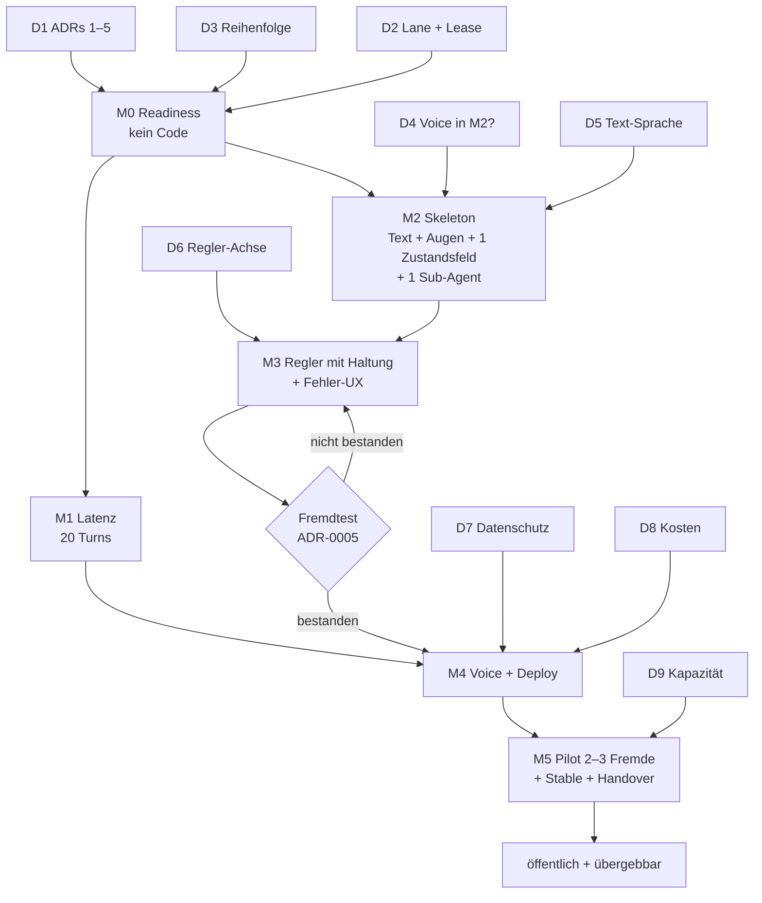

# EXECUTION_PLAN — Agentfähig

Stand: 25.11.2026, Reality Sync · Status: **VORSCHLAG REBASELINE — einziger
Gesamtplan für den aktuellen Produktstand; Ratifizierung durch Samuel offen.**
Vertragshistorie: [`PROJECT_CONTRACT.md`](PROJECT_CONTRACT.md) bleibt ein
Entwurf und wird nicht rückwirkend als genehmigt behandelt.

> **Abgrenzung:** [`tech/EXECUTION_PLAN-M1-MESSLAUF.md`](../tech/EXECUTION_PLAN-M1-MESSLAUF.md)
> ist ab diesem Sync ausschließlich das historische Task-Protokoll für den
> Voice-Messlauf. Es ist kein zweiter Gesamtplan. Die nachfolgenden M0–M5-
> Abschnitte bleiben als Begründung und Entscheidungsgeschichte erhalten.

## 0 · Verifizierte Ausgangsbasis

- Integrierter Produktstand: adaptive Living Surface, reaktive Augen,
  Surface-State und Regler, echte Agentenantwort, ruhiger `error`-Zustand und
  aktivierte 2.5D-Tiefe.
- Integrations-HEAD beim Sync: `ea3bd2e` auf
  `integration/spatial-depth-error-state`.
- Nachweise: 279/279 Node-Tests, 43/43 Slice-A-Tests, lokale Fehler- und
  Spatial-Browserprüfungen inklusive Reduced Motion, grünes `validate.sh` und
  öffentlich sichtbare echte `PONG`-Antwort ohne DEV-DATA-Badge.
- Slice A ist in `a6a8a00` umgesetzt und durch den kanonischen ACCEPT-Report
  sowie einen zusätzlichen unabhängigen mcode-Validator bestätigt.

## 1 · Einziger vorgeschlagener Ausführungspfad

| Stufe | Ergebnis | Aktueller Status / Austritt |
| --- | --- | --- |
| **R0 — Reality Sync** | Git-, Code-, Cloudflare- und Teststand verifiziert; kanonische Dokumente widerspruchsfrei; fremde Arbeit klassifiziert | Dieser Auftrag. Abnahme durch `tech/REALITY-SYNC-2026-11-25.md`; kein neues Feature |
| **R1 — Slice A abschließen** | Ruhiger Fehlerzustand durch Store, Augen und Tests | Umgesetzt in `a6a8a00`; 43/43 gezielte Tests und Browser-Smoke grün. Kein rückwirkender Ersatz für die dokumentierte Build-Reihenfolge |
| **R2 — Genau ein Spatial Vertical Slice** | Eine fachlich begrenzte Erweiterung der vorhandenen 2.5D-Surface auf dem integrierten Stand | Nächster Produkt-Schritt. Vorher: Scope von Samuel, Upstream-First, Plan-Council und unabhängiges ACCEPT. Danach: Node-Suite, Default-/Bones-/Mobile-/Reduced-Motion-Browser und Diff-Review |
| **R3 — Produktevidence statt Politur-Glaube** | Nachweis des Kernversprechens mit Fremdbeobachtung und reproduzierbaren Produktionschecks | Fremdtest bleibt offen. Für Stable und vor weiterer Expansion erneut Owner-Entscheidung; nicht rückwirkend als bestanden markieren |
| **R4 — Voice / DPPM getrennt weiterentwickeln** | Voice-Messung, Multi-Agent-Verhalten und Persistenz mit eigenen technischen Gates | Nicht Bestandteil von R2. Start nur bei tatsächlichem Bedarf und eigenem Plan; Datenschutz/Kosten/Owner-Freigaben bleiben eigene Gates |

R2 darf nicht mit Voice, DPPM, neuen Agenten, neuen Modalitäten oder einem
Architekturwechsel erweitert werden. Ein Zusammenhang ist erst dann ein Blocker,
wenn er für den konkret gewählten Spatial-Slice technisch belegt ist.

## 2 · Gate-Klassifikation nach dem Rebaseline

### Weiterhin sicherheitskritisch / verbindlich

- Owner-Freigabe für Commits, Push, Deploy, Secrets und kostenpflichtige Dienste.
- Upstream-First vor Feature-/App-Code; kein stiller Eigenbau.
- Plan-Council plus unabhängiges `PLAN_VALIDATION_REPORT.md` mit `ACCEPT` vor
  einer neuen Build-Lane. `SCORE_OK` allein reicht nicht.
- Continuous Authorize bei Methodenwechsel, Scope-Drift und Pflicht-Triggern.
- Ein Writer pro Integrationsstelle; fremde Arbeit nicht überschreiben.
- Keine alten Gates nachträglich bestanden, keine Owner-Entscheidungen erfunden.

### Technisch notwendig für R2

- Integrierter Ausgangs-HEAD bleibt reproduzierbar testbar.
- Betroffene Node-Tests plus Gesamt-Suite und `validate.sh` grün.
- Browserprüfung der konkret veränderten Spatial-Eigenschaften auf Desktop,
  Mobile und Reduced Motion; DEV DATA und echte Agentenantworten unterscheiden.
- Nachweisbare Plan-/Council-/Validator-Artefakte für den neuen Slice.

### Evidence Debt, kein pauschaler UI-Blocker

- Voice-20-Turn-Messung und aktuelle STT-Stabilität.
- Fremdtest und Produkterkenntnis über Verständlichkeit und Kontrolle.
- DPPM, Zwei-Tab-Synchronisation und langfristige Zustandsevolution.
- Vollständige Spatial-Browser-Matrix auf der Produktions-URL statt nur lokal.

Diese Punkte bleiben sichtbar offen. Sie blockieren R2 nur, wenn der gewählte
Slice sie direkt verändert oder Samuel sie ausdrücklich zum Gate erklärt.

### Historisch, nicht automatisch auf neue UI-Arbeit übertragbar

- „M0 = kein Code“ und die alte Reihenfolge, nach der jede UI-Arbeit auf den
  Voice-Messlauf warten muss.
- Die alten D1–D9-/O-Listen als angebliche aktuelle Freigaben oder Blocker.
- Die Task-Reihenfolge des historischen Voice-Plans als Gesamtarchitektur.

## 3 · OPEN OWNER DECISIONS

1. **Ratifizierung:** Gilt dieser Rebaseline-Plan als einziger Gesamtplan?
2. **R2-Scope:** Welche eine räumliche Verbesserung bildet den nächsten Vertical
   Slice? Ohne diese Festlegung wird kein neuer Feature-Code geschrieben.
3. **Fremdtest-Gate:** Ist der Fremdtest weiterhin Gate vor jeder Expansion oder
   verbindlich vor Stable? Die Antwort ändert den Plan, nicht den Ist-Nachweis.
4. **Voice/DPPM:** Wann werden diese getrennten Linien reaktiviert, und mit
   welchen Datenschutz-, Kosten- und Abnahmegrenzen?

Bis Punkt 1 und 2 entschieden sind, ist R2 ein Vorschlag, keine Build-Freigabe.

---

## Historischer M0–M5-Plan (19.11.2026)

Die folgenden Abschnitte dokumentieren die damalige Planung. Ihre Ist-Zahlen und
Gates sind weder aktualisierte Produktwahrheit noch rückwirkend bestanden.

## H1 · Ausgangszustand — was damals belegbar war

| Befund | Wert | Beleg |
|---|---|---|
| Anwendungscode | **0 Dateien** (`src/` nur README) | `src/README.md`, `find src tests -type f` → 2 |
| Anwendungstests | **0** | `tests/README.md` |
| Repo-Check | grün (prüft Gerüst + Links, **keine** Funktion) | `bash scripts/validate.sh`, Exit 0, 19.11. |
| Messzeilen Latenz | **0 von 20** | `tech/MESSPROTOKOLL-2026-11-19.md`, Abschnitt „Messwerte" |
| Laufversuch 1 | gescheitert, **keine** Latenzzahl, Ursache Free-Account/Paid-Modell | ebd., Abschnitt „Laufversuch 1" |
| Messumgebung | Klon vorhanden, Server antwortet (`:5173` → 200, `workerd` aktiv), LLM in einer Zeile auf `@cf/zai-org/glm-4.7-flash` getauscht (`src/server.ts:139`) | `git diff --stat` → `package.json` + `server.ts`; `curl` |
| Vorprüfung 19:57 | Free-Plan trägt das getauschte Modell: zwei **Text**-Turns beantwortet, keine Konsolenfehler. `turn_metrics` mit dem unveränderten Beispiel nicht erfassbar (UI, Netzwerk, Trace-Store, Globals geprüft) | `tech/MESSPROTOKOLL-2026-11-19.md` „Vorprüfung 19:57" |
| Laufversuch 2 | Voice-Pfad **instabil**: fünf Fehlstarts der Spracherkennung 20:01–20:04 (`Flux STT WebSocket upgrade failed`), derselbe Fehler schon 18:43:50; Sprach-Turns gelangen dagegen 19:44–19:47. LLM/TTS-Pfad intakt | ebd. „Messversuch 20:01–20:04" und „Teilmessung lokal"; Serverlog `voice-agent-dev.log` |
| Fremdtests | **0** | keine Evidenz im Repo |
| ADRs bestätigt | **0 von 6** (alle „vorgeschlagen"; ADR-0006 Zeitvertrag seit 19.11. abends) | `docs/adr/*`, `PLAN-STUFEN-0-5.md:247–248`, `adr/ADR-0006-zeitvertrag.md:3` |
| Plan-Validator | `ACCEPT`, aber **nicht** an die aktuelle Plandatei gebunden | `PLAN_VALIDATION_REPORT.md:88–104` |
| Technische Machbarkeit | T1–T9 mit Primärquellen + SDK-Code belegt | `CLOUDFLARE-MACHBARKEIT-AUDIT-2026-11-19.md:32–46` |
| Upstreams | `EyeFace.js` (MIT), Pika `generative-ui` (Apache-2.0); **nichts ausgeführt** | `UPSTREAM-SEARCH-vergleichbare-projekte.md:160–168` |
| Kosten | kein Budget; Free-Plan-Annahme; 10.000 Neurons/Tag | `MESSLAUF-PLAN.md:104–112` |
| Kapazität | nicht zugesagt; Projekt hat **keine** Lane | `PROJEKTPFADE.md` §5, `hai_status` |
| Deprecation-Datum | **20.11.2026** (morgen): u. a. `melotts`, `llama-3.2-3b`, `qwen3-30b-a3b-fp8` | `CLOUDFLARE-MACHBARKEIT-AUDIT-2026-11-19.md:20,117–130` |

**Fünf offene Abweichungen, die vor M2 geschlossen oder ausdrücklich akzeptiert
werden müssen** (`PROJEKTPFADE.md` §5, plus eine neue):

1. Plan-Hash-Drift → `ACCEPT` nicht an den Text gebunden. **M0.2**
2. `~/Control/ACTIVE_PROJECTS.md` fehlt → keine Lane. **M0.3**
3. Doppeltes Machbarkeitsdokument (`tech/` 12.11. vs. `docs/` 19.11.) → gültig ist `docs/`. **M0.4**
4. **Die Abweichungsliste ist selbst teilweise veraltet:** `PROJEKTPFADE.md` §5
   Punkt 4 behauptet, `PLAN-STUFEN-0-5.md:82` plane deutsche Wechsel. Das ist nicht
   mehr wahr — `PLAN-STUFEN-0-5.md:5–6` sagt „Stufe 1 misst **englisch**, nicht
   deutsch", und Zeile 82 ist ein anderer Abschnitt (KI-Dialog). Die Abweichung
   besteht nicht; der Listeneintrag muss als überholt markiert werden. **M0.4** —
   ein Beleg dafür, dass die Abweichungsliste geprüft und nicht abgeschrieben
   gehört.
5. **Neu:** `DESIGN-DECISIONS.md:21` („Voice ist Teil des Erstbaus") widerspricht
   `PLAN-STUFEN-0-5.md:176–190` (Voice erst Stufe 5, Mikrofon ohne Funktion). **→ D4**

---

## 2 · Meilenstein-Architektur

Sechs Stufen, an dieses Projekt angepasst. Zwei Anpassungen gegenüber dem
Schema, beide begründet:

- **M1 ist kein Skeleton, sondern eine Messung** — weil ADR-0001 (sofern
  bestätigt) keinen Anwendungscode vor einem Messwert erlaubt. Der Messlauf ist
  die einzige Stufe, die ohne `src/` auskommt.
- **Der Fremdtest sitzt am Ende von M3, nicht am Projektende** — ADR-0005 sagt
  „vor dem Ausbau", und M4 (Voice + Deploy) ist Ausbau. Ein Test erst in M5 wäre
  zu spät: dann ist bereits deployt.

**Nummern-Kollision, bewusst sichtbar:** `tech/MESSPROTOKOLL-2026-11-19.md`
nennt den 20-Turn-Lauf „M2". Dieses Kapitel meint mit M2 den Walking Skeleton;
gemeint ist dort **M1**. Bis zur Umbenennung gilt: „M2" im Protokoll = Messlauf.
Verwandt: `docs/UNSOLVED-TECHNIK.md` U2 (mehrere D-Nummernkreise).

### M0 — Evidence & Engineering Readiness

| Feld | Inhalt |
|---|---|
| **Zielzustand** | Die Planung ist entscheidbar: fünf ADRs beantwortet, Lane/Lease vorhanden, Planfassung an einen Hash gebunden, Widersprüche aufgelöst, neun offene Owner-Entscheidungen (D1–D9) mit Datum beantwortet. **Kein Code.** |
| **Warum notwendig** | Ohne D1–D3 baut M2 gegen Vorschläge statt gegen Beschlüsse; ohne D2 hat Arbeit keinen rechtmäßigen Ort; ohne gebundene Fassung ist das `ACCEPT` eine Behauptung. |
| **Reduzierte Unsicherheit** | Nicht Technik, sondern **Verbindlichkeit**: Ist der Plan, gegen den gebaut wird, wirklich der Plan? |
| **Deliverables** | `docs/DECISIONS-M0.md` (Entscheidungsblatt mit Datum, je D1–D9: Entscheidung / Begründung / Konsequenz) · Lane-Eintrag · `tech/PLAN_VALIDATION_REPORT.md` mit Hash-Nachtrag **oder** neuer Score · `PROJEKTPFADE.md` §5 Punkt 4 als überholt markiert · Warnhinweis in `tech/CLOUDFLARE-MACHBARKEIT-VORPRUEFUNG-2026-11-12.md` (überholt) |
| **Abhängigkeiten** | keine (kann heute starten) |
| **Akzeptanzkriterien** | (a) D1 für alle fünf ADRs beantwortet, ADR-Status aktualisiert; (b) D2 mit Lane-Identität; (c) D3 entschieden; (d) D4–D6 entschieden; (e) Planfassung mit `sha256` benannt, gegen die gebaut wird; (f) `bash scripts/validate.sh` grün |
| **Validierungsablauf** | `rg "Status:" docs/adr/` zeigt 5× bestätigt/geändert/verworfen, nicht „vorgeschlagen" · `sha256sum tech/MESSLAUF-PLAN.md` gegen den im Report genannten Hash · `bash scripts/validate.sh` |
| **Erwartete Evidenz** | Entscheidungsblatt mit Datum · Hash-Paar (Datei, Hash) · Lane-Eintrag |
| **Aufwand** | Agent 1–2 h · Owner 1,5–2,5 h (**eine** Sitzung D1/D3/D4/D5/D6 + 10 min D2). Unsicherheit: niedrig (±30 %), weil es Lesen und Entscheiden ist, kein Bauen |
| **Größte Risiken** | Entscheidungsmüdigkeit (fünf ADRs auf einmal); Orphan-Mission lässt sich nicht ohne Owner-Gate auflösen; D9 wird vergessen und der Kalender bleibt leer |
| **Rolle** | Owner entscheidet; Agent bereitet Entscheidungsblatt vor, schreibt nichts in ADRs ohne Auftrag |
| **Exit** | **GO** = D1–D6 entschieden + Planfassung gebunden + Lane. **BLOCKED** = D2 nicht möglich (dann bleibt alles Weitere Lesen). **REWORK** = D1 verworfen (dann Plan-ADREN neu schreiben, nicht M1 starten) |

### M1 — Latenz-Evidenz (Messlauf)

| Feld | Inhalt |
|---|---|
| **Zielzustand** | 20 englische Sprach-Wechsel protokolliert, Median und P90 von `first_audio_ms` berechnet, Kriterium daraus abgeleitet, Free-Plan-Pfad belegt oder widerlegt. |
| **Warum notwendig** | Die einzige Anforderung, die bisher Behauptung ist („unter 1 s"), wird zur Zahl. Der Free-Account-Pfad ist seit Laufversuch 2 für **Text** belegt (`glm-4.7-flash`, zwei Turns, keine Konsolenfehler); ungeklärt ist der **Voice**-Pfad — dort startet die STT-Stufe nicht (`Flux STT WebSocket upgrade failed`, 5 Versuche, modellunabhängig; [`UNSOLVED-TECHNIK.md`](UNSOLVED-TECHNIK.md) U4). |
| **Reduzierte Unsicherheit** | Trägt die Voice-Pipeline auf **diesem** Account? Ist Cloudflare für M4 überhaupt eine Option? |
| **Deliverables** | Gefülltes `tech/MESSPROTOKOLL-2026-11-19.md` (20 Zeilen, Modell-ID, geänderte Zeile im Klon zitiert) · Auswertungsabschnitt Min/Median/P90 · `docs/DESIGN-DECISIONS.md` mit dem abgeleiteten Kriterium |
| **Abhängigkeiten** | M0 (D3 entscheidet, ob M1 vor oder parallel zu M2 läuft); Task-Ebene: `tech/EXECUTION_PLAN-M1-MESSLAUF.md` T1→T2→T3; **isolierte Browser-/DO-Session** — Owner-Regel 19.11.: ein Writer pro Integrationsstelle, fremde Turns im geteilten Durable Object kontaminieren den 20-Turn-Lauf (`tech/MESSPROTOKOLL-2026-11-19.md`, „Nachtrag 20:10") |
| **Akzeptanzkriterien** | 20 Zeilen, keine Schätzung; jeder aussortierte Turn begründet; benutztes Modell mit `Datei:Zeile` **aus dem Code, nicht aus dem UI-Label** (`client.tsx:400` zeigt „deepseek", geroutet wird das getauschte Modell); Median + P90 nachrechenbar; Ergebnis (grün/gelb/rot) in einem Satz |
| **Validierungsablauf** | Zeilenzahl = 20 (`grep -c "^| [0-9]"`) · Nachrechnung Median aus den Rohwerten · Vorzeichenprobe: gehört jeder Wert zu einem Turn? · Wiederholung eines Turns erzeugt plausiblen zweiten Wert |
| **Erwartete Evidenz** | Protokoll · Modell-Diff des Klons · Server-Log-Ausschnitt ohne unbehandelten Fehler |
| **Aufwand** | Agent 1,5–2,5 h · Owner 0,5–1 h (20 Turns sprechen, Zahl beurteilen). Budgetdeckel aus `MESSLAUF-PLAN.md:174–178`: ≤ 2 h reine Arbeit, sonst BLOCKED. **Nicht eingerechnet:** die Entscheidung über den Erfassungsweg und ein etwaiger Capture-Helfer ([`UNSOLVED-TECHNIK.md`](UNSOLVED-TECHNIK.md) U1) — kann 1–3 h addieren |
| **Größte Risiken** | STT-Stufe startet nicht (bereits eingetreten, modellunabhängig) · Erfassungsweg für Stage-Timings fehlt (U1) · fremde Turns im geteilten DO verfälschen den Lauf · Mikrofon/Browser-Aufnahme verfälscht · Deprecation am 20.11. macht Ersatzmodelle obsolet |
| **Rolle** | Agent führt, Owner spricht und beurteilt (O3). **Niemals** Agent allein: er kann nicht ins Mikrofon sprechen |
| **Exit** | **GO** = 20 Zeilen + Auswertung (jedes Ergebnis, auch „gelb"/„rot", ist ein gültiger Ausgang — nur „keine Zahl" ist es nicht). **BLOCKED** = Paid-/Key-Wand ohne Freigabe oder > 1 h Fehlersuche. **REWORK** = Messwerte unplausibel → Messaufbau prüfen, nicht Modell wechseln |

### M2 — Minimal End-to-End Walking Skeleton (Text)

| Feld | Inhalt |
|---|---|
| **Zielzustand** | Lokal erreichbar: Ankommen → Augen wachen nach ~5 s auf → Textnachricht → gestreamte Antwort erscheint als wortlängen-abhängiger Typewriter → **ein** Zustandsfeld (Vorstufe des Reglers) verändert die Seite sichtbar und überlebt Reload → **ein** Sub-Agent reicht still ein Ergebnis nach. Kein Voice, keine Politur. |
| **Warum notwendig** | Erster Beweis, dass die Architektur trägt: Agent-Runtime, State-Sync, Frontend, Hintergrundpfad in **einem** Durchlauf. Danach ist jeder weitere Schritt Politur, nicht Struktur. |
| **Reduzierte Unsicherheit** | Trägt „Seite = Agentzustand" technisch? Kommen Token früh genug für einen lebendigen Typewriter? Erreicht ein Sub-Agent den Browser, ohne zu unterbrechen? |
| **Deliverables** | `src/` mit lauffähigem Worker + Frontend · `src/vendor/` mit `EyeFace.js` + Lizenznotiz + Quell-URL · dokumentiertes Zustandsschema (eine Datei) · 3 Smoke-Checks in `tests/` · Startanleitung in `README.md` (ein Abschnitt) |
| **Abhängigkeiten** | M0 (D1, D3, D4, D5) · Upstream `EyeFace.js` · Modellwahl (frei wählbar, solange gratis) · **nicht** M1 |
| **Akzeptanzkriterien** | (a) Ein Turn end-to-end, erster Token messbar (Wert protokolliert, T1); (b) Augen wachen ~5 s auf, ohne Ton, ohne Schreck; (c) Typewriter sichtbar ungleichmäßig, kein sichtbarer Leerlauf; (d) Zustandsfeld ändert CSS und überlebt Reload (Q2); (e) Sub-Agent-Ergebnis erscheint still (T4); (f) 3 Smoke-Checks grün; (g) `validate.sh` grün; (h) Owner-Teach-Back O1 bestanden |
| **Validierungsablauf** | `npm run dev` (oder Äquivalent) → Browser → Ablauf durchspielen → Smoke-Checks einzeln ausführen → Reload-Probe → Teach-Back O1 mit zwei Rückfragen |
| **Erwartete Evidenz** | Bildschirmaufzeichnung des Ablaufs · Smoke-Check-Ausgaben · State-Snapshot vor/nach Reload · Teach-Back-Notiz |
| **Aufwand** | Agent 12–24 h · Owner 2–4 h (D5-Inhalte, 2 Design-Feedbackrunden, Teach-Back). **Unsicherheit hoch (±50 %):** kein Vergleichswert aus einem früheren Build in diesem Repo; einziger Kalibrierpunkt ist der Klon-Setup (≈1 h bis zum ersten Fehler) |
| **Größte Risiken** | `EyeFace.js` passt nicht ans Protokoll (Adapter größer als gedacht) · Typewriter ruckelt bei Streaming-Pausen (bekannte offene Frage, `DESIGN-DECISIONS.md:69–71`) · Zustandsschema zu früh festgelegt und in M3 teuer zu ändern · Scope-Ausweitung „wenn wir schon dabei sind" |
| **Rolle** | Agent baut; Owner entscheidet Inhalte und beurteilt Präsenz. **Ein** schreibender Worker; M1 darf parallel laufen, weil anderer Write-Root |
| **Exit** | **GO** = (a)–(h) belegt. **BLOCKED** = Upstream-Adoption scheitert und Eigenbau wäre > 80 Zeilen Glue. **REWORK** = Ablauf funktioniert, wirkt aber „wie eine Website mit Chatfenster" → M3 nicht starten, Ursache benennen |

### M3 — Core Functionality: der Regler mit Haltung + Fremdtest-Gate

| Feld | Inhalt |
|---|---|
| **Zielzustand** | Der Agent fragt im Gespräch nach seinem Aussehen; **ein** Regler entsteht; seine Stellung verändert Palette, Typografie/Raum **und** die Antwort-Haltung messbar; der Besucher darf anschließend selbst ziehen; Fehlerzustände sind sichtbar. Danach: **ein Fremder, 20 Sekunden, ohne Anleitung.** |
| **Warum notwendig** | Das ist die Produktthese. Ein Regler, der nur Farbe ändert, ist die Falle, die das Projekt tötet (`ADR-0004`, `GUTACHTEN` Falle 1). |
| **Reduzierte Unsicherheit** | Die größte: **Wirkt es?** Nicht „funktioniert es" — das hat M2 gezeigt. |
| **Deliverables** | Regler-Bindung (ein Zustandsfeld → CSS + Prompt-Fragment) · dokumentierte Achse + Startwert (D6) · Fehler-UX für 3 Fälle (Q1) · Fremdtest-Protokoll in `tech/FREMDTEST-<Datum>.md` (Aufzeichnung, zwei Antworten wörtlich, Urteil des Owners) |
| **Abhängigkeiten** | M2 · ADR-0004 bestätigt (D1) · D6 **beantwortet** (warm ↔ cold, `DESIGN-DECISIONS.md` 19.11. abends) |
| **Akzeptanzkriterien** | (a) T3: alle drei Wirkungen in einem Durchlauf; (b) nach Reload identisch; (c) Besucher kann selbst ziehen; (d) 3 Fehler injiziert, 3 sichtbar; (e) Fremdtest **durchgeführt** (nicht bestanden — durchgeführt); (f) Urteil von Samuel, nicht von mir; (g) O2 bestanden |
| **Validierungsablauf** | Zwei Reglerstellungen, Antworten **blind** vergleichen (Reihenfolge vertauscht) — unterscheidbar? · Reload-Probe · Fehlerinjektion (Modell offline, Mikrofon verweigert, Netz weg) · Fremdtest: 20 s, keine Anleitung, Aufzeichnung, zwei Fragen |
| **Erwartete Evidenz** | 2 Bildschirmfotos · 2 Antworttexte · Blindvergleichs-Notiz · 3 Fehleraufzeichnungen · Fremdtest-Protokoll mit wörtlichen Antworten |
| **Aufwand** | Agent 8–16 h · Owner 2–4 h (Haltungs-Urteil, D6, Fremdtest 0,5 h). Unsicherheit hoch bei der Haltung: Prompt-Verhalten ist empirisch, nicht planbar |
| **Größte Risiken** | **R1:** Der Unterschied ist nur Farbe → Gate fällt, zurück zu M3 (teuerste Erkenntnis, aber billiger als nach M4) · **R2:** Agent *behauptet* die Haltung, statt sie zu zeigen · **R3:** Fremder ist ein Bekannter mit Tech-Brille → Test wertlos (ADR-0005 „Wer") |
| **Rolle** | Agent baut; Owner urteilt über Haltung und führt den Fremdtest |
| **Exit** | **GO** = (a)–(g) + Fremdtest **bestanden** → M4. **REWORK** = Fremdtest nicht bestanden → zurück in M3 mit dem, **was** nicht passte (nicht „geht nicht"). **BLOCKED** = kein geeigneter Fremder erreichbar → M4 startet **nicht**, aber M1-Auswertung und Doku dürfen weiterlaufen |

### M4 — Real Integration (Voice + Deploy)

| Feld | Inhalt |
|---|---|
| **Zielzustand** | Auf einer erreichbaren URL: Text-Ablauf wie in M3 **plus** Voice nach Klick (englisch) mit gemessener Latenz; echte Modelle laut D8; Rate-/Kostenschutz aktiv; Rollback erprobt. **Nicht** öffentlich angekündigt. |
| **Warum notwendig** | Alles bis M3 ist lokal. Erst hier zeigt sich, ob Latenz, Free-Limits und Deployment die These tragen. |
| **Reduzierte Unsicherheit** | Produktionsrealität: Latenz über das Netz, Kosten, Ausfälle, Rollback. |
| **Deliverables** | Deployte URL (ungelistet) · Voice-Pfad mit Messwert aus dem deployten Zustand · Kosten-/Rate-Guard · `docs/RUNBOOK.md` (starten, messen, zurückrollen, wo Logs liegen) · Q5-Entscheidung dokumentiert |
| **Abhängigkeiten** | M3-GO · **M1** (Latenz-Kriterium und Account-Pfad) · D7, D8 |
| **Akzeptanzkriterien** | (a) Text-Ablauf aus M3 auf der URL unverändert erlebbar; (b) Voice-Turn end-to-end, `first_audio_ms` protokolliert; (c) Messwert gegen das in M1 abgeleitete Kriterium eingeordnet — **mit** Hinweis, dass lokal ≠ Produktion; (d) Q5 entschieden; (e) Rollback einmal durchgeführt; (f) O5 bestanden |
| **Validierungsablauf** | Zwei Geräte/Browser, ein Fremdgerät · Voice-Turn × 5 protokolliert · Rollback ausführen und zurück · Kostencheck gegen D8-Deckel |
| **Erwartete Evidenz** | URL · 5 Messzeilen · Rollback-Protokoll · Kostenübersicht · Q5-Notiz |
| **Aufwand** | Agent 8–16 h · Owner 1,5–3 h. Unsicherheit mittel-hoch: Deploy- und Voice-Integration sind die zwei unerprobtesten Schritte |
| **Größte Risiken** | Latenz über Netz deutlich schlechter als lokal → Voice wirkt kaputt, obwohl sie „funktioniert" (Falle 2) · Free-Limits im Betrieb · Mikrofon-Berechtigung auf fremden Geräten · Datenschutz-Frage zu spät gestellt |
| **Rolle** | Agent baut/deployt **nur mit Freigabe**; Owner gibt Domain/Deploy frei |
| **Exit** | **GO** = (a)–(f) + Rollback belegt. **BLOCKED** = Paid-Wand oder Latenz klar außerhalb des Kriteriums → Entscheidung: kleineres Modell, WebRTC-Pfad, oder Voice bleibt Feature-Flag. **REWORK** = Deploy bricht M3-Verhalten |

### M5 — Pilot & Stable Release & Handover

| Feld | Inhalt |
|---|---|
| **Zielzustand** | 2–3 Fremde erleben die Seite auf der echten URL; die Befunde sind protokolliert; **ein** Fix-Zyklus ist abgeschlossen; die Seite ist öffentlich, dokumentiert und übergebbar; Samuel kann sie allein betreiben und zurückrollen. |
| **Warum notwendig** | Ein einzelner Fremdtest (M3) ist eine Stichprobe, kein Beweis (`ADR-0005`, „Negativ"). Vor „stable" braucht es mehr als eine Person. |
| **Reduzierte Unsicherheit** | Ob der Effekt reproduzierbar ist — oder ein Zufall mit einem bekannten Testpublikum. |
| **Deliverables** | `tech/PILOT-<Datum>.md` (3 Durchläufe, wörtliche Antworten, Urteil) · ein priorisierter Fix-Zyklus, abgeschlossen · `docs/RUNBOOK.md` final · `docs/PROJECT.md` auf Endstand · öffentliche URL · `README.md` mit „was es ist / wie starten / wie zurückrollen" |
| **Abhängigkeiten** | M4-GO · 3 erreichbare Fremde · D9 (Kapazität) |
| **Akzeptanzkriterien** | (a) ≥ 2 von 3 Fremden bestehen P1 (Vorschlag V2); (b) P2: mindestens 2 nennen die Selbstveränderung in eigenen Worten; (c) Regressionsprobe: M2/M3-Ablauf nach Fixes unverändert; (d) Runbook von Samuel **allein** ausgeführt; (e) O4, O6 bestanden; (f) `validate.sh` grün; (g) alle Abweichungen aus §1 geschlossen oder bewusst akzeptiert |
| **Validierungsablauf** | Drei Sitzungen à 20 min, keine Anleitung, Aufzeichnung · Runbook-Probe: Samuel startet/rollt zurück ohne mich · Regressionsprobe: 3 Smoke-Checks + Fremdtest-Ablauf |
| **Erwartete Evidenz** | 3 Protokolle · Runbook-Ausführung mit Zeitstempel · Smoke-Check-Ausgaben · finale URL |
| **Aufwand** | Agent 5–10 h · Owner 3–5 h (3 Sitzungen + Urteil + Handover-Abnahme). **Fix-Aufwand unbegrenzt** → Deckel: **ein** Zyklus, max. 2 Iterationen, dann Release mit benannten offenen Punkten |
| **Größte Risiken** | Fix-Zyklus wird offen (Scope-Creep unter dem Label „Pilot-Feedback") · Testpublikum zu ähnlich · Übergabe wird Dokumentation ohne Probe · Erwartung „fertig" kollidiert mit bewusst offenen Punkten (Regler 2/3, Deutsch) |
| **Rolle** | Owner führt Tests und Abnahme; Agent fixt im vereinbarten Deckel |
| **Exit** | **GO** = (a)–(g). **REWORK** = < 2 von 3 bestehen → zurück in M3 (Produktkern, nicht Politur). **BLOCKED** = keine 3 Fremden erreichbar → kein „stable", aber „preview" mit offenem Punkt |

---

## 3 · Abhängigkeitsgraph und kritischer Pfad



**Kritischer Pfad:**
`D1/D2/D3 → M0 → M2 → M3 → Fremdtest-Gate → M4 → M5`
(≈ 34–60 h Agent + 11–19 h Owner; siehe Kapitel 5)

**Nicht auf dem kritischen Pfad:**
- **M1** liegt daneben. Der Textpfad enthält kein STT/TTS; die Latenzmessung
  betrifft den Voice-Pfad (M4). M1 blockiert M2 **nicht** — außer ADR-0001 wird
  wörtlich bestätigt (→ D3, CR-1). Das ist die wichtigste Reihenfolge-Aussage
  dieses Plans.
- **D7/D8** sind bis M4 parkbar, ohne irgendetwas zu blockieren.
- **D9** blockiert nur die *Terminnennung*, nicht die Arbeit.

**Welche Aufgabe die höchste Unsicherheit beseitigt:**
Der **Fremdtest am Ende von M3** — nicht die Latenzmessung. Er beantwortet die
einzige Frage, die keine Messung beantworten kann (`ADR-0005`), und er ist mit
30 Minuten das billigste Ereignis im Plan. Deshalb sitzt er vor M4 und nicht am
Ende.

**Welche Reihenfolge die wenigste Nacharbeit erzeugt:**
1. Zustandsschema **vor** Haltungs-Kopplung (M2 vor M3) — das Schema wird von
   Palette, Prompt und Persistenz gleichzeitig benutzt; nachträglich ändern
   kostet dreifach.
2. Haltungs-Kopplung **vor** Voice (M3 vor M4) — Voice verdoppelt die
   Fehlerquellen; ein Produktkern, der noch nicht wirkt, wird durch Voice nicht
   besser, nur lauter.
3. Deploy **nach** dem Fremdtest — sonst wird eine unfertige These öffentlich.

**Besonders teuer oder nicht rückholbar:**

| Entscheidung | Warum teuer/nicht rückholbar | Wann |
|---|---|---|
| Öffentliche URL auf `agentfähig.de` | indexiert, verlinkbar, Erwartungen Dritter; Rückzug ist ein Ereignis | M4/M5 |
| Zustandsschema | drei Verbraucher (CSS, Prompt, Persistenz) müssen mitwandern | M2 |
| Plattform-/Providerwechsel | verworfenes M2/M3, neue Messung nötig (`PLAN-STUFEN-0-5.md:215–217`) | nach M4 |
| Upstream-Code ohne Lizenznotiz | nachträglich Herkunft rekonstruieren ist Handarbeit mit Rechtsrisiko | M2 |
| „Wir machen das!"-Ankündigung | Erwartung ist nicht zurückholbar | erst M5 |

---

## 4 · Priorisierter Backlog

**P0 — ohne das kein Produkterfolg** (nicht streichbar):
F1 Augen · F2 Text + Typewriter · F3 Regler mit Haltung · F4 ein stiller
Sub-Agent · F7 Fremdtest · T6 State-Sync-Beweis · Q1 sichtbare Fehler.

**P1 — nötig für V1-Vollständigkeit** (nur mit Owner-Entscheid streichbar):
F5 Voice englisch · F6 Upstream-Adoption statt Eigenbau · Q2 Reload-Persistenz ·
Q7 drei Smoke-Checks · M4-Rollback · Runbook.

**P2 — Ausbau, ausdrücklich nach V1:**
zweiter/dritter Regler · zweiter Sub-Agent · deutsches TTS · Bildinput ·
proaktives Nachsprechen · Pathways · Analytics · eigene Domain statt
`workers.dev`.

**Streichreihenfolge bei Ressourcenknappheit** (von oben nach unten streichen;
der Kernnutzen bleibt jeweils intakt):

| Stufe | Was fällt | Was bleibt | Folge |
|---|---|---|---|
| 1 | Voice (F5) → Feature-Flag, erst nach Pilot scharf | Text-Ablauf, Regler, Augen, Fremdtest | Produktkern unberührt; **dokumentierte Abweichung von `DESIGN-DECISIONS.md:21`** (D4 nötig) |
| 2 | Zweiter Sub-Agent (ist schon V1-fremd) | ein stiller Sub-Agent | keiner |
| 3 | Deploy auf eigener Domain (CR-5) → `workers.dev` | alles andere | Q5/D7 entfallen vorerst |
| 4 | Fehler-UX auf 1 statt 3 Fälle | sichtbarer Fehlerzustand | Q1 teilweise |
| 5 | Pilot auf 1 statt 3 Fremde | M3-Fremdtest | Aussagekraft sinkt, Projekt endet „preview" |
| — | **Nicht streichbar:** Augen, Text-Turn, Regler mit Haltung, ein stiller Sub-Agent, **M3-Fremdtest** | | ohne diese fünf ist die These unbelegt |

---

## 5 · Kapazitäts- und Aufwandsmodell

**Was fehlt und nicht erfunden wird:** Owner-Stunden/Woche (D9), Verfügbarkeit
von drei Fremden, Entscheidungslatenz. Deshalb **kein Kalender**, sondern
Aufwand in Stunden plus eine Szenario-Rechnung, die erst mit D9 gültig wird.

| Meilenstein | Agent (h) | Owner (h) | Summe | Unsicherheit |
|---|---|---|---|---|
| M0 | 1–2 | 1,5–2,5 | 2,5–4,5 | ±30 % |
| M1 | 1,5–2,5 | 0,5–1 | 2–3,5 | ±30 % (Budgetdeckel 2 h) |
| M2 | 12–24 | 2–4 | 14–28 | ±50 % |
| M3 | 8–16 | 2–4 | 10–20 | ±50 % |
| M4 | 8–16 | 1,5–3 | 9,5–19 | ±50 % |
| M5 | 5–10 | 3–5 | 8–15 | +Fix-Deckel |
| **Summe** | **35,5–70,5** | **10,5–19,5** | **46–90** | **±50 %** |

**Basis der Schätzung (damit sie prüfbar bleibt):** einziger Kalibrierpunkt ist
Laufversuch 1 — Klon-Setup bis diagnostizierter Fehler ≈ 1 h
(`MESSPROTOKOLL:23–24`: 17:45→18:47). Es gibt **keinen** abgeschlossenen Build in
diesem Repo, gegen den sich schätzen ließe. Die Zahlen sind Größenordnungen, keine
Zusagen.

**Die bindende Ressource ist nicht Code, sondern Aufmerksamkeit.** Der Agent kann
viele Stunden liefern; das Projekt hängt an 10,5–19,5 Owner-Stunden und an
**sechs Gate-Entscheidungen**. Szenario-Rechnung (keine Zusage):

| Owner-Kapazität H | reine Owner-Zeit | plus Gate-Wartezeit (Erfahrungswert: 1–2 Wochen je Entscheidung) |
|---|---|---|
| 1 h/Woche | 11–20 Wochen | **14–26 Wochen** |
| 2 h/Woche | 6–10 Wochen | **8–14 Wochen** |
| 4 h/Woche | 3–5 Wochen | **5–9 Wochen** |

**Puffer ist eingeplant, nicht dekorativ:** In M2/M3/M4 sind je ~20 % der
Agent-Stunden für Debugging enthalten; M5 hat einen harten Fix-Deckel (ein
Zyklus, max. 2 Iterationen), weil Pilot-Feedback sonst unbegrenzt wird.

---

## 6 · Risikoregister

Eintritt = Wahrscheinlichkeit (H/M/N), Wirkung = Schaden für Produkt oder
Termin. „Frühwarnung" ist das, was zuerst sichtbar wird.

| ID | Risiko | Eintritt | Wirkung | Frühwarnung | Gegenmaßnahme | Verantwortlich |
|---|---|---|---|---|---|---|
| **R1** | **Theme-Switcher-Falle:** Regler ändert nur Farbe, wirkt als Spielerei | M | **sehr hoch** (tötet die These) | Blindvergleich der Antworten nicht unterscheidbar | ADR-0004 ernst nehmen: Haltung **vor** Politur; Blindvergleich als Gate (M3 c) | Agent baut, Owner urteilt |
| **R2** | **Fremdtest wird zum Alibi-Test** (Bekannter, Tech-Brille, erklärt mit) | H | hoch | Testperson kennt das Projekt | Kriterien aus ADR-0005 „Wer"; Testperson außerhalb der Tech-Blase; Samuel führt ihn | Owner |
| **R3** | **Governance-Stillstand:** D1–D3 bleiben offen, Arbeit hat keinen Ort | H | hoch | M0 seit > 2 Wochen ohne Entscheidungsblatt | M0 als eine Sitzung bündeln; D2 ist ein 10-Minuten-Schritt | Owner |
| **R4** | **Free-Account trägt den Voice-Pfad nicht** | M | mittel-hoch | Laufversuch 2 endet wie Laufversuch 1 | M1 vor M4; Ersatzmodelle ohne Deprecation; sonst D8 (Paid) oder Voice-Flag | Agent + Owner |
| **R5** | **Latenz über 1 s im Betrieb** | M | mittel | `first_audio_ms`-Median in M4 > Kriterium | Text-Pfad bleibt Kern; Voice ist Zusatz (Streichreihenfolge 1) | Agent |
| **R6** | **Scope-Creep unter gutem Namen** („nur noch ein Regler") | H | hoch | Backlog wächst ohne CR-Nummer | Change Control A/B/C; Streichreihenfolge §4 | Owner |
| **R7** | **Samuel kann das Artefakt nicht abnehmen** (kein Dev-Hintergrund) | M | hoch | O1/O2-Teach-Back fällt aus oder wird verschoben | Owner-Success O1–O6 als Gate, nicht als Annex; Erklärung vor Lieferung | Agent |
| **R8** | **Upstream-Adapter größer als gedacht** (`EyeFace.js`) | M | mittel | Adapter > 80 Zeilen Glue | `UPSTREAM_FIRST_GATE`-Grenze; sonst eigenes minimales Auge statt Fremdcode | Agent |
| **R9** | **Typewriter ruckelt / Puffer läuft leer** | M | mittel | sichtbare Pausen bei langen Antworten | Token-Puffer + Status `speaking` (belegt: `CLOUDFLARE-MACHBARKEIT-AUDIT-2026-11-19.md` §3.5); Rate aus Messung | Agent |
| **R10** | **Datenschutz ungeklärt beim Deploy** | M | hoch (rechtlich) | Q5 hat kein Datum | D7 **vor** M4-Deploy; keine Aufbewahrung ohne Entscheidung | Owner |
| **R11** | **Messlauf wiederholt sich als Fehlschlag** | M | niedrig-mittel | > 1 h ohne Ton | Stop-Kriterium `MESSLAUF-PLAN.md:176–178`; BLOCKED statt Debugging-Fork | Agent |
| **R12** | **Planung ersetzt Bauen** (weitere Dokumente statt 20 Sekunden) | **H** | **hoch** | neue Doku ohne neuen Code | Regel: ab M0 kein neues Planungsdokument ohne CR; Code-Zähler in §1 | Owner |

---

## 7 · Definition of Done je Meilenstein

Ein Meilenstein ist **nicht** fertig, weil seine Tickets geschlossen sind.

| M | DoD (was physisch existiert) | Abnahmeprozedur | Wer prüft | Ausdrücklich **nicht** ausreichend |
|---|---|---|---|---|
| M0 | `docs/DECISIONS-M0.md` mit D1–D9, Lane-Eintrag, Hash-Paar, 5 ADR-Status aktualisiert | Durchsicht der neun Entscheidungen + `sha256sum` + `validate.sh` | Owner (Verifier ≠ Autor) | „Wir haben drüber gesprochen" |
| M1 | 20 gefüllte Protokollzeilen + Auswertung + abgeleitetes Kriterium | Zeilen zählen, Median nachrechnen, Modell-Diff ansehen | Owner liest die Zahl und deutet sie (O3) | Ein einzelner guter Turn |
| M2 | Lauffähiges `src/`, `vendor/` mit Lizenz, Zustandsschema, 3 Smoke-Checks, Startanleitung | Ablauf vorführen, Reload-Probe, Checks ausführen, Teach-Back | Owner (O1) + Autor | „Läuft bei mir" ohne Aufzeichnung |
| M3 | Regler-Bindung mit 3 Wirkungen, Fehler-UX, Fremdtest-Protokoll | Blindvergleich, Fehlerinjektion, Fremdtest durchgeführt | Owner fällt das Urteil (O2, O4) | Farbwechsel-Demo |
| M4 | URL, 5 Produktions-Messzeilen, Rollback-Protokoll, Q5-Notiz, Runbook | Zwei Geräte, Voice-Turns, Rollback selbst ausführen | Owner (O5) | „Deploy hat geklappt" |
| M5 | 3 Pilot-Protokolle, ein abgeschlossener Fix-Zyklus, finales Runbook, öffentliche URL | Drei Sitzungen; Runbook von Samuel allein; Regressionsprobe | Owner (O4, O6) | „Fühlt sich fertig an" |

---

## 8 · Der kleinste wertvolle nächste Schritt

**Genau einer:** Eine Sitzung von 45–60 Minuten, in der Samuel
`docs/DECISIONS-M0.md` ausfüllt — D1 (sechs ADRs, inkl. ADR-0006), D3
(Reihenfolge), D4 (Voice), D5 (Text-Sprache) — und danach in 10 Minuten D2
(Lane/Lease). **D6 ist entfallen:** am 19.11. abends beantwortet (warm ↔ cold,
sichtbare Umgestaltung im ersten Ablauf).

- **Warum dieser und nicht der Messlauf:** Der Messlauf ist 2 h Arbeit und war
  schon einmal gescheitert; das Modell ist seit Laufversuch 2 geklärt
  (`glm-4.7-flash` trägt auf Free), offen ist der Erfassungsweg für
  `turn_metrics` ([`UNSOLVED-TECHNIK.md`](UNSOLVED-TECHNIK.md) U1). Er ist **nicht** der Engpass.
  Der Engpass ist, dass acht Entscheidungen (D1–D5, D7–D9) offen
  sind, fünf davon nur ein Ja/Nein brauchen. Ohne sie ist jede weitere Stunde
  Arbeit gegen einen Vorschlag gebaut.
- **Warum „klein":** Es ist Lesen und Entscheiden, kein Bauen. Kein Risiko, keine
  Kosten, keine Technik.
- **DoD dieses Schritts:** `docs/DECISIONS-M0.md` existiert, enthält für D1–D9
  je „entschieden am / Entscheidung / Konsequenz" oder ausdrücklich „vertagt
  bis …"; die fünf ADR-Status sind entsprechend aktualisiert; `validate.sh` grün.

---

## 9 · Kritische Bewertung: ausführbar oder nur professionell?

**Was an diesem Plan trägt:** Die Gates sind an vorhandene Artefakte gebunden,
die Zahlen haben eine benannte Herkunft (oder stehen als Vorschlag), die
Reihenfolge ist technisch begründet (Zustandsschema vor Haltung vor Voice), und
der teuerste Irrtum — „es funktioniert und berührt nicht" — wird durch das
billigste Ereignis (30 Minuten Fremdtest) **vor** dem Ausbau geprüft. Die
Streichreihenfolge lässt den Kernnutzen intakt, egal wo die Ressourcen reißen.

**Was nur professionell aussieht:**

1. **Die Aufwandszahlen sind eine Größenordnung, keine Schätzung.** Ein einziger
   Kalibrierpunkt (1 h bis zum ersten Fehler) trägt keine 46–90 h. Wer sie als
   Planung liest, wird enttäuscht; wer sie als Größenordnung liest, nicht.
2. **Der Kalender fehlt — mit Absicht.** Ohne D9 wäre jede Wochenangabe
   erfunden. Das ist unangenehm, aber ehrlicher als ein Termin, der platzt.
3. **Der Plan ist an einer Stelle selbst eine Wette:** dass die Haltungs-Kopplung
   (R1) im Prototyp sichtbar wirkt. Dafür gibt es keinen Beleg — keinen
   Upstream, keine Messung, nur Argons Argument. Fällt M3, kostet das 10–20 h.
   Das ist der richtige Ort für diese Wette (klein, früh, prüfbar), aber es
   bleibt eine Wette.
4. **M5 hat einen unbegrenzten Posten**, den ich nur deckeln, nicht schätzen
   kann: was Pilot-Fremde auslösen. Der Deckel (ein Zyklus, 2 Iterationen) ist
   eine Verwaltungsregel, keine Aufwandsschätzung.

**Das unbequemste Argument gegen diesen Plan:** Das Projekt hat am 19.11. rund
zwanzig Dokumente und null Zeilen Anwendungscode erzeugt. Ein weiterer sauber
strukturierter Plan kann genau das verlängern — er sieht nach Fortschritt aus und
ist eine weitere Runde Planung. Der Plan ist deshalb nur ausführbar, wenn **M0 in
einer Sitzung endet** und **M2 der nächste Code ist, nicht das nächste Dokument**.
Wenn nach dieser Antwort ein weiteres Planungsartefakt entsteht, ohne dass
`src/` wächst, ist dieser Plan gescheitert, nicht das Projekt.

**Was ich nicht getan habe:** keine Freigabe erteilt, keine ADRs geändert, keinen
Zielwert als vereinbart dargestellt, keinen Kalender erfunden, nichts committet,
nichts deployt, keine Mission in Samuels Namen eröffnet oder überschrieben.

---

## 10 · UI-Implementierungsplan — Wireframe → Code

Stand: 19.11.2026 · Status: **VORSCHLAG, kein Build.** Kein Schreibrecht:
`hai_health` ist `ok`, aber `remaining_writer_capacity: 0`, zwei Lanes
(`prezero-clean`, `brueggen`) bei Limit 2 und Orphan-Mission
`M-20261119T194948-3db0ab44`. Dieses Kapitel ist Planungsartefakt ohne
Mission/Lease. Nichts committet, nichts deployt.

> **Selbstbegrenzung gegen R12:** Das ist das *letzte* Planungsstück vor `src/`.
> Es entsteht kein neues Dokument; dieses Kapitel wird nach UI-1 nicht
> fortgeschrieben. Wächst danach Planung statt `src/`, gilt §9.

### 10.0 Beleglage (Stand 19.11., 20:20)

| Artefakt | Status | Verwendung hier |
|---|---|---|
| [`wireframes/README.md`](wireframes/README.md) | **VORSCHLAG**, nicht freigegeben | Scope, Lesekonvention |
| [`wireframes/00-flows-and-viewports.md`](wireframes/00-flows-and-viewports.md) | vollständig | UF-01…UF-08, Präsenz, Viewports, Navigation |
| [`wireframes/01-screens.md`](wireframes/01-screens.md) | vollständig | WF-01…WF-12 im Detail — **maßgeblich, hier nicht wiederholt** |
| [`wireframes/02-components.md`](wireframes/02-components.md) | vollständig | C-01…C-14 — **maßgeblich für Komponenten** |
| [`wireframes/03-state-matrix.md`](wireframes/03-state-matrix.md) | vollständig | 8 UI-Zustände, Feedback, Übergänge — **maßgeblich** |
| [`wireframes/04-open-decisions.md`](wireframes/04-open-decisions.md) | vollständig | OD-00…OD-17 — **Empfehlungen, keine Entscheidungen** |
| [`UX-INFORMATIONSARCHITEKTUR.md`](UX-INFORMATIONSARCHITEKTUR.md) §4.8 | parallel entstanden | IA-Ebene S1/L1, vier A11y-/Betriebsbefunde |

Drei Ebenen, **nicht** drei Wahrheiten:

- **IA** (Fläche `S1`, Schichten `L1`/`L2`): wie viele Bausteine es überhaupt gibt.
- **Wireframe** (WF-01…12, C-01…14, 8 UI-Zustände): wie jeder Zustand aussieht.
- **Dieses Kapitel**: Dateien, Naht, Reihenfolge, Prüfverfahren.

**Gegen Fehlbau:** WF-01…WF-12 sind **Zustände einer Fläche**, keine zwölf
Bausteine. Technisch entstehen 14 Komponenten (02) auf **einer** Route.

### 10.1 Screen-to-Code-Mapping

| WF | Flow | Requirements (Entwurf) | Komponenten (02) | Datei (geplant) |
|---|---|---|---|---|
| WF-01 Ankommen | UF-01 | F1, P4 | C-01, C-02, C-13, C-14 | `Stage.tsx`, `EyePresence.tsx`, `SkipLinks.tsx` |
| WF-02 Bereit | UF-01, UF-05 | F1, F2, F5, F6 | C-01–C-05, C-08, C-14 | dito + `Composer.tsx` |
| WF-03 Schreiben | UF-01 | F2, P4 | C-04 | `Composer.tsx` |
| WF-04 Antwort im Fokus | UF-01, UF-02, UF-05 | F2, T2, Q1 | C-03, C-11, C-13 | `FocusAnswer.tsx`, `HistoryList.tsx` |
| WF-05 Aussehen erfragt | UF-03 | F3, ADR-0004, D6 | C-03, C-06 | `AppearanceSlider.tsx` |
| WF-06 Regler bewegen | UF-03 | F3, T3 | C-06, C-01 | dito + E-03 |
| WF-07 Veränderter Zustand | UF-03 | F3, T3, Q2 | C-01, C-06 | E-03, E-02 |
| WF-08 Hintergrund-Ergebnis | UF-04 | F4, T4, Q1 | C-07 | `BackgroundResult.tsx` |
| WF-09 Voice nach Klick | UF-05 | F5, T5, Q4, D4 | C-05, C-10 | `MicControl.tsx`, `PermissionNotice.tsx` |
| WF-10 Fehler | UF-07 | Q1, Q5 | C-08, C-09, C-10 | `InlineError.tsx`, `StatusLine.tsx` |
| WF-11 Wiederkehr | UF-06 | Q2, T6 | E-01, C-08 | `state/provider.tsx` |
| WF-12 Verlauf | UF-08 | ADR-0002 | C-11, C-12 | `HistoryList.tsx`, `NewAnswerAnchor.tsx` |

Eingaben, Defaults, Systemfeedback und Varianten je Screen stehen in `01`; die
Zustandsmatrix in `03`. Beides wird hier **nicht** dupliziert.

### 10.2 Engineering-Nähte (E-xx, bewusst nicht C-xx)

`C-01…C-14` sind in `02` vergeben. Vier Nähte sind keine UI-Komponenten und
bekommen eigene IDs, damit keine ID zwei Bedeutungen hat:

| ID | Naht | Datei | Verantwortung |
|---|---|---|---|
| E-01 | AgentStateProvider | `client/state/provider.tsx` | WS-Verbindung, `seq`-Prüfung, Reconnect, ein Reducer |
| E-02 | Zustandsvertrag | `shared/state.ts` | Typen, von Client **und** Worker importiert |
| E-03 | Token-Schicht | `client/styles/tokens.css` | Rollen aus `02` §4; OKLCH-Werte erst mit D6 |
| E-04 | EyeFace-Upstream-Adapter | `vendor/EyeFace.js` + `client/components/EyeFaceAdapter.ts` | MIT-Kopie mit Lizenznotiz (Q3); C-02 konsumiert den Adapter |

**Stack — Vorschlag, keine bestätigte Entscheidung.** Nichts Neues wählen: das
Gerüst aus dem geklonten `examples/voice-agent` (Worker + Durable Object +
React/Vite, belegt in [`MESSPROTOKOLL-2026-11-19.md`](../tech/MESSPROTOKOLL-2026-11-19.md))
übernehmen, damit keine zweite Toolchain entsteht. Slider: `C-06` nutzt die
Baseline aus `02` §1 (nativ) oder Radix — beides dort schon abgewogen.

Nicht gebaut: Router, State-Bibliothek, UI-Kit, CSS-Framework, Chatfenster,
zweiter Regler, Analytics, Accounts.

### 10.3 Transportzustand — nur was `03` nicht abdeckt

`03` regelt UI-Zustände und WF-Übergänge. Hier steht ausschließlich die
Transportebene, damit kein drittes Zustandsmodell entsteht:

```text
connection: idle | connecting | open | offline
seq:        streng monoton, vom Server vergeben
snapshot:   vollständiger Zustand zu einem seq
```

| Von | Ereignis | Nach (`03` §7) | Sichtbar |
|---|---|---|---|
| beliebig | WS getrennt | WF-10 | C-08 (offline) + C-09, Textweg bleibt |
| WF-10 | Reconnect ok | letzter WF-Zustand | Zustand ist wieder da, kein Verlaufsverlust |
| beliebig | `seq`-Lücke | gleicher Zustand | Snapshot anfordern — **nicht** patchen |
| beliebig | Duplikat (`seq` ≤ aktuell) | unverändert | verwerfen, keine Doppelansage |
| Start | Snapshot vorhanden | WF-02 | kein zweites 5-s-Aufwachen (UF-06) |
| Start | kein Snapshot | WF-01 | frischer Start, leiser Hinweis |

**Invarianten (testbar):** kein Zustand ohne `seq` · `seq` streng monoton ·
Lücke ⇒ Snapshot · `presence=Antwortet` ⇒ Antworttext vorhanden ·
Hintergrund-Ergebnis ändert `presence` nie · Fehler ⇒ genau eine Aktion.

### 10.4 Integration

| Naht | Bedarf | Regel |
|---|---|---|
| Client ↔ Agent | Snapshot beim Verbinden, Deltas danach, Intents zurück | Client rendert nur Empfangenes; einzige Ausnahme: Reglerwert sofort sichtbar, Rücksprung bei Fehler (`03` §3.1) |
| `seq` | Monotonieprüfung in E-01 | Lücke → Snapshot; Duplikat verwerfen |
| Reconnect | Backoff 0,5/1/2/4/8 s, max. 5, dann `offline` | kein stiller Retry-Loop (Regel Q1) |
| Reload | Snapshot → sofort `Wach` | kein zweites Aufwachen |
| Modellfehler | Server → `InlineError` | Präzedenz `AI_APICallError 5035` (`MESSPROTOKOLL:30–33`): sichtbar, kein Ersatzwert |
| Mikrofon | `getUserMedia` **nur nach Klick** | Ablehnung ist normaler Zustand, kein Defekt |
| Messung | `first_glyph_ms` statt nur `first_audio_ms` | Hauptweg ist Text; `first_audio_ms` misst den zweiten Weg (Register C-11) |
| SDK-Namen | `setState`, `onStateUpdate`, `send`, Status-Callbacks | **vor UI-2** gegen `examples/voice-agent/src/client.tsx` belegen; hier stehen Fähigkeiten, keine geratenen Methodennamen |

### 10.5 Reihenfolge

| Stufe | Inhalt | Warum hier |
|---|---|---|
| **A · UI-1** | Route `/`, E-02, C-01, C-02, C-14, C-13, Fixture | kleinster Screen mit funktionierender Navigation (= Fokus/Scroll/Skip) |
| **B · UI-2** | WF-03/04 real: Senden, Streaming, Typewriter | zentraler Flow, schneidet alle Schichten |
| **C · UI-3** | WF-11: Reload + Reconnect | erst danach ist der Zustand server-autoritativ |
| **D · UI-4** | WF-10: drei Fehlerfälle | ohne sie ist jeder Fehler unsichtbar (Q1) |
| **E · UI-5** | WF-05/06/07: ein Regler, Oberfläche **und** Haltung | braucht D6; teuerster Irrtum (R1) |
| **F · UI-6** | WF-08: stilles Ergebnis | beweist „die Welt läuft weiter, nur leiser" |
| **G · UI-7** | WF-09: Voice nach Klick | hängt an D4 und am Messlauf |
| **H · UI-8** | A11y-/Viewport-/Regressionslauf, dann Feinschliff | Politur erst nach dem Fremdtest |

Abweichung von „erst alle Screens, dann A11y": A11y ist **pro Task** Pflicht
(Live-Region, Fokus, Ziele), Stufe H prüft nur nach. Nachträgliche Live-Regionen
würden die Typewriter-Architektur ändern.

### 10.6 Aufgaben

Jede Aufgabe ist ≤ 1 Tag, hat einen Writer und endet an einem prüfbaren Pfad.

**UI-1 · Route, Shell, Zustandsvertrag**
WF-01/02 aus Fixture, ohne Netz. Komponenten: C-01, C-02, C-13, C-14, E-02, E-03.
Voraussetzung: PV-1, PV-4. Daten: Fixture (`connection: idle`).
Done: `/` lädt; 5-s-Aufwachen läuft einmal; `prefers-reduced-motion` überspringt
es; Tab-Reihenfolge aus `00` §6; `shared/state.ts` existiert.
Test: 3 Playwright-Smokes (Aufwachen ≤ 6 s, Reduced-Motion, Tab-Reihenfolge).
Aufwand: 3–5 h (±50 %, kein Vergleichsbuild im Repo).

**UI-2 · Text-Turn end-to-end**
Senden → `Wartet` → erster Token → Typewriter → `Wach`. C-03, C-04, C-11, C-13.
Voraussetzung: UI-1, PV-2, SDK-Namen belegt.
Done: Live-Region hört den ganzen Satz einmal; kein Leerlauf; ältere Antwort tritt
zurück. Test: 3 Turns, Frame-Timing, `first_glyph_ms` protokolliert. 4–7 h (±50 %).

**UI-3 · Reload und Reconnect**
E-01, C-08, C-09. Voraussetzung: UI-2.
Done: Reload identisch ohne zweites Aufwachen; `seq`-Lücke ⇒ Snapshot.
Test: Reload × 3, Netz trennen/wiederherstellen, Lücke injiziert. 2–4 h (±40 %).

**UI-4 · Fehler- und Leerzustände**
C-09, C-10, C-08. Voraussetzung: UI-2.
Done: Modell weg / Mikrofon verweigert / Netz weg → je eigener Text, Teiltext
bleibt, kein Modal, kein Auto-Dismiss (`03` §4). Test: Fehlerinjektion × 3 mit
Screenshot **und** Zustands-Dump. 2–3 h (±30 %).

**UI-5 · Ein Regler, Oberfläche und Haltung**
C-06, C-01, E-03. Voraussetzung: UI-2, **D6**.
Done: Regler erscheint mit der Frage, nicht davor (`01` WF-05); Reload hält den
Wert; Kontrast-Gate über den ganzen Regelweg grün; Blindvergleich
unterscheidbar. Test: A/B blind, Kontrast-Test, Reload-Probe. 3–6 h (±50 %).

**UI-6 · Stilles Hintergrund-Ergebnis**
C-07. Voraussetzung: UI-3.
Done: `presence` unverändert, `document.activeElement` unverändert, kein Scroll,
Fehlerfall sichtbar. Test: Ereignisprotokoll + Fokus-Assertion. 1–2 h (±30 %).

**UI-7 · Voice nach Klick**
C-05, C-10, C-13. Voraussetzung: UI-4, **D4**, Messlauf M1.
Done: keine Aufnahme vor Klick (Netzwerk-Assertion); Ablehnung führt zu C-10,
Textweg bleibt. Test: Permission deny/allow, Escape-Stopp. 3–6 h (±50 %).

**UI-8 · A11y-, Viewport- und Regressionslauf**
Done: 320/390/768/1280/1440 px ohne horizontalen Scroll; 200 % Zoom; Tastatur
vollständig; Kontrast geprüft; 3 Smoke-Checks grün. Test: Achsen-Skript +
manueller Tastaturdurchlauf. 2–4 h (±30 %).

**Budgetdeckel:** UI-1…UI-8 = **20–37 h**. Das ist die UI-Scheibe von M2+M3
(§5: 20–40 h zusammen). Reißt der Deckel, ist die Schätzung in §5 falsch und
wird korrigiert — der Umfang wächst nicht still.

### 10.7 UI-Abnahme je Screen

Ein Screenshot ist kein Nachweis: jede Zeile braucht Interaktionsprobe oder
Zustands-Dump. Inhalt und Varianten stehen in `01`/`03`; hier steht nur, **womit**
geprüft wird.

| WF | Navigation | Interaktion | Fehler | Viewport | Barrierefreiheit |
|---|---|---|---|---|---|
| WF-01 | Tab erreicht Eingabe | Aufwachen nach ~5 s | Fixture fehlt → WF-10 | 390/1440 | Reduced-Motion sofort wach; Augen nicht einziges Signal |
| WF-02 | Skip-Links, Reihenfolge `00` §6 | Mikrofon nur nach Klick | WS weg → sichtbar | 5 Größen | Ziele ≥ 44 px |
| WF-03 | Enter sendet | IME bricht nicht ab | Fehler behält Text | Tastatur offen, Composer sichtbar | Label vorhanden |
| WF-04 | neue Antwort sichtbar ohne Fokusklau | Typewriter ungleichmäßig | Teiltext bleibt | Spalte 65–75 Zeichen | Live-Region = ganzer Satz, einmal |
| WF-05 | Regler in Tab-Reihenfolge | erscheint ohne Sprung | Sync weg → kein toter Regler | Regler einzeilig | `aria-valuetext` nennt Achsenenden |
| WF-06 | Pfeile/Home/End | Ziehen ändert sofort | Rücksprung auf bestätigten Wert | Thumb ≥ 44 px | Wert angesagt, nicht nur Farbe |
| WF-07 | – | nächste Antwort klingt nachweislich anders | – | 5 Größen | Kontrast 4,5:1 / 3:1 auf **jedem** Schritt |
| WF-08 | Enter öffnet, Escape schließt | kein Fokuswechsel | leise Fehlerzeile | umbricht, kein Modal | `aria-live` ohne Unterbrechung |
| WF-09 | Space/Enter, Escape | kein Ton vor Aktion | verweigert → Textweg | Touch-Ziel 48 px | Zustand auch als Text |
| WF-10 | Tab zur Aktion | Retry führt zurück | – | alle | nicht nur Farbe; keine rohen Codes |
| WF-11 | – | kein zweites Aufwachen | Zustand fehlt → WF-01 | 5 Größen | Fokus startet sinnvoll |
| WF-12 | Sprungmarke | Scrollen ohne Auto-Scroll | – | 320 px umbruchfrei | Ankündigung statt Fokusklau |

### 10.8 Voraussetzungen

| # | Voraussetzung | Blockiert | Wer |
|---|---|---|---|
| PV-1 | Flows UF-01…08 bestätigt (OD-00) | UI-2…UI-8 | Owner |
| PV-2 | **D5** Textsprache | nur `copy.ts` | Owner |
| PV-3 | **D6** Achse + Startwert | UI-5 | Owner |
| PV-4 | Herkunft des `src/`-Gerüsts belegt (Template aus dem Klon, Lizenznotiz, Quell-URL; Q3) | UI-1 | Agent, 30 min |
| PV-5 | **D4** Voice im Erstbau (Konflikt K-1) | UI-7 | Owner |
| PV-6 | M0-GO + Lane/Lease (heute DEGRADED) | UI-1 | Owner |
| PV-7 | A11y-Entscheid zu Dauerbewegung (WCAG 2.2.2, siehe K-6) | WF-01/02-Abnahme | Owner |
| PV-8 | **OD-04** Eingabe während der Antwort | UI-2 | Owner |
| PV-9 | **OD-06** Reload-Identität | UI-3 | Owner |

### 10.9 Widersprüche und Korrekturen (keine stille Änderung)

| # | Befund | Auswirkung | Kleinste Korrektur | Freigabe |
|---|---|---|---|---|
| K-1 | `00`/`01`/`02` + `DESIGN-DECISIONS:21` planen **Voice im Erstbau**; `graphify-out/prebuild/REGISTER.md` Q8 sagt **Text-first, Voice später** | WF-09, Fehlermatrix, UI-7 | eine Quelle gilt; sonst UI-7 als Feature-Flag mit sichtbarem „nicht verfügbar" | Owner (D4) |
| K-2 | `00`/`02` §C-06: **ein** Regler; REGISTER Q9: **drei** | Layout, Tokens, Tests, M3-Gate | ein Regler bauen; `design` um zwei **nicht gerenderte** Felder erweitern | Owner (D6) |
| K-3 | Typewriter bei reduzierter Bewegung: `02` §C-03 rahmt es, **OD-15** (P1) entscheidet es — Empfehlung: sofort oder wortweise, nie zeichenweise | WF-04/12 | Variante im Test festhalten | Owner (OD-15) |
| K-4 | **OD-14** (P2): Empfehlung „Feld ab t=0, leise; Augen bleiben ambient", nicht entschieden | WF-01-Abnahme | Prop `composerVisibleFrom`; Default erst nach OD-14 setzen | Owner |
| K-5 | **OD-01** (P0): Empfehlung **B** — Mobile trägt Text und Voice, Desktop ist Referenz; `02` §5 spezifiziert es vollständig | Umfang UI-8 | bis zur Entscheidung B prüfen, A nicht bauen | Owner |
| K-6 | `UX-INFORMATIONSARCHITEKTUR.md` §4.8/§5.1: für automatisch blinkende Augen gilt **WCAG 2.2.2 (Level A, Pause/Stop)**; Reduced-Motion ist kein Ersatz, `EyeFace.js` bringt es nicht mit | WF-01/02, E-04 | Pause/Stop im Adapter ergänzen **oder** Bewegung entschärfen; Entscheid liegt dort (A1/A11y-Vorschlag) | Owner |
| K-7 | `04` liegt vor: **18 ODs, 7 davon P0** (OD-00, 01, 04, 06, 07, 08, 11). D5/D6/D7 erscheinen dort als OD-07/08/11 — dieselbe Frage, zwei Nummern | jede Screen-Abnahme | im Owner-Gate gemeinsam entscheiden; ODs sind Empfehlungen, keine Beschlüsse | Owner |
| K-8 | **OD-04** (P0): Empfehlung Entwurf erlauben, Senden und Mikrofon sperren, kein Stopp in V1 | WF-03/04, UI-2/4 | „gesperrt" heißt: Feld editierbar, Senden aus — nicht Feld blockiert | Owner (OD-04) |

### 10.10 Exakt der erste ausführbare UI-Task

**UI-1 — Route `/`, Shell und Zustandsvertrag aus Fixture.**

- **Ziel:** `/` zeigt WF-01 → WF-02 aus lokalem Fixture, inkl. 5-Sekunden-
  Aufwachen, Reduced-Motion-Zweig, Skip-Links und geteiltem Typvertrag — ohne
  Netz, Modell, Regler.
- **Non-Goal:** kein Server, kein WS, kein Typewriter, kein Regler, keine
  Fehlerfälle, keine Copy außer Platzhaltern in `copy.ts`, kein Commit.
- **Boundaries:** neu nur `src/shared/state.ts`, `src/client/**`,
  `src/vendor/EyeFace.js` + Lizenznotiz, `tests/ui/ui-1.spec.ts`.
- **Schritte:** (1) PV-4 belegen. (2) E-02 schreiben. (3) C-01 + C-02 über E-04
  gegen Fixture. (4) C-14 und Tab-Reihenfolge nach `00` §6. (5)
  Reduced-Motion-Zweig. (6) E-03 mit **einem** Platzhalterwert; Achse erst mit D6.
- **Done:** Route rendert; Aufwachen läuft einmal; Reduced-Motion überspringt es;
  Tab-Reihenfolge stimmt; `bash scripts/validate.sh` grün.
- **Test:** 3 Playwright-Smokes + manueller 1440/390-Durchlauf.
- **Aufwand:** 3–5 h, ±50 %.

**Nicht in UI-1 entschieden:** Textsprache (D5/OD-07), Achse (D6/OD-08),
Voice-Umfang (D4), Mobile-Pflicht (OD-01), Composer-Sichtbarkeit vor dem
Aufwachen (OD-14), Eingabe während der Antwort (OD-04), Reduced-Motion-Variante
(OD-15), Pause/Stop (K-6). Diese acht sind als Datei oder Prop isoliert.
