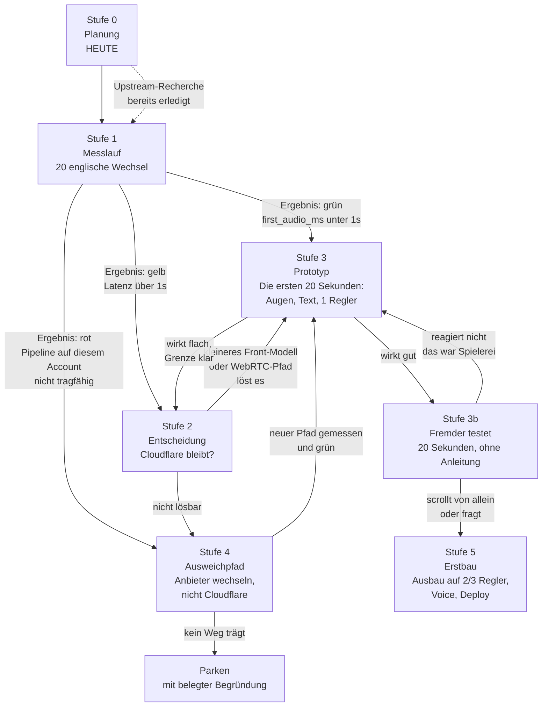

# Projektplan Agentfähig — Stufen 0–5 (Wenn-Dann-Planung)

Stand: 19.11.2026 · Verfasser: MiniMax M3 (OpenCode) · Vertrag: `03_HAI/docs/UPSTREAM_FIRST_GATE.md`

> **Nachtrag 19.11.2026, abends:** Stufe 1 misst **englisch**, nicht deutsch
> (Entscheidung: [`DESIGN-DECISIONS.md`](DESIGN-DECISIONS.md), Voice-Sprache).
> Laufversuch 1 ist gescheitert — nicht an der Latenz, sondern am Free-Account
> (Paid-Modell als Default). Beleg:
> [`tech/MESSPROTOKOLL-2026-11-19.md`](../tech/MESSPROTOKOLL-2026-11-19.md),
> Abschnitt „Laufversuch 1".

Dieses Dokument ist die **Reihenfolge- und Entscheidungsgrundlage** für den
Bau von Agentfähig. Es sagt nicht, *was* gebaut wird (das entscheidet Samuel),
sondern **was zuerst geprüft wird, wann ein Weg fällt und was dann passiert**.

Grundlage: [`docs/DESIGN-DECISIONS.md`](DESIGN-DECISIONS.md) (Entscheidungen vom
19.11.2026), [`tech/CLOUDFLARE-MACHBARKEIT-VORPRUEFUNG-2026-11-12.md`](../tech/CLOUDFLARE-MACHBARKEIT-VORPRUEFUNG-2026-11-12.md)
(Machbarkeit), [`UPSTREAM-SEARCH-vergleichbare-projekte.md`](../UPSTREAM-SEARCH-vergleichbare-projekte.md)
und [`tech/UPSTREAM-SEARCH-cloudflare.md`](../tech/UPSTREAM-SEARCH-cloudflare.md)
(die beiden Upstream-Suchen).

---

## Das große Bild

Die Pfeile sind **Gates**: Jeder Pfeil braucht eine Zahl oder ein Urteil, das
gemessen wurde. Kein Pfeil wird nach Gefühl übersprungen.

---

## Stufe 0 — Planung (dieses Dokument)

**Ziel:** Bevor irgendetwas gebaut wird, steht fest: in welcher Reihenfolge,
mit welchen Upstreams, an welchen Messwerten.

**Erledigt in dieser Stufe:**

- [x] Produkt- und Designentscheidungen vom 19.11.2026 gebündelt
      ([`DESIGN-DECISIONS.md`](DESIGN-DECISIONS.md))
- [x] Technische Fragen T1–T9 formuliert ([`tech/INTENT-TECHNIK.md`](../tech/INTENT-TECHNIK.md))
- [x] Machbarkeit je Baustein mit Urteil und Lücke
      ([`tech/CLOUDFLARE-MACHBARKEIT-VORPRUEFUNG-2026-11-12.md`](../tech/CLOUDFLARE-MACHBARKEIT-VORPRUEFUNG-2026-11-12.md))
- [x] Cloudflare-Upstreams gesucht (8 Kandidaten)
- [x] **Vergleichbare Projekte gesucht** (5 Produkt-Kandidaten, 5 Bausteine)
- [x] Unabhängiges Zweitgutachten: Argon (Gemini) und ich
      ([`GUTACHTEN-wow-oder-scheitern.md`](GUTACHTEN-wow-oder-scheitern.md))
- [x] ADRs für die fünf folgenkritischen Entscheidungen
      ([`docs/adr/`](adr/))
- [ ] **KI-Dialog 19.11. auswerten** — Platzhalter steht, Aufnahme ist
      aufgezeichnet, aber noch nicht ausgewertet
      ([`KI-DIALOG-2026-11-19.md`](KI-DIALOG-2026-11-19.md)). Liefert
      Erfahrungswerte zu denselben drei Fragen, an denen Stufe 1 und 3 hängen:
      Latenz/Abbruchschwelle im echten Betrieb, Bewertungsmethode für Avatare,
      Qualitätssicherung im geführten Dialog.

**Abgeschlossen, wenn:** Samuel die fünf ADRs bestätigt oder korrigiert **und**
der KI-Dialog eingespeist oder bewusst verworfen ist (die Befunde sind Belege,
keine Entscheidungen).

---

## Stufe 1 — Messlauf (der Punkt, an dem alles hängt)

**Ziel:** Eine Zahl statt einer Vermutung. Kein Anwendungscode.

**Was gemacht wird:** `examples/voice-agent` aus `cloudflare/agents` klonen,
lokal mit `wrangler dev` starten, ein Free-fähiges Modell eintragen
(`src/server.ts:139`), 20 **englische** Sprachwechsel aufnehmen und
`first_audio_ms` sowie die Stage-Timings auswerten. Deutsch ist an dieser Stelle
kein Messziel mehr, sondern geparktes Feature (siehe unten).

**Gemessene Fragen:**

| # | Frage | Messgröße | Grenze für „grün" |
|---|---|---|---|
| M0 | Latenz bis zum ersten Text | `llm_ms` (Text-Pfad, ohne STT/TTS) | Wert **tatsächlich gemessen**, kein Beispiel aus der Doku |
| M1 | T2: Latenz bis zum ersten Audio | `first_audio_ms` | < 1000 ms im Median |
| M2 | Englisches STT mit `flux` (Default des Beispiels) | Transkript der englischen Wechsel | Text korrekt, keine Fehlzeichen |
| M3 | Englisches TTS mit `aura-1` | erzeugtes Audio, Höreindruck | verständlich, kein Silly |
| M3c | Latenz des Voice-Pfads | `first_audio_ms` über den gewählten Weg | < 1000 ms — **Falle 4, siehe ADR-0001** |
| M4 | Stille-Erkennung | `eot_timeout_ms` / `eot_threshold` | kein Doppel-Sprechen, keine abgeschnittenen Sätze |
| M5 | Stage-Verteilung | `llm_ms`, `tts_ms` | wissen, wo die Zeit hingeht |
| — | *geparkt:* deutsches STT (`nova-3`, `language: "de"`) und deutsches TTS über externen `TTSProvider` | nicht Teil dieses Laufs | eigener Lauf bei Bedarf; Kosten in [`kosten-tts-voice.md`](../tech/research/kosten-tts-voice.md) |

**Wenn grün:** Weiter zu Stufe 3. Cloudflare steht, der Prototyp kann starten.

**Wenn gelb (Latenz über 1 s):** Weiter zu Stufe 2. Das
Problem ist dann messbar eingegrenzt — die Uhr sagt, welcher Posten zu groß ist.

**Wenn rot (Pipeline auf diesem Account nicht tragfähig):** Weiter zu Stufe 4.
Cloudflare trägt die Sprachanforderung dann nicht.

> **Warum das ein Gate bleibt, obwohl Deutsch geparkt ist.** Die Deutsch-Frage
> ist am 19.11.2026 beantwortet und damit kein Messziel mehr: Workers AI führt
> nur **drei** TTS-Modelle — `aura-1`, `aura-2-en`, `aura-2-es` —, `aura-1` hat
> nur englische Sprecher; der einzige mehrsprachige TTS, `@cf/myshell-ai/melotts`,
> ist zum 20.11.2026 zur Abschaltung vorgemerkt und nicht realtimefähig. Für
> **STT** trägt Workers AI Deutsch: `@cf/deepgram/nova-3` hat `language: "de"`
> und `detect_language` (gegen den SDK-Quellcode geprüft). Deutsch rein ginge
> also, deutsch raus braucht einen externen `TTSProvider` — ein eigener Lauf,
> kein Teil dieses. Quellen:
> [`CLOUDFLARE-MACHBARKEIT-AUDIT-2026-11-19.md`](CLOUDFLARE-MACHBARKEIT-AUDIT-2026-11-19.md),
> [`kosten-tts-voice.md`](../tech/research/kosten-tts-voice.md).
>
> **Was das Gate weiterhin begründet:** (1) das reale `first_audio_ms` ist
> nirgends gemessen — Cloudflares Budget 890 ms bleibt unaufgelöst;
> (2) Beta-Verhalten im Live-Betrieb; (3) Modell-Wahl unter den Deprecations
> vom 20.11.2026; (4) der LLM-Pfad auf einem **Free**-Account — genau das ist
> in Laufversuch 1 gescheitert, bevor eine einzige Latenzzahl entstand.

---

## Stufe 2 — Entscheidung Cloudflare ja/nein

**Ziel:** Wenn Stufe 1 gelb war: Ist Cloudflare die richtige Plattform — oder
nur die bequemste?

**Prüfpfad:**

1. **Kleineres Front-Modell.** Der große Posten im Budget ist das Modell
   (400–850 ms). Ein kleineres Modell am Edge, größeres hinten — genau die
   `fast / slow`-Architektur aus der Skizze. → neu messen.
2. **WebRTC statt WebSocket.** Cloudflare nennt WebRTC selbst als „the better
   choice" für Echtzeit-Gespräche. Cloudflare Realtime Agents ist offene Beta
   seit August 2025. → neu messen.
3. **Stille-Erkennung prüfen — aber nicht als Latenzposten.** Der Client-Wert
   `silenceDurationMs` (500 ms) stackt **nicht** auf die Server-Latenz: der
   Server ignoriert das Client-Event `end_of_speech`, das Turn-Ende bestimmt
   das STT-Modell (belegt: [`CLOUDFLARE-MACHBARKEIT-AUDIT-2026-11-19.md`](CLOUDFLARE-MACHBARKEIT-AUDIT-2026-11-19.md)
   §3.3, SDK-Quellcode `dist/voice/index.js:705-706`). Zu messen bleibt die
   Turn-Erkennung selbst (`eot_threshold`, `endpointingMs`). → neu messen.
4. **Text zuerst, Voice später.** Designentscheidung vom 19.11.2026: Text ist
   zuerst da. Der Textpfad hat kein STT und kein TTS und ist damit das
   Latenzrisiko nicht. → Prototyp ohne Voice starten, Voice nachziehen.

**Wenn einer davon die Latenz löst:** Zurück zu Stufe 3 (muss neu gemessen
werden — jede Änderung braucht einen neuen Messwert).

**Wenn keiner davon hilft:** Zu Stufe 4.

---

## Stufe 3 — Prototyp (Text zuerst)

**Ziel:** Der erste Besucherablauf steht. Nicht mehr.

**Umfang, exakt begrenzt — die ersten 20 Sekunden, nichts sonst:**

| Element | Umfang |
|---|---|
| Eingang | **Nur Text.** Mikrofon nur als Knopf vorhanden, noch ohne Funktion |
| Ablauf | Ankommen → Augen wachen nach ~5 s auf → eine Nachricht → Typewriter-Antwort im Fokus |
| Regler | **Genau einer.** Der Agent erfragt sein Aussehen. Der Regler verändert **Oberfläche *und* Antwort-Haltung** (siehe [ADR-0004](adr/ADR-0004-regler-veraendert-oberflaeche-und-haltung.md)) — reiner Farbwechsel wäre Dekoration, keine Anpassung |
| Agenten | Front-Agent **plus ein Sub-Agent**, der still ein Ergebnis nachreicht. Der Sub-Agent beweist die These „Ergebnisse kommen still an" — er gehört in den ersten Durchstich, nicht erst in Stufe 5 |
| Upstreams | `EyeFace.js` (MIT) aus OpenVoiceUI übernommen, nicht selbst gebaut |

**Offen in dieser Stufe:** Ob das Mikrofon schon sendet (Voice ist laut
[`DESIGN-DECISIONS.md`](DESIGN-DECISIONS.md) Teil des Erstbaus) oder erst in
Stufe 5 scharf wird, ist nicht entschieden. Diese Tabelle plant den
risikoärmsten Fall; die Abweichung ist bewusst sichtbar und keine stille
Entscheidung.

**Wenn es passt:** Weiter zu Stufe 3b — **ein Fremder testet.** Erst wenn der
Fremder von allein scrollt oder fragt, was passiert, geht es weiter. Sonst
zurück in Stufe 3.

**Wenn es nicht passt:** zurück zu Stufe 2 mit der Information, *was* nicht
passe (das ist die wertvollere Rückmeldung als ein allgemeines „geht nicht").

---

## Stufe 4 — Ausweichpfad (wenn Cloudflare nicht trägt)

**Ziel:** Nicht „Cloudflare aufgeben", sondern: **welche Anbieter-Kombination
trägt die Anforderung?** Der Upstream-Search zeigt, dass es sie gibt.

**Kandidaten und was sie jeweils mitbringen:**

| Kandidat | Bringt mit | Was es kostet |
|---|---|---|
| **A. Cloudflare + TTS-Adapter** | **Der billigste Ausweg.** Deutsche Ausgabe über einen `TTSProvider` (`@cloudflare/voice-elevenlabs`, `@cloudflare/voice-telnyx`) oder einen eigenen Adapter (≈15 Zeilen). STT bleibt auf Workers AI (`nova-3`, `language: "de"`). | Zwei Anbieter statt einem; Datenweg verlässt Cloudflare |
| **B. Cloudflare + Aura-2 direkt** | Aura-2 hat deutsche Stimmen (`aura-2-julius-de`) — aber nur über Deepgrams eigene API, nicht über Workers AI. | Anderer API-Weg neben Workers AI; Binding selbst gebaut |
| **C. LiveKit + Thesys** | Genau das Muster: Voice-Agent streamt UI-Komponenten. Next.js-Referenz. | Eigener Server; Lizenz der Vorlage ungeklärt |
| **D. LiveKit Agents (Python)** | Reife Agent-Framework, eigene Präsenzlogik | Python-Server statt Worker; Umstellung des Whole-Stacks |
| **E. OpenAI Realtime** | Das Muster hinter Pika `generative-ui` — Voice plus generative Oberfläche in einem Stack | OpenAI-Kosten; Anbieterbindung |
| **F. OpenVoiceUI** | Vollständige Voice-Shell mit Gesicht, Provider-Registry, Canvas-System | Flask/Python-Backend |

**Die Regel für Stufe 4:** Wechsel **nur** nach einem erneuten Messlauf auf dem
neuen Weg. Ein Plattformwechsel ohne Messung ist der Fehler, den der
Messlauf in Stufe 1 gerade verhindert.

---

## Stufe 5 — Erstbau und Ausbau

Erst wenn Stufe 3b bestanden ist, in dieser Reihenfolge:

1. **Voice** nachziehen — jetzt mit bekanntem Messwert aus Stufe 1.
2. **Zweiter und dritter Regler** (Ausbaupfad 1 → 2/3 → max 3).
3. **Mehr Sub-Agenten** — Looking-up neben Analysing. Aus
   `tech/CLOUDFLARE-MACHBARKEIT-VORPRUEFUNG-2026-11-12.md` ist der Mechanismus (`this.subAgent`)
   machbar; offen war nur, ob der Front-Agent **nachträglich weitersprechen**
   kann, wenn der langsame Pfad fertig ist. Das Konzept existiert (siehe
   [`UPSTREAM-SEARCH-vergleichbare-projekte.md`](../UPSTREAM-SEARCH-vergleichbare-projekte.md),
   `qwen-audio-agent`). → eigener ADR bei Stufe 5.
4. **Deploy** auf die echte Domain.

---

## Die fünf ADRs

| ADR | Thema | Kernaussage |
|---|---|---|
| [ADR-0001](adr/ADR-0001-messlauf-vor-bau.md) | Messlauf vor Bau | Kein Anwendungscode, bevor eine Zahl existiert |
| [ADR-0002](adr/ADR-0002-agent-als-interface.md) | Agent als Interface | Die Seite ist der Zustand des Agenten, nicht sein Inhalt |
| [ADR-0003](adr/ADR-0003-wiederverwendung-vor-eigenbau.md) | Wiederverwendung | Augen und Layout-Muster werden übernommen, nicht gebaut |
| [ADR-0004](adr/ADR-0004-regler-veraendert-oberflaeche-und-haltung.md) | Regler mit Haltung | Farbe allein ist Dekoration — der Regler verschiebt Oberfläche *und* Antwort-Verhalten |
| [ADR-0005](adr/ADR-0005-fremder-testet.md) | Fremder testet | Vor dem Ausbau: 20 Sekunden mit jemandem, der das Projekt nicht kennt |

Alle fünf stehen auf **„vorgeschlagen"**. Sie sind Vorschläge zur Freigabe durch
Samuel, keine getroffenen Entscheidungen.

ADR-0004 und ADR-0005 stammen aus dem unabhängigen Zweitgutachten
([`GUTACHTEN-wow-oder-scheitern.md`](GUTACHTEN-wow-oder-scheitern.md)).

---

## Was ein „Nein" in jeder Stufe auslöst

| Stufe | Nein bedeutet |
|---|---|
| 1 (Messlauf) | Nicht „Cloudflare ist schlecht", sondern: **die Latenzfrage ist technisch offen.** Weiter zu 2 oder 4. |
| 2 (Cloudflare-Entscheidung) | Der Plattformwechsel ist **kein Scheitern**, sondern eine begründete Entscheidung. Weiter zu 4. |
| 3 (Prototyp) | Der Ablauf ist noch nicht der richtige. Zurück zu 2 mit der Information, *was* nicht passte. |
| 3b (Fremder testet) | **Es funktioniert, aber es wirkt nicht.** Zurück zu 3 — nicht weiterbauen. Das ist die teuerste Erkenntnis des Projekts, weil sie erst am Ende auftaucht und trotzdem alles rückwärts kostet. |
| 4 (Ausweichpfad) | Wenn kein Kandidat trägt: **parken**, mit dokumentierter Begründung. Das ist ein gültiges Ergebnis des Projekts. |

---

## Was jetzt ansteht

**Genau ein nächster Schritt:** Laufversuch 2 — im Klon das Default-Modell
(`examples/voice-agent/src/server.ts:139`) auf ein Free-fähiges, nicht
abgekündigtes Modell stellen, dann 20 englische Wechsel messen und
[`tech/MESSPROTOKOLL-2026-11-19.md`](../tech/MESSPROTOKOLL-2026-11-19.md)
füllen.

**Blockiert davor, nicht durch Technik:** Die fünf ADRs sind weiter
„vorgeschlagen" und brauchen Samuels Bestätigung. Ohne aktive Lane und
Run-Contract hat der Lauf nach HAI-Vertrag keinen rechtmäßigen Ort — das ist
ein Prozessschritt, kein Messschritt.

**Wartet auf Material (kein Blocker für Stufe 1):** die Auswertung des
KI-Dialogs vom 19.11. ([`KI-DIALOG-2026-11-19.md`](KI-DIALOG-2026-11-19.md)).
Die Aufnahme liegt auf dem Plaud NotePin; sobald sie synchronisiert ist, werden
die drei Beiträge (Wohlmuth, Looma, Agent IVA) gegen die offenen Fragen aus
Stufe 1 und 3 gelegt.

**Nicht anstehen:**

- Kein Build ohne Stufe 1.
- Keine Entscheidung über Modell, Hosting oder Provider ohne Messwerte.
- Kein Ausbau der Reglerzahl vor Stufe 3b (Fremder testet).
- Kein Commit, Push oder Deploy ohne ausdrückliche Freigabe.
