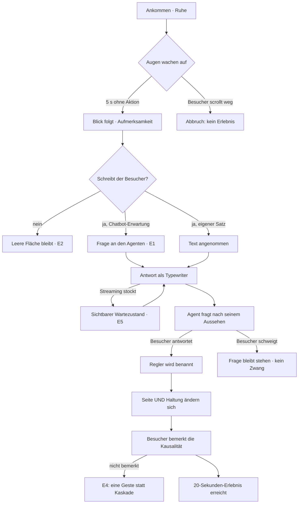
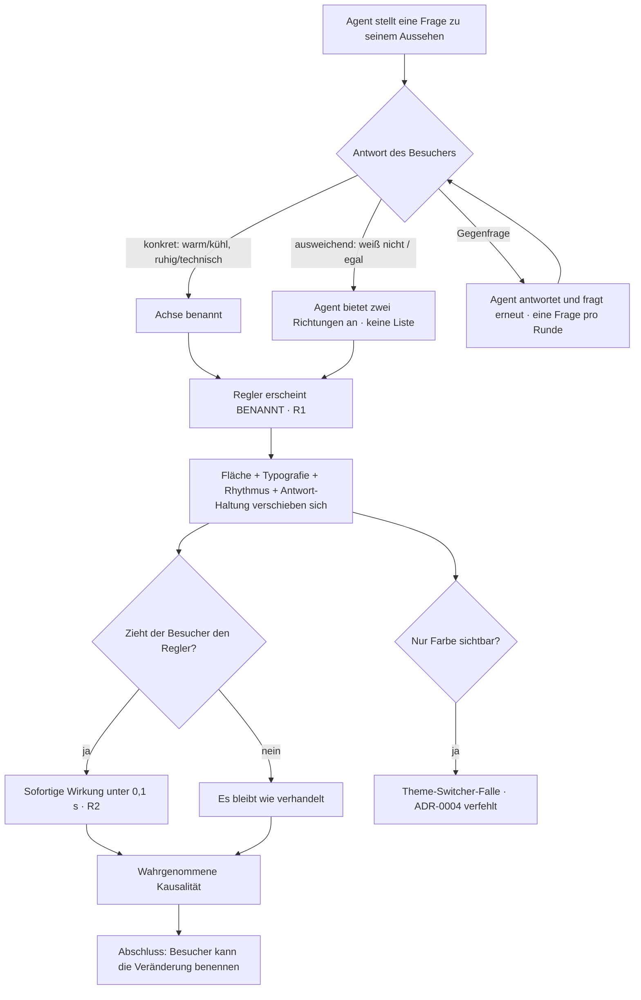
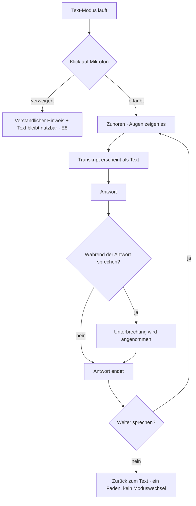
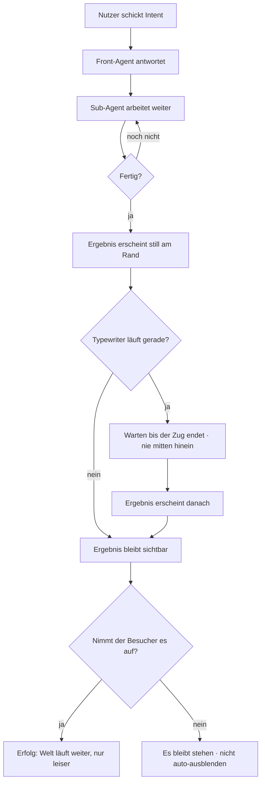
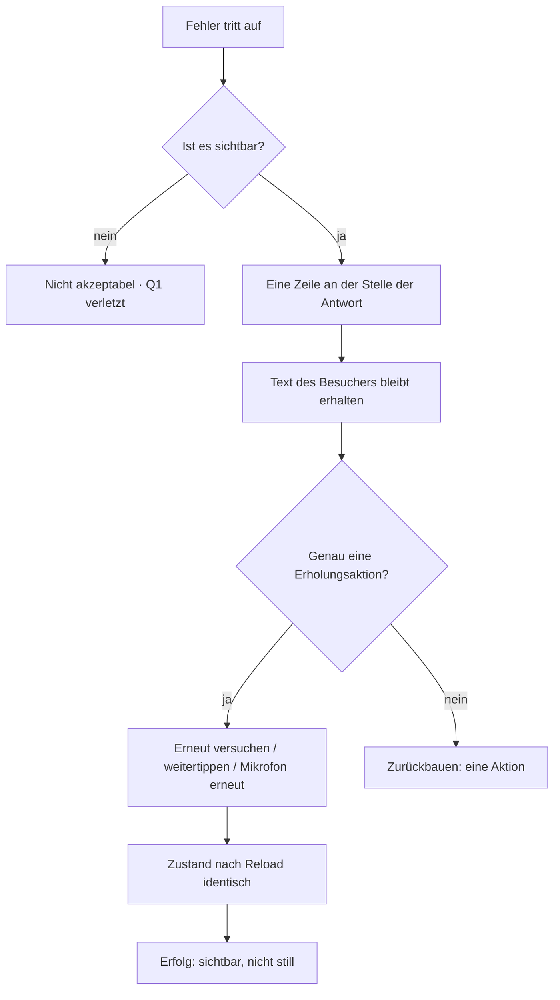
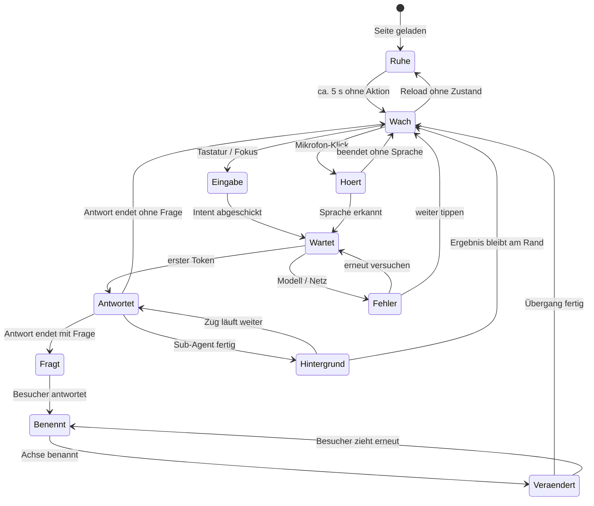

# UX & Informationsarchitektur — Agentfähig V1

Stand: 19.11.2026 · Rolle: Senior Product Designer & UX Research Engineer ·
Verfasser: OpenCode (DeepSeek V4.1 Flash), Planungsartefakt.

**Status: ENTWURF, keine Freigabe, kein autorisierter Lauf.**
Keine visuelle Gestaltung, keine Implementierung, kein Commit.

> **Control-Plane-Status: DEGRADED (sichtbar).** `hai_health` meldet `ok`, aber
> `mission_capacity.remaining_writer_capacity = 0` und
> `remaining_mission_capacity = 0`: die aktive Mission
> `M-20261119T194948-3db0ab44` (T1 Messlauf) gehört zu einer anderen Aufgabe.
> Diese Arbeit hat damit weder Mission noch Lease. Sie ist ein
> Planungsartefakt wie [`PROJECT_CONTRACT.md`](PROJECT_CONTRACT.md), kein
> autorisierter Lauf. **Backfill:** Mission für UX/IA öffnen oder diesen
> Slice nach Owner-Gate an die bestehende Mission anschließen; beide
> Dokumente als Evidenz nachtragen.
>
> **Und ein Satz, der vor allem anderen gilt:** Es gibt in diesem Repo **keine
> freigegebene Produktanforderung.** Der Contract steht auf „ENTWURF zur
> Owner-Abnahme" (`PROJECT_CONTRACT.md:3`), alle fünf ADRs stehen auf
> „vorgeschlagen" (`PLAN-STUFEN-0-5.md:247`). Wo unten „Pflicht" steht, heißt das
> **„vorgeschlagene Pflicht"**, nicht „beschlossen".

### Parallelarbeit in diesem Arbeitsbaum (Stand 19.11., 20:00)

Im selben Baum arbeiten weitere Sessions. Dieses Dokument **wiederholt deren
Belege nicht** und überschreibt keine ihrer Dateien:

| Datei | Was sie beantwortet | Verhältnis zu diesem Dokument |
|---|---|---|
| [`research/PRIOR_ART_REPORT.md`](../research/PRIOR_ART_REPORT.md) | Build/Buy/Adapt je Baustein, Lizenz, Reifegrad, Engineering-Lessons | **Quelle** für 2.5/2.6; korrigiert die Pika-Aussage der älteren Upstream-Suche |
| [`research/EMBODIMENT-RECHERCHE.md`](../research/EMBODIMENT-RECHERCHE.md) | Muster für Präsenz, Streaming-Typografie, adaptive Oberfläche, Ambient Agents | **Quelle** für 2.1/2.6; dort ausführlicher belegt |
| [`docs/wireframes/`](wireframes/00-flows-and-viewports.md) | Viewports, Größen, Tastatur-/Touch-Matrix, WF-01…WF-12 | **nachgelagert**: Gestaltung und Maße. Abgleich und vier Befunde in §4.8 |

Die Arbeitsteilung ist bewusst: **dieses Dokument entscheidet Nutzerführung,
Zustände und Scope — nicht Pixel.** Wo die Wireframe-Arbeit bereits etwas
festgelegt hat (z. B. „Enter sendet"), steht das hier als *gesetzter, aber
nicht freigegebener* Stand und nicht als offene Frage.

---

## 0 · Kurzfassung

1. **Es gibt keine Screens.** Es gibt **eine** Fläche und **elf Zustände**.
   Jede zusätzliche Seite wäre ein Bruch mit dem einzigen Produktkern
   („die Seite *ist* der Agent", `ADR-0002`).
2. **Die einzige Navigation ist die Frage des Agenten.** Ein Frage-Antwort-Zug
   pro Runde (`DESIGN-DECISIONS.md:19`) ersetzt Menüs, Tabs und Seiten.
3. **Das größte UX-Risiko ist nicht die Gestaltung, sondern die leere Fläche
   bei Sekunde 0.** Der 20-Sekunden-Test verlangt eine Eigenaktion, während
   die Vision „fast nichts" und „nicht bevormundend" verlangt. Dieser
   Widerspruch ist ungelöst und blockiert den ersten Durchstich.
4. **Der Regler ist eine Antwort, kein Werkzeug.** Er darf erst sichtbar
   werden, wenn das Gespräch ihm eine Bedeutung gegeben hat — sonst ist er
   der Theme-Switcher, vor dem `ADR-0004` warnt.
5. **Vorgeschlagene kleinste Oberfläche:** 1 Fläche, 3 nicht-navigierbare
   Schichten, 0 Menüs, 0 Pflichtklicks vor der ersten Eingabe.

---

## 1 · Nutzerverständnis

### 1.1 Primäre Nutzer

| ID | Nutzer | Situation | Was er wirklich will | Beleg |
|---|---|---|---|---|
| **U1** | **Der Fremde** (Primärnutzer) | Link aus Chat/Social, Desktop oder Handy, Ton meist aus, 20–60 s Aufmerksamkeit, kennt das Projekt nicht | „In wenigen Sekunden merken, dass hier etwas lebt, das auf *mich* reagiert" | `PROJECT_CONTRACT.md:63–66` (P1–P4), `ADR-0005:42–46` |
| **U2** | Wiederkehrender Besucher | Bookmark, Reload, kennt den Ablauf grob | „Ist es noch da — und anders als beim letzten Mal?" | T6 (`PROJECT_CONTRACT.md:80`), `DESIGN-DECISIONS.md:15–16` |
| **U3** | Samuel als Autor/Betreiber | Beim Bauen, Abnehmen, Erklären | „Kann ich es ohne Notizen erklären und selbst verändern?" | O1–O6 (`PROJECT_CONTRACT.md:112–119`) |
| **U4** | Fremdtester (ADR-0005) | Beobachtete 20 s, keine Anleitung | (kein Eigeninteresse — er ist Messinstrument, kein Nutzer) | `ADR-0005:40–55` |

**Rollen im Produkt: genau eine.** Keine Accounts, keine Rechte, keine
Moderations- oder Admin-Rolle. Das ist keine Auslassung, sondern Teil des
Scopes: „Accounts, Persistenz über Besucher hinweg" sind ausgeschlossen
(`PROJECT_CONTRACT.md:161`). Sobald eine zweite Rolle nötig würde, wäre das
ein Change Request, keine Designfrage.

**Wichtig für alle folgenden Abschnitte:** U3 ist **kein Nutzer der
Oberfläche**. Seine Bedürfnisse (Abnahme, Teach-Back, Messwerte lesen) dürfen
deshalb **nicht** als Bedienelemente in die Besucherfläche wandern. Genau hier
entstehen sonst Settings-Seiten, Debug-Panels und Statusanzeigen, die der
Fremde nie wollte.

### 1.2 Konkrete Nutzungssituationen

| ID | Situation | Randbedingung, die das Design bestimmt |
|---|---|---|
| **N1** | Klick auf einen geteilten Link, Desktop, **Ton aus** | Erste Wirkung muss ohne Audio funktionieren; Stimme ist Zugabe, nicht Eintritt |
| **N2** | Handy, eine Hand, unterwegs, lautlos | Eine Eingabezeile, kein Hover, keine Fläche, die auf Mausbewegung wartet |
| **N3** | Zurück am selben Gerät (Reload/Bookmark) | Zustand muss wieder da sein — sonst wirkt es wie ein Formular, das sich zurücksetzt |
| **N4** | Zweiter Tab, neugieriges Vergleichsschauen | Zwei Tabs müssen denselben Zustand zeigen (T6), sonst bricht die Illusion „ein Gegenüber" |
| **N5** | Samuel beim Bauen/Abnehmen | Braucht Messwerte — **nicht** in der Besucherfläche |
| **N6** | Fremdtest mit Beobachter | Es darf **nichts** erklärt werden; die Fläche muss ohne Worte tragen |

**Belegt:** N1/N2 sind aus dem Scope ableitbar (Voice „nach Klick",
`DESIGN-DECISIONS.md:21`; Text zuerst, `:20`). **Annahme:** dass die Mehrheit
mit Ton aus ankommt — dafür gibt es in diesem Repo **keine Messung** und
bewusst kein Analytics (`PROJECT_CONTRACT.md:161`).

### 1.3 Jobs-to-be-Done

Formuliert als Job, nicht als Feature. Die ersten drei sind der Produktkern;
die letzten drei sind Qualitätsjobs, ohne die die ersten drei kippen.

| ID | Job | Zugehöriges Kriterium |
|---|---|---|
| **J1** | „Wenn ich zum ersten Mal hier lande, will ich in Sekunden spüren, dass etwas auf mich reagiert, damit ich bleibe und es ausprobiere." | P1 |
| **J2** | „Wenn es mich etwas fragt, will ich antworten können, ohne die ‚richtige' Antwort zu kennen, damit ich mich nicht blamiere." | P2, P4 |
| **J3** | „Wenn ich etwas sage, will ich sofort sehen, dass es angekommen ist, damit ich nicht ins Leere rede." | P3, T1, T2 |
| **J4** | „Wenn im Hintergrund etwas passiert, will ich es beiläufig mitbekommen, ohne unterbrochen zu werden." | T4 |
| **J5** | „Wenn etwas nicht geht, will ich wissen, dass es nicht an mir liegt." | Q1 |
| **J6** | „Wenn ich zurückkomme, will ich dasselbe Gegenüber vorfinden, damit es kein Formular ist." | Q2, T6 |

### 1.4 Erwartete Ergebnisse (was nach 20 s im Kopf sein muss)

Drei Sätze, in dieser Reihenfolge — sie sind die eigentliche UX-Spezifikation:

1. **„Es hat mich angeschaut."** (Präsenz vor dem Intent, `DESIGN-DECISIONS.md:13`)
2. **„Es hat auf meinen Satz geantwortet — nicht wie ein Chatfenster."** (Typewriter im Fokus, `:17`)
3. **„Es hat mich nach sich selbst gefragt, und dann war es anders."** (`VISION-samuel.md:71–76`)

Wenn Satz 3 fehlt, ist P1 nicht erfüllt, egal wie gut 1 und 2 sind. Wenn
Satz 3 nur „Farbe wurde braun" ist, ist es die Theme-Switcher-Falle
(`ADR-0004:22–25`).

### 1.5 Fehlerquellen und Verständnisprobleme

Die wichtigste Tabelle dieses Dokuments. Jede Zeile ist entweder ein belegtes
Risiko oder eine benannte Annahme — nichts dazwischen.

| ID | Was schiefgeht | Warum (strukturell) | Strukturelle Gegenmaßnahme | Beleglage |
|---|---|---|---|---|
| **E1** | Der Besucher hält es für einen Chatbot und tippt „Was kannst du?" | Erwartungstransfer: 10 Jahre Chat-UI haben eine Eingabezeile geprägt | Die *erste Antwort* muss über den Agenten selbst sprechen, nicht über eine Aufgabe; der Agent fragt zuerst nach sich | Annahme; Kern von `ADR-0002:28–41` |
| **E2** | **Leere Fläche, keine Handlung, Abbruch** | P4 verbietet Aufforderungen, P1 verlangt Eigenaktion — der Widerspruch ist ungelöst | Eine Einladung, die keine Anweisung ist; im Fallback darf der Agent zuerst sprechen | **offen**, siehe A2 |
| **E3** | Regler wirkt als Theme-Switcher | Regler sichtbar, bevor er Bedeutung hat | Regler erscheint erst **benannt** (R0→R1), nie als leerer Kasten | `ADR-0004:22–25` |
| **E4** | Besucher merkt die Veränderung nicht (oder merkt nicht, *warum*) | Veränderung gleichzeitig zu breit (alles) oder zu fein (nur ein Farbton) | Eine Veränderung als **eine Geste**, plus eine spurbare Kette „mein Satz → seine Antwort → sein Aussehen" | Annahme; `ADR-0004:44` |
| **E5** | Typewriter stockt, Fläche wirkt kaputt | Streaming-Pausen, leerer Puffer | Regel für leeren Puffer (nie sichtbar leerlaufen) + sichtbarer Wartezustand ohne Floskel | T2 (`PROJECT_CONTRACT.md:76`), `DESIGN-DECISIONS.md:70` |
| **E6** | Stilles Ergebnis ist **zu leise** (unbemerkt) oder **zu laut** (Unterbrechung) | „Still" ist keine Skala — es fehlt eine Definition | „Still ≠ unsichtbar": eine nicht-modale Spur am Rand, persistent, ohne Fokuswechsel | T4; Widerspruch zu P1 auflösen (A7) |
| **E7** | Sprachbruch: Stimme englisch, Text deutsch | Offene Entscheidung D5 | Eine Sprache pro Kanal sichtbar machen, nicht mischen | `PROJECT_CONTRACT.md:202`, `DESIGN-DECISIONS.md:78–79` |
| **E8** | Mikrofon verweigert / Agent redet zu lang / kein Abbruch | Kein dokumentierter Abbruch- und Berechtigungsweg | Mikrofon-Klick öffnet den Berechtigungsweg **sichtbar**; Zuhören ist jederzeit beendbar | Q1, Q4; `DESIGN-DECISIONS.md:21` |
| **E9** | Nach Reload: Zustand da, Gespräch weg → „hat es mich vergessen?" | Zustand ist server-autoritativ, Verlauf ist es nicht automatisch | Entscheiden, was Reload überlebt (Zustand ja, Text nein?) und es **nicht** als Gedächtnis versprechen | Q2; offen (A3) |
| **E10** | Zwei Tabs widersprechen sich | Zwei Projektionen ohne gemeinsame Sequenz | Eine Zustandsquelle, eine Reihenfolge | T6 |
| **E11** | Nur die Augen tragen Präsenz → wer keine Bewegung sieht, erlebt nichts | Kanalmonokultur | Text trägt dieselbe Information; `prefers-reduced-motion` hat eine **gleichwertige** ruhige Fassung | WCAG 2.3.3 (siehe 2.6), `VISION-samuel.md:59–61` |
| **E12** | Fehler wird still verschluckt | Ist bereits passiert: Laufversuch 1 scheiterte für den Besucher unsichtbar | Jeder Fehlerzustand sichtbar, in der Fläche, wo die Antwort stünde | `MESSPROTOKOLL-2026-11-19.md:30–33`, Q1 |
| **E13** | **Kontingent erschöpft**: die Seite antwortet nicht mehr | Free-Kontingent trägt nach projektinterner Rechnung ca. 18 vollständige Voice-Wechsel pro Tag; das ist eine Demo, keine Startseite | Betriebsgrenze ist ein **gestalteter** Zustand, kein Ausnahmefall: sichtbar benennen, Textweg offen lassen | [`research/PRIOR_ART_REPORT.md`](../research/PRIOR_ART_REPORT.md), Kurzantwort 5 + E2 |
| **E14** | Besucher wartet, ohne dass sich etwas zeigt | „kein simuliertes Denken" wird fälschlich als „keine Rückmeldung" gelesen | Regel: **nie Stille ohne sichtbare Reaktion** — die Augen und die Textebene zeigen Arbeit, ohne Text zu erfinden | `VISION-samuel.md:107–109`; Regel aus PRIOR_ART_REPORT H2 |

### 1.6 Validierte Anforderungen vs. Annahmen

| Kategorie | Inhalt | Belastbarkeit |
|---|---|---|
| **Vom Owner bestätigt** | Text zuerst, Mikrofon nach Klick; Augen nach ~5 s; eine Frage pro Runde; genau ein Regler; Belegung entsteht im Gespräch; ältere Antworten treten zurück und sind beim Scrollen sichtbar; neue Antwort im Fokus; Front-Agent schnell, Sub-Agent still | `DESIGN-DECISIONS.md:8–25` — direkte Antworten Samuels |
| **Vorgeschlagen, nicht bestätigt** | F1–F7, P1–P4, Q1–Q7, ADR-0001…0005, alle Zielwerte V1–V6 | Contract-Status „ENTWURF", ADRs „vorgeschlagen" |
| **Annahme in diesem Dokument** | Nutzungssituationen N1/N2 als Mehrheit; E1 als häufigster Verstehensfehler; „eine Geste" als bessere Kausalität; „still" braucht eine sichtbare Spur; Regler erst nach Benennung ziehbar | als A1–A14 in §6 geführt und dort mit Test versehen |

---

## 2 · UX Prior Art

Fünf Produkte plus drei Prüfquellen. Für jedes: Problem,
Muster, was belegbar gut ist, was dokumentiert schwach ist, was wir übernehmen.
**Keiner der Kandidaten wurde ausgeführt** (gleiche Einschränkung wie
`UPSTREAM-SEARCH-vergleichbare-projekte.md:26–29`); Aussagen stammen aus
Dokumentation, README oder Fachpresse. Die Belegart steht in jeder Zeile.
Für Sesame, die Zeitgrenzen und die Streaming-Typografie liegen die
Primärbelege ausführlicher in
[`research/EMBODIMENT-RECHERCHE.md`](../research/EMBODIMENT-RECHERCHE.md); hier
steht nur, was die **Informationsarchitektur** daraus folgert.

### 2.1 Sesame (Voice-Presence-Demo → App)

| | |
|---|---|
| Problem | Gespräch als Schnittstelle, Präsenz **ohne** Chatverlauf |
| Muster | Ein Einstieg → Anruf; vier Charaktere; visuelle Zusätze (Suchkarten, Notizen, Textmodus) sind *Zugabe* zur Stimme; **mehrere Suchen laufen parallel, während gesprochen wird, und werden mitten im Satz eingewoben** |

- **Belegbar gut:** Präzises Ziel „voice presence" mit vier benannten
  Komponenten — emotionale Intelligenz, Gesprächsdynamik, Kontextbewusstsein,
  konsistente Persönlichkeit. Erste Wochen: >1 Mio. Menschen, >5 Mio. Minuten
  (Sequoia, Sekundärquelle). Ein unabhängiger Tester nennt es die beste
  getestete Voice-Erfahrung (PCWorld).
- **Dokumentiert schwach:** Das Unternehmen sagt selbst „We're not there yet".
  PCWorld: „the best I've tested. That's what worries me" — die Sorge ist
  Manipulation durch Natürlichkeit, nicht Funktionsmangel. Im getesteten
  App-Stand fehlten Wortprotokoll und Dateianhänge. Ein Charakter-Picker vor
  dem Gespräch ist ein Katalog — genau die Vorauswahl, die Agentfähig
  vermeiden will.
- **Übernehmen:** **Antworten, während der langsame Pfad noch läuft** —
  Hintergrund-Ergebnisse werden in den laufenden Zug gewoben statt als
  zweiter Kanal gemeldet. Das ist die stärkste externe Stütze für F4/T4 und
  beantwortet die offene Frage „unterbricht das?" mit: es muss nicht.
- **Nicht übernehmen:** Charakter-Auswahl, Anruf-Metapher, Memory-Versprechen.

### 2.2 ElevenLabs ElevenAgents Widget / Orb

| | |
|---|---|
| Problem | Einen Sprachagenten in wenigen Zeilen auf eine beliebige Seite bringen |
| Muster | Launcher unten rechts → Widget; Orb-Avatar; **explizite Agent-Zustände** `null / thinking / listening / talking`; Voice-only als Default, Voice+Text umschaltbar; Terms-Gate; Abschluss-Rating |

- **Belegbar gut:** Der Zustandsenum ist genau das minimale Zustandsmodell,
  das eine Präsenzfläche braucht („denkt / hört / spricht / nichts"). Modus
  (Stimme ↔ Text) ist ohne Verlust des Gesprächsfadens umschaltbar. Terms
  werden einmal akzeptiert und per lokalem Schlüssel nicht wiederholt.
- **Dokumentiert schwach:** Das Widget **ist** „eine Website mit einem
  Agenten" — der Launcher konkurriert mit dem Seiteninhalt um Aufmerksamkeit
  und sitzt in dessen Ecke. Der Orb ist markenunabhängig und dadurch
  austauschbar (dieselbe Form bei jedem Anbieter). Einbettung verlangt
  öffentliche, unauthentifizierte Agenten.
- **Übernehmen:** **Zustand ist ein UI-Primitiv**, nicht ein Textlabel. Vier
  Zustände reichen; mehr werden zu Statusanzeigen.
- **Nicht übernehmen:** Floating Launcher, Abschluss-Rating, Terms-Modal vor
  dem Erlebnis (das ist ein Pflichtklick vor dem Intent → P4-Verstoß).

### 2.3 ChatGPT Voice

| | |
|---|---|
| Problem | Gesprochenes Gespräch in einem Allzweck-Assistenten |
| Muster | Voice-Symbol in der Eingabezeile → Orb-Fläche; **Unterbrechen per Tippen**; **Transkript per Tippen auf den Orb**; zunehmend in den normalen Chat integriert statt als eigene Fläche; Mute/Ende als eigene Bedienelemente |

- **Belegbar gut:** Unterbrechung ist ein erstklassiges Bedienelement, nicht
  ein Sonderfall (OpenAI Help Center). „Orb antippen → Transkript" löst das
  Problem „wo sind die Worte hin?" mit **einer** Geste am Präsenzobjekt statt
  mit einer Navigation. Die Integration in denselben Faden erhält Kontext.
- **Dokumentiert schwach:** Rezensionen beschreiben die Antworten weiterhin
  als „vorgelesen", dozierend statt dialogisch; die visuelle Schicht trägt
  wenig. Einstellungen (Stimme, Denkstufe) liegen im Gespräch und verlangen
  vom Nutzer Modusverwaltung.
- **Übernehmen:** **Das Präsenzobjekt ist zugleich das Bedienelement für den
  wörtlichen Nachweis.** Bei Agentfähig: die Augen sind der Ort, an dem sich
  Zustand zeigt — nicht ein Panel daneben.
- **Nicht übernehmen:** Einstellungen im Gespräch; zweite Fläche für den
  Verlauf.

### 2.4 Pi (Inflection)

| | |
|---|---|
| Problem | Gespräch ohne Aufgabenrahmen; Wärme als Produkt |
| Muster | Eine Spalte, **keine Menüs, keine Modi**, ein Eingabefeld; Stimme; Login optional; das Gespräch ist die einzige Struktur |

- **Belegbar gut:** Hält eine menülose Einzelfläche über Jahre tragfähig; Ton
  und Geduld sind die eigentliche Leistung. Vor 2024 rund eine Million
  tägliche Nutzer (Reuters, Sekundärquelle).
- **Dokumentiert schwach:** 2024 stand das Produkt kurz vor der Abschaltung,
  bekam Nutzungsgrenzen, die Gründer gingen (TechCrunch/Axios). Der
  2026er-Neustart fügte Erinnerungen, To-do-Listen, Speicher hinzu — ein
  Zeichen, dass Gespräch allein nicht trägt. Nutzer berichten weiterhin von
  Vergessen.
- **Übernehmen:** **Eine Frage pro Runde, null Chrome.** Das ist die einzige
  Navigation, die dieses Produkt braucht.
- **Nicht übernehmen und daraus lernen:** Pi verspricht Gedächtnis und hält
  es unzuverlässig. Agentfähig darf **kein** Gedächtnis versprechen; was
  bleibt, ist der *sichtbare Zustand der Seite* — das ist ehrlicher und
  prüfbar (Q2).
- **Warnung für uns:** Wärme ohne etwas, das bleibt, ist nicht genug. Bei
  Agentfähig ist das Bleibende die veränderte Seite, nicht ein Verlauf.

### 2.5 Pika `generative-ui` (Apache-2.0) — als Muster, **nicht** als Code

| | |
|---|---|
| Problem | Der Agent schreibt keine Prosa, sondern komponiert die Oberfläche |
| Muster | Voice-Loop + generative Leinwand; Layouts wechseln pro Antwort und animieren zwischen Zuständen; **Layout-Historie ist navigierbar** |

- **Korrektur gegenüber der älteren Upstream-Suche:** Die Layout-Erzeugung
  liegt **nicht** im Repo, sondern im gehosteten **Pika MCP**; das Repo ist ein
  Canvas-Renderer plus OpenAI-Realtime-Client und verlangt ein Pika-Konto.
  7 Sterne, letzter Push 25.06.2026, README: „Local-only prototype". Die
  Aussage „die Vorlage existiert" ist damit **nur als Muster** haltbar
  ([`research/PRIOR_ART_REPORT.md`](../research/PRIOR_ART_REPORT.md), A6).
- **Belegbar gut:** Es zeigt, dass ein Agent die Fläche pro Zug neu komponieren
  kann, und macht mit der Layout-Historie die Entscheidungen nachschaubar.
- **Dokumentiert schwach:** Ein pro Antwort neu generiertes Layout hat **keine
  stabilen Bedienelemente** — der Nutzer muss nach jedem Zug neu finden, wo
  etwas ist. Die Historie ist Navigationslast, kein Erlebnis. Nicht ausgeführt,
  nur gelesen.
- **Übernehmen:** Die Grundannahme, dass die Fläche sich verändern **darf**.
- **Nicht übernehmen — die wichtigste Abgrenzung des Abschnitts:** Pika
  verändert **die Anordnung**; Agentfähig verändert **Aussehen und Haltung**
  und lässt die Bedienelemente an ihrem Platz. Der Unterschied ist nicht
  kosmetisch: genau dadurch bleibt der eine Regler wiederfindbar, und genau
  dadurch ist es kein Layout-Zufall, sondern eine Antwort.

### 2.6 `ui-morph` — der einzige echte PoC für „Modell verändert die Seite"

| | |
|---|---|
| Problem | Ein Modell soll eine **bestehende** Seite verändern, ohne sie zu zerstören |
| Muster | Fünf erlaubte Operationen, deklarierte Ziele über `data-morph` + Manifest, Anwendung nur an Seitengrenzen, Validierung gegen Schema, geschützte Zonen und Budget, Audit-Log, gecachte Kette |

- **Belegbar gut:** Der **geschlossene Wortschatz** hielt über alle Szenarien;
  die Dichte kam aus Manifesten, nie aus Motorleistung. Das ist die
  ingenieurmäßige Antwort auf „decoration, not adaptation" — nicht Farbe
  freischalten, sondern Werte aus einem kleinen Vokabular mit Grenze.
- **Dokumentiert schwach:** 0 Sterne, ausdrücklich „proof of concept", keine
  Nutzerstudie, p50 **5,5 s** pro Live-Austausch; vier von zwölf Defekten waren
  Grenz-/Teardown-Races, in Unit-Tests unsichtbar. Die Begründung
  „Layout-Churn zerstört räumliches Gedächtnis" stammt aus zitierter
  HCI-Literatur, nicht aus eigener Messung.
- **Übernehmen:** Für die IA heißt das konkret: die Fläche ändert **Aussehen
  und Haltung**, aber **nie die Position der Bedienelemente**, und die Änderung
  passiert **an Zug-Grenzen**, nicht mitten im Lesen.
- **Nicht übernehmen:** freies CSS/HTML aus dem Modell, Änderungs-Historie als
  eigene Ansicht, Live-Anwendung während eines laufenden Satzes.

### 2.7 Normative Pattern-Quellen (keine Produkte, aber prüfbar)

| Quelle | Inhalt | Konsequenz für Agentfähig |
|---|---|---|
| NN/g, „Response Times: The 3 Important Limits" | 0,1 s = direkte Manipulation; 1 s = Denkfluss hält; 10 s = Aufmerksamkeit reißt | **Der Regler** muss unter 0,1 s reagieren (direkte Manipulation). **Der Typewriter** darf bei 0,3–1 s starten, aber nie in einen sichtbar leeren Puffer laufen. **Der stille Pfad** darf >1 s brauchen, weil er nicht im Fokus steht — genau dafür ist er „still". |
| WCAG 2.2 SC 2.2.2 (Level A), Pause/Stop/Hide | Automatisch bewegte oder aktualisierte Inhalte über 5 s brauchen eine Pause-, Stop- oder Versteck-Möglichkeit | Die Augen blinzeln und bewegen sich **ohne** Interaktion — das ist 2.2.2, nicht 2.3.3. Ein `prefers-reduced-motion`-Pfad ist **kein Ersatz** dafür. |
| WCAG 2.2 SC 2.3.3 + Technik C39 | Bewegungsanimation **aus Interaktion** muss abschaltbar sein (`prefers-reduced-motion`) | Zusätzlich zu 2.2.2: die Augen reagieren auf Ereignisse (zuhören, antworten) — auch dieser Anteil braucht eine ruhige Fassung. |

### 2.8 Was wir übernehmen — und was ausdrücklich nicht

| Übernehmen | Von | Wofür |
|---|---|---|
| Antworten, während der langsame Pfad läuft | Sesame | F4/T4 ohne zweite Sprechspur |
| Zustand als UI-Primitiv (4 Zustände genügen) | ElevenLabs | Augen-Zustände statt Statusleiste |
| Präsenzobjekt = Bedienelement für den Nachweis | ChatGPT Voice | Zustand und „was war das?" an einem Ort |
| Eine Frage pro Runde, null Chrome | Pi | ersetzt Navigation vollständig |
| Fläche darf sich ändern, Bedienelemente bleiben | ui-morph (Grenze gezogen) | Regler bleibt auffindbar |
| 0,1/1/10 s als Prüflatten | NN/g | Timing-Gates, nicht Gefühl |
| Bewegung abschaltbar **und** pausebar, Bedeutung bleibt | WCAG 2.2.2 + 2.3.3 | Präsenz ohne Animation |

| **Nicht** übernehmen | Warum |
|---|---|
| Launcher/Widget in der Seitenecke | „Website mit Agent" — der Kern wird damit verfehlt |
| Charakter- oder Theme-Auswahl vorab | Pflichtklick vor dem Intent (P4) |
| Chatverlauf als Hauptansicht | `ADR-0002:35` |
| Pro-Zug generiertes Layout | keine stabilen Affordanzen |
| Abschluss-Rating, Onboarding-Tour, Settings | nicht im Scope, siehe §4.6 |
| Memory-Versprechen | unhaltbar, Q2 deckt nur Zustand |

---

## 3 · User Journeys

> **Vorbemerkung gegen die eigene Methode.** Die Designinspiration behauptet:
> „The linear 'User Journey Map' is dead. It assumes a predictable path."
> (`Agentfähig/GreateWriting.txt:292`). Der Einwand trifft lineare
> Marketing-Journeys. Deshalb sind die folgenden Maps **keine**
> Idealverläufe, sondern **Entscheidungsgraphen**: jeder Knoten, an dem der
> Besucher abbricht, zweifelt oder etwas anderes tut, ist eingezeichnet.
> Für dieses Produkt ist ohnehin weniger der Pfad als die **Choreografie über
> Zeit** das Designobjekt („Temporal Design", ebd.:289–290).

### J1 — Erstbesuch, die ersten 20 Sekunden (Kernfall)

| | |
|---|---|
| **Ausgangssituation** | U1 kommt über einen Link, kein Kontext, Ton aus, Bereitschaft ~20 s |
| **Einstiegspunkt** | Die Bühne, Zustand `Ruhe`. Kein Header, kein Menü, keine Erklärung |
| **Nutzeraktionen** | 1) schauen (0–5 s) · 2) Augen werden wach · 3) einen Satz tippen · 4) lesen · 5) auf die Frage antworten |
| **Systemreaktionen** | Augen öffnen sanft → Blick folgt · Eingabe nimmt Text an · Antwort als Typewriter im Fokus · Agent fragt nach seinem Aussehen · Seite **und** Haltung ändern sich |
| **Entscheidungspunkte** | D1 „Bleibe ich?" (nach dem Erwachen) · D2 „ Schreibe ich etwas?" (leere Fläche) · D3 „Antworte ich auf seine Frage?" |
| **Fehlerfälle** | E2 (nichts tun), E1 (Chatbot-Erwartung), E4 (Veränderung nicht bemerkt), E5 (Typewriter stockt), E12 (stiller Fehler) |
| **Erfolgreicher Abschluss** | Der Besucher hat **selbst** etwas ausgelöst und die Kausalität erlebt: mein Satz → seine Antwort → sein Aussehen. P1/P2/P3 |

### J2 — Aussehen verhandeln (der unterschiedende Moment)

| | |
|---|---|
| **Ausgangssituation** | Der erste Textzug ist gelaufen; der Agent hat noch keine Gestalt-Verhandlung geführt |
| **Einstiegspunkt** | Der Agent stellt **eine** Frage zu seinem Aussehen — nicht ein Dialog, nicht ein Panel |
| **Nutzeraktionen** | frei antworten („wärmer", „ruhiger", „weniger Technolook") · optional danach selbst ziehen |
| **Systemreaktionen** | Antwort wird zur **Benennung** der Achse → Regler erscheint benannt und zeigt die verstandene Richtung → Fläche, Typografie, Rhythmus **und** Antwort-Haltung verschieben sich |
| **Entscheidungspunkte** | D1 „Versteht er mich?" (Antwort-Haltung muss die Deutung spiegeln) · D2 „Ziehe ich selbst?" · D3 „War das nur Farbe?" |
| **Fehlerfälle** | E3 (Regler vor Bedeutung), E4 (Veränderung nicht zuordenbar), Fehldeutung (Regler zeigt etwas anderes als gemeint) |
| **Erfolgreicher Abschluss** | Besucher kann in eigenen Worten sagen, *was* sich geändert hat — ohne die Worte „Theme" oder „Dark Mode" (P2) |

### J3 — Stimme (freiwillig, nach Klick)

| | |
|---|---|
| **Ausgangssituation** | Text läuft. Der Besucher will sprechen oder hat es versehentlich angetippt |
| **Einstiegspunkt** | Mikrofon-Knopf, sichtbar, aber untätig bis zum Klick (`DESIGN-DECISIONS.md:21`) |
| **Nutzeraktionen** | klicken → Berechtigung erteilen/verweigern → sprechen → unterbrechen/beenden |
| **Systemreaktionen** | Berechtigungsweg sichtbar · Zuhören-Zustand an den Augen · Transkript erscheint als Text · Antwort (Text und/oder Stimme) · jederzeit beendbar |
| **Entscheidungspunkte** | D1 „Erlaube ich das Mikrofon?" · D2 „Rede ich weiter, während er antwortet?" · D3 „Beende ich?" |
| **Fehlerfälle** | E8 (verweigert, kein Ton, kein Abbruch), E7 (Sprachbruch), Stille-Erkennung schneidet ab |
| **Erfolgreicher Abschluss** | Ein gesprochener Zug endet mit verstandener Antwort — **ohne** dass die Textfläche dabei verschwindet |

### J4 — Stilles Hintergrund-Ergebnis

| | |
|---|---|
| **Ausgangssituation** | Der Front-Agent hat geantwortet; ein Sub-Agent arbeitet weiter |
| **Einstiegspunkt** | kein Einstieg — das Ergebnis erscheint von selbst |
| **Nutzeraktionen** | nichts tun · beiläufig hinsehen · später darauf eingehen |
| **Systemreaktionen** | eine nicht-modale Spur am Rand wird sichtbar und **bleibt** · kein Fokuswechsel · keine Sprechunterbrechung · beim nächsten Zug kann der Agent es aufgreifen |
| **Entscheidungspunkte** | D1 „Bemerke ich es?" · D2 „Stört es mich?" |
| **Fehlerfälle** | E6 (zu leise → T4 nicht belegt; zu laut → Unterbrechung), Ergebnis erscheint mitten im Typewriter |
| **Erfolgreicher Abschluss** | Der Besucher sagt später „da kam noch was" — ohne dass er es suchen musste |

### J5 — Fehler und Rückkehr

| | |
|---|---|
| **Ausgangssituation** | Modell nicht verfügbar, Mikrofon verweigert, Netz weg, oder Reload |
| **Einstiegspunkt** | irgendwo im Ablauf — Fehler haben keinen eigenen Ort |
| **Nutzeraktionen** | lesen, was los ist · erneut versuchen oder weiter tippen · neu laden |
| **Systemreaktionen** | eine Zeile **dort, wo die Antwort stünde** · eingegebener Text bleibt · genau eine Erholungsaktion · kein Schuldton · Zustand nach Reload wieder da |
| **Entscheidungspunkte** | D1 „Liegt es an mir?" · D2 „Versuche ich es nochmal?" · D3 „Ist mein Zustand weg?" |
| **Fehlerfälle** | E12 (still), E9 (Zustand da, Gespräch weg), doppelte Fehlermeldungen |
| **Erfolgreicher Abschluss** | Der Besucher weiß, dass es nicht an ihm lag, und kann weitermachen |

---

## 4 · Informationsarchitektur

### 4.1 These: eine Fläche, Zustände statt Seiten

`ADR-0002` sagt: „Die Seite ist sein Zustand, nicht sein Inhalt" (`:31`). Für
die IA heißt das nicht „weniger Screens", sondern **null
Navigationsebenen**. Es gibt keinen Ort, an den man gehen kann. Was sich
ändert, ist der Zustand derselben Fläche.

Daraus folgen drei Regeln, die jede spätere Gestaltung binden:

1. **Kein Element darf einen Ort versprechen.** Kein Menü, kein Tab, kein
   „Zurück", kein Breadcrumb.
2. **Die Zeit ist die einzige Achse.** Ältere Antworten treten zurück und
   werden beim Scrollen sichtbar (`DESIGN-DECISIONS.md:15`). Der Verlauf ist
   die Seite selbst, kein Panel.
3. **Die Frage des Agenten ist der einzige Übergang.** Wer eine neue Ansicht
   braucht, braucht eine neue Frage — nicht eine neue Seite.

**Die IA in einem Satz:** eine öffentliche Fläche, elf Zustände, drei
nicht-navigierbare Schichten, null Menüs.

### 4.2 Screen Inventory

„Screen" ist hier bewusst weit gefasst: **Fläche** (eigener Ort) vs.
**Schicht** (existiert nur über der Fläche, ohne Navigation).

| ID | Fläche / Schicht | Art | Zweck (ein Satz) | Pflichtbezug | Zustände |
|---|---|---|---|---|---|
| **S1** | **Die Bühne** | einzige öffentliche Fläche | Der Agent ist sichtbar da, nimmt Intent an und antwortet | F1, F2, F3, F4, F5 | `Ruhe · Wach · Eingabe · Wartet · Antwortet · Fragt · Benennt · Verändert · Hört · Fehler · Rückkehr` |
| **L1** | **Der stille Rand** | Region auf S1 | Ergebnis des Sub-Agenten, ohne Fokusklau | F4, T4 | `leer · neu · gelesen` |
| **L2** | **Die Unterbrechungszeile** | Zustand von S1 | Ein Fehler, sichtbar, mit genau einer Erholung | Q1 | `Modell · Mikrofon · Netz · Strom · Kontingent` |
| **L3** | **Die Einwilligungszeile** | Zustand von S1 | Vor der ersten Aufnahme sagen, was aufgenommen wird | Q4, D7 | `ungesehen · bestätigt` |

**Bewusst nicht als Fläche geführt:** der Regler (er ist ein Element von S1,
keine Ansicht), die Augen (Präsenzobjekt, kein Screen), das Mikrofon (Knopf).

### 4.3 Der Zustandsgraph (das Navigationsdiagramm)

Es gibt **keine** Hierarchie. Was folgt, ist der vollständige Übergangsgraph
der einen Fläche. Jeder Pfeil ist ein Ereignis, kein Klick auf ein Ziel.

**Lesart:** `Hintergrund` ist **kein** eigener Zustand der Fläche, sondern
eine Markierung. Sie darf während eines laufenden Zugs entstehen, wird aber
erst **an der Zug-Grenze** sichtbar (R-C, R-H) — deshalb führt sie nie mitten
in `Antwortet` zurück, sondern nur nach `Wach`.
`Kontingent erreicht` ist kein eigener Zustand, sondern eine Variante von
`Fehler`, bei der der Textweg offen bleibt (R-J, E13).

### 4.4 Beziehungen und Sichtbarkeitsregeln

| Regel | Inhalt | Quelle |
|---|---|---|
| **R-A** | Der Regler existiert in drei Stufen: `R0 unsichtbar` → `R1 benannt, passiv` → `R2 ziehbar`. R1 ist Pflicht, R2 ist Vorschlag | `ADR-0004:86–89` (offen), `DESIGN-DECISIONS.md:22` |
| **R-B** | Neue Antwort holt den Fokus zurück, auch wenn der Besucher im Verlauf liest | `DESIGN-DECISIONS.md:16` (bewusste Entscheidung, mit Kosten: Leseposition geht verloren) |
| **R-C** | Ergebnisse des langsamen Pfads erscheinen **nie** während eines laufenden Typewriters | J4, abgeleitet aus T4 + T2 |
| **R-D** | Fehler erscheinen an der Stelle, an der die Antwort stünde — nie als Modal, nie als Toast am Rand | Q1, E12 |
| **R-E** | Das Mikrofon ist sichtbar, aber bis zum Klick untätig; der Klick ist die Einwilligung | `DESIGN-DECISIONS.md:21` |
| **R-F** | Nach Reload ist der Zustand identisch; der Textverlauf ist es nur, wenn A3 das entscheidet | Q2, A3 |
| **R-G** | Es gibt keinen Zustand, der den Besucher zu einer Aktion zwingt | P4 |
| **R-H** | Aussehen und Haltung ändern sich nur **an Zug-Grenzen**, nie mitten im Lesen oder im laufenden Typewriter | `ui-morph`-Muster, PRIOR_ART_REPORT D4/D5 |
| **R-I** | Dauerbewegung (Augen) ist pausierbar; die ruhige Fassung trägt **dieselbe** Information | WCAG 2.2.2 (A) + 2.3.3 (AAA) |
| **R-J** | Ist das Kontingent erschöpft, bleibt die Fläche bedienbar: Grund sichtbar, Textweg offen, kein Dead End | E13 |

### 4.5 Gemeinsame UI-Komponenten

Sieben Komponenten tragen alles. Alles, was nicht hier steht, ist verdächtig.

| Komponente | Vorkommen | Aufgabe | Muss-Zustände | Darf nicht |
|---|---|---|---|---|
| **Augen** | immer | Präsenz und Zustand (wach, zuhörend, denkend, sprechend) | ruhig / wach / zuhörend / antwortend / ruhig-Fassung ohne Bewegung | Statusmeldungen tragen, die nur es gibt; dauerhaft bewegen ohne Pause/Stop; ungefragt auf „spricht" schalten, wenn ein Hintergrund-Ergebnis kommt |
| **Textebene** | immer | Antwort im Fokus, Typewriter, ältere Züge nach oben | leer / schreibt / fertig / wartet | scrollen erzwingen, Fließtextwand |
| **Eingabezeile** | immer | Intent annehmen, ohne Formularcharakter | leer / tippt / gesendet / gesperrt bei Fehler | Pflichtfeld, Label, Absende-Zwang ohne Rückmeldung |
| **Regler** | nur ab R1 | die verhandelte Achse zeigen und haltbar machen | unsichtbar / benannt-passiv / ziehbar | vor der Benennung erscheinen, als Liste von Themes |
| **Stiller Rand** | wenn Sub-Agent liefert | Ergebnis zeigen, ohne zu unterbrechen | leer / neu / gelesen | Modal, Ton, Auto-Ausblenden, Fokusklau |
| **Unterbrechungszeile** | nur im Fehler oder bei erschöpftem Kontingent | sagen, was los ist, und einen Weg zurück geben | je Fehlerart eine Formulierung | Schuld beim Besucher, mehrere Aktionen, Verschwinden von selbst |
| **Einwilligungszeile** | nur vor der ersten Aufnahme | in einem Satz sagen, was aufgenommen wird, und den Weg freigeben | ungesehen / bestätigt | Modal, Checkbox-Formular, zweiter Pflichtklick |

### 4.6 Unnötige oder redundante Flächen

Jede Zeile ist eine Fläche, die **jemand** bauen wollen wird. Die Begründung
ist der eigentliche Inhalt dieser Tabelle.

| Nicht bauen | Warum nicht | Was stattdessen |
|---|---|---|
| **Startseite / Landing** | Es gibt nichts zu erklären, was die Fläche nicht selbst zeigt; eine Landing-Page wäre „Website mit Agent" | S1 ist der Einstieg |
| **Chatverlauf-Ansicht** | `ADR-0002:35`; ein Verlauf macht die aktuelle Antwort zu einer von vielen | Zeitachse auf S1 |
| **Theme-Picker / Einstellungen** | Die Belegung entsteht im Gespräch; ein Picker macht daraus Dekoration | Regler ab R1 |
| **Onboarding-Tour / Tooltip-Serie** | Erklärt in Worten, was in 5 Sekunden gezeigt werden soll; kostet die 20 s | Die Augen und die erste Antwort |
| **About / Philosophie / Motto-Seite** | Nicht im Scope; „wir machen das!" ist ein Satz, keine Ansicht | späterer CR, falls je gebraucht |
| **Pathways-Auswahl** (`website · person · team · company`) | Ausdrücklich außerhalb V1 (`PROJECT_CONTRACT.md:159`) | — |
| **Konto / Login / Profil** | Accounts sind ausgeschlossen; eine zweite Identität würde den Zustand teilen | Zustand ohne Identität |
| **Sprach-Umschalter** | Sprache ist eine Entscheidung (D5), kein Bedienelement; ein Umschalter verrät, dass es zwei gibt | eine Sprache pro Kanal |
| **Status-/Debug-Panel** | U3-Bedürfnis (Messwerte), nicht U1 | Messung außerhalb der Besucherfläche |
| **Fehlerseite (404/500) als eigene Ansicht** | Ein Fehler ist ein Zustand, kein Ort | L2 |
| **Cookie-Banner / Analytics-Zustimmung** | Analytics ist ausgeschlossen; ein Banner wäre ein Pflichtklick vor dem Intent | — (Datenschutzfrage D7 bleibt) |

### 4.7 Die kleinste Oberfläche

Prüffrage: „Kann eine der fünf Komponenten entfallen, ohne dass ein
Pflichtkriterium fällt?"

| Entfällt … | … dann fällt | Also |
|---|---|---|
| Augen | F1 (Erwachen), Präsenz vor dem Intent | bleibt |
| Textebene | F2, P2, T2 | bleibt |
| Eingabezeile | F2, P4 („0 Klicks vor der ersten Texteingabe" setzt eine Texteingabe voraus) | bleibt |
| Regler | F3, ADR-0004, P3 | bleibt |
| Stiller Rand | F4, T4 | bleibt |
| Unterbrechungszeile | Q1 | bleibt |
| Einwilligungszeile (L3) | Q4/D7 — **rechtlich**, nicht produklich | bleibt, aber nur eine Zeile, kein Screen |

**Ergebnis: 7 Komponenten (eine davon nur bei Voice), 1 Fläche, 0 Navigation.**
Weniger ist nicht möglich, ohne ein vorgeschlagenes Pflichtkriterium zu
streichen — und Streichen ist Owner-Sache (`PROJECT_CONTRACT.md:181`).

### 4.8 Abgleich mit der parallelen Wireframe-Arbeit

[`docs/wireframes/00-flows-and-viewports.md`](wireframes/00-flows-and-viewports.md)
nennt zwölf „Screens" (WF-01…WF-12) und sagt selbst, dass es keine Routen gibt.
Das ist inhaltlich dasselbe Modell wie hier — aber die Zählung lädt dazu ein,
zwölf Bausteine zu bauen. Deshalb die Zuordnung:

| Wireframe | Dieses Dokument | Anmerkung |
|---|---|---|
| WF-01 Ankommen · WF-02 Bereit · WF-03 Schreiben | **S1** `Ruhe → Wach → Eingabe` | eine Fläche, drei Zustände |
| WF-04 Antwort · WF-12 Verlauf | **S1** `Wartet → Antwortet` + Zeitachse | Verlauf ist kein Screen, sondern die Scrollrichtung derselben Spalte |
| WF-05 Aussehen erfragt · WF-06 Regler · WF-07 verändert | **S1** `Fragt → Benennt → Verändert` | Regler ist Komponente, kein Zustand (R0/R1/R2) |
| WF-08 Hintergrund-Ergebnis | **L1** | Schicht, kein Screen |
| WF-09 Voice | **S1** `Hört` | Zustand derselben Fläche |
| WF-10 Fehler | **L2** | Schicht mit einer Erholungsaktion |
| WF-11 Wiederkehr | **S1** `Rückkehr` | derselbe Screen, anderer Eintritt |

**Vier Befunde, die dort noch fehlen** (kein Widerspruch, eine Ergänzung):

1. **Barrierefreiheit ist zu schwach abgesichert.** Dort steht
   `prefers-reduced-motion`; für automatisch blinkende Augen ist aber **WCAG
   2.2.2 (Level A)** einschlägig — Pause/Stop ist Pflicht, Reduced-Motion ist
   kein Ersatz. `EyeFace.js` bringt beides nicht mit
   ([`research/PRIOR_ART_REPORT.md`](../research/PRIOR_ART_REPORT.md), A5, E3).
2. **Das Kontingent fehlt als Zustand.** Bei ca. 18 Voice-Wechseln pro Tag auf
   dem Free-Kontingent ist „Grenze erreicht" ein **normaler** Betriebszustand,
   kein Fehlerfall am Rand (E13).
3. **Der Sende-Auslöser ist dort bereits gesetzt** („Enter sendet", eigener
   Senden-Knopf in der Tastatur-/Touch-Matrix), aber ohne Owner-Freigabe. Er
   ist damit **gesetzt und ungeprüft**, nicht offen — siehe A1.
4. **„Stille ohne sichtbare Reaktion" ist nicht als Regel formuliert.** Der
   Wartezustand ist dort korrekt beschrieben, aber ohne die Grenze, dass
   Arbeit sichtbar werden muss, **ohne** Text zu erfinden (E14).

**Was dort besser ist als hier:** die Tastatur-/Touch-Matrix, die
Viewport-Tabelle und der Satz „Hintergrund ist kein Präsenzzustand". Diese drei
gehören zur Gestaltung und bleiben dort.

---

## 5 · Scope-Prüfung: gehört jede Fläche zur Anforderung?

Der Auftrag verlangt die ausdrückliche Prüfung. Sie kann nur gegen die
**vorgeschlagenen** F1–F7 laufen, weil nichts freigegeben ist. Die Tabelle
trennt deshalb Bezug, Vertragsstatus und Urteil — eine Fläche, die nur
*mittelbar* aus einer Qualitätsanforderung folgt, steht nicht in derselben
Spalte wie eine, die eine Pflichtfunktion trägt.

| ID | Fläche | Bezug | Vertragsstatus | Gehört dazu? | Begründung |
|---|---|---|---|---|---|
| S1 | Bühne | F1, F2, F3, F4, F5 | vorgeschlagen | **Ja, vollständig** | Jede der fünf Pflichtfunktionen braucht sie |
| L1 | Stiller Rand | F4, T4 | vorgeschlagen | **Ja** | Ohne sichtbare Spur ist „still" nicht belegbar (E6) |
| L2 | Unterbrechungszeile | Q1 | vorgeschlagen | **Ja, mittelbar** | Q1 verlangt sichtbare Fehler; *eine* Zeile ist die kleinste Form |
| L3 | Einwilligungszeile | Q4, D7 | vorgeschlagen + gesperrt | **Ja, aber nicht aus F1–F7** | Rechtlich/Privacy, fällig vor M4-Deploy; kein Produktfeature |
| — | Alles aus §4.6 | — | teils ausgeschlossen | **Nein** | teils explizit außerhalb V1, teils Widerspruch zu ADR-0002 |

### 5.1 Was ich vorschlage, das **nicht** in F1–F7 steht

Transparenzregel: Diese fünf Dinge sind Auslegungen. Sie sind klein, aber sie
sind nicht „die Anforderung" — sie brauchen ein Ja, bevor sie gebaut werden.

| Vorschlag | Warum er trotzdem nötig ist | Risiko, wenn er fehlt | Gate |
|---|---|---|---|
| **Sichtbarer Sende-Auslöser** (erscheint mit dem ersten Zeichen) | F2 verlangt „kein Formular", nicht „kein Senden". Ohne Auslöser ist unklar, wann ein Satz abgeschickt wird | Unfreiwillige Sends oder gar keine | Owner (A1) |
| **Genau eine Erholungsaktion** je Fehler | Q1 verlangt Sichtbarkeit, nicht Handlung. Ohne Handlung ist der Fehler eine Sackgasse | Besucher muss neu laden | Owner (klein) |
| **Ruhige Fassung der Augen** (`prefers-reduced-motion`) | WCAG 2.3.3; F1 verlangt Erwachen, nicht Bewegung | Präsenz fehlt für einen Teil der Besucher | Owner (Barrierefreiheit) |
| **Pause/Stop für die Dauerbewegung** | WCAG 2.2.2 ist **Level A** und gilt für automatisch blinkende Inhalte; Reduced-Motion ersetzt es nicht | Rechtlich/ethisch nicht vertretbar; `EyeFace.js` bringt es nicht mit | Owner (Barrierefreiheit) |
| **Eine Zeile Datenschutz vor der ersten Aufnahme** | Q4/D7; nicht Teil der Produktliste | Rechtlich nicht deploybar | D7 (gesperrt) |

Alles Weitere, was hier nicht steht, ist **nicht** vorgeschlagen. Nach der
Change-Control-Regel des Contracts (`:214–231`) gilt: neue Idee → Frage C
(„was entfällt dafür?") beantworten, sonst nicht aufnehmen.

---

## 6 · Offene UX-Annahmen

Jede Annahme hat einen billigsten Test. Keine ist mit Analytics prüfbar
(ausgeschlossen). Vier Arten von Test kommen vor: Owner-Entscheidung
(A5, A6, A8), Beobachtung mit einer Person (A2, A7, A12–A14),
First-Click-/5-Sekunden-Test (A1, A16) und technische Probe
(A3, A9–A11, A15).

| ID | Annahme | Risiko, wenn falsch | Billigster Test | Blockiert |
|---|---|---|---|---|
| **A1** | Es braucht einen sichtbaren Sende-Auslöser | Kein Absenden oder versehentliche Sends | **in `docs/wireframes/` bereits gesetzt** (Enter + Knopf), aber ohne Owner-Freigabe: First-Click-Test mit 3 Personen | ersten Durchstich |
| **A2** | Der **Besucher** spricht zuerst (nicht der Agent) | Leere Fläche → niemand handelt → P1 fällt | Stufe 3b; bei Durchfall **zuerst** die Variante „Agent spricht nach dem Erwachen" testen | ersten Durchstich |
| **A3** | Reload stellt Zustand her, aber nicht zwingend den Text | „Hat es mich vergessen?" | Reload-Probe im eigenen Ablauf | Q2 |
| **A4** | „Kein Formular" heißt formularfrei, nicht interaktionsfrei | Überinterpretation führt zu unbedienbarer Fläche | Review gegen `DESIGN-DECISIONS.md:20` mit Samuel | Designfreigabe |
| **A5** | Erste Achse ist warm↔kühl | Falsche Achse macht ADR-0004 unprüfbar | Owner-Entscheidung D6 | Regler |
| **A6** | Der Regler ist nach der Benennung ziehbar (R2) | Ohne R2 ist es eine Ansage, kein Regler | Owner liest `ADR-0004:86–89` | Regler |
| **A7** | „Still" braucht eine sichtbare, persistente Spur | Zu leise → T4 nicht belegbar; zu laut → Unterbrechung | Zwei Varianten im Durchstich, eine Person | F4 |
| **A8** | Kanal-Sprache ist pro Kanal konsistent (Text D, Stimme EN) | Sprachbruch mitten im Erlebnis | Owner-Entscheidung D5 | Textinhalte |
| **A9** | Auf eine Antwort darf sofort die nächste Frage folgen | Warteschlange oder Verlust des Intents | Protokoll im Durchstich | F2 |
| **A10** | Lange Antworten dürfen scrollen, aber nicht als Wand enden | Typewriter wird zur Textwand, Fokus kippt | Eine lange Antwort bewusst provozieren | F2 |
| **A11** | Fehlertexte sprechen in derselben Haltung wie der Agent | Bruch: warmer Agent, kalte Systemsprache | Fehlerinjektion (Q1) | Q1 |
| **A12** | Die ruhige Fassung **plus Pause/Stop** trägt die Präsenz ohne Bewegung | Ohne Bewegung wirkt es tot → F1 verfehlt; ohne Pause/Stop ist es WCAG 2.2.2 (A) verletzt | Eine Person mit `reduce motion` **und** eine Review gegen 2.2.2 | F1 |
| **A13** | Elf Zustände sind unterscheidbar, ohne erklärt zu werden | Statusüberlast: Besucher deutet Zustände als Bedienung | Beobachtung im Stufe-3b-Test | S1 |
| **A14** | Der stille Rand hat auf dem Handy Platz, ohne den Fokus zu stehlen | Auf kleinen Flächen wird „still" zu „unsichtbar" | 2 Viewports, 1 Person | F4 |
| **A15** | Die Betriebsgrenze (Kontingent) ist ein gestalteter Zustand | Erschöpftes Kontingent sieht aus wie ein Defekt; der Textweg bleibt aber offen | Grenze künstlich setzen und die Fläche ansehen | öffentlicher Betrieb |
| **A16** | Die leere Fläche ist ohne Anleitung bedienbar | Ohne First-Click-Test wird „es wirkt schön" mit „es ist bedienbar" verwechselt | First-Click-Test (wo klickt/tippt die Person zuerst?) + 5-Sekunden-Test; eine Person ist ein Datenpunkt, ~5 zeigen ~85 % der Probleme | P1 |

**Der wichtigste Eintrag ist A2.** Er ist der einzige, der P1 und P4 direkt
gegeneinander stellt, und er lässt sich nicht am Schreibtisch entscheiden.
Bis er entschieden ist, ist jede Gestaltung der leeren Fläche geraten.

---

## 7 · Empfehlung: der minimale Nutzerfluss

### 7.1 Vorbemerkung zum Namen „M1"

Es gibt in diesem Repo **zwei** M1-Definitionen, und keine davon hat einen
Nutzerfluss:

| Quelle | M1 bedeutet | Konsequenz |
|---|---|---|
| `PROJECT_CONTRACT.md:86` + `tech/EXECUTION_PLAN-M1-MESSLAUF.md:65` | **D1 Messlauf** (20 Voice-Turns, Protokoll, Latenzkriterium) | M1 hat **keine Besucherfläche** — nur Messwerte |
| `docs/PLAN-STUFEN-0-5.md:170–183` | Stufe 3 Prototyp | das ist der erste sichtbare Fluss |

Ein „minimaler M1-Nutzerfluss" existiert also **unter der Contract-Nummerierung
nicht**. Ich empfehle, den hier beschriebenen Fluss als **„M-UI1"** zu führen
und die Nummerierung nicht stillschweigend zu überschreiben. Das ist eine
Namensfrage, keine Scope-Frage — aber eine, die später Evidenz verwechselbar
macht.

### 7.2 Der Fluss (ein Durchlauf, ~20 Sekunden)

| # | Schritt | Was der Besucher tut | Was die Fläche tut | Pflichtbezug |
|---|---|---|---|---|
| 1 | **Ankommen** | schauen | fast nichts; keine Erklärung, kein Menü | F1 |
| 2 | **Erwachen** | bemerkt Bewegung | Augen öffnen sanft nach ~5 s, Blick folgt | F1 |
| 3 | **Satz** | tippt einen Satz | nimmt an, ohne Formularcharakter | F2, P4 |
| 4 | **Antwort** | liest | Typewriter im Fokus, wortlängen-abhängig | F2, T2 |
| 5 | **Frage** | antwortet auf „wie soll ich aussehen?" | eine Frage, keine Liste | F3 |
| 6 | **Veränderung** | sieht zu | Regler wird benannt; Fläche **und** Haltung ändern sich | F3, ADR-0004, P3 |
| 7 | **Leise Zugabe** | bemerkt am Rand | Sub-Agent-Ergebnis erscheint still, bleibt stehen | F4, T4 |

### 7.3 Was in diesem Fluss ausdrücklich **nicht** vorkommt

Voice (F5 ist Pflicht, aber nicht im 20-Sekunden-Kern — der Klick-Pfad läuft
parallel), zweiter/dritter Regler, zweiter Sub-Agent, Bildinput, Pathways,
Verlaufspanel, jede Form von Einstellungen, jede Erklärung.

**Eine Ausnahme von „weglassen":** Die Fehlerzeile (L2) ist kein Ausbau,
sondern die Bedingung dafür, dass der Fluss überhaupt ehrlich ist. Ein
20-Sekunden-Erlebnis, das beim ersten Modellfehler schweigt, hat Q1 schon
verloren — das ist am 19.11. bereits passiert (`MESSPROTOKOLL:30–33`).

### 7.4 Woran der Fluss gemessen wird

Nicht an Gefallen, nicht an Verweildauer (Analytics ist ausgeschlossen),
sondern an vier Beobachtungen aus P1–P3:

1. Die Person handelt **ohne Anleitung** (scrollt, tippt, fragt).
2. Sie kann **in eigenen Worten** sagen, was die Seite gemacht hat — ohne
   „Theme" oder „Dark Mode".
3. Sie hat den Ablauf **selbst** ausgelöst, ohne Pflichtklick davor.
4. **First-Click-Test:** Ist ohne Erklärung erkennbar, wo man anfängt? Das ist
   die billigste Prüfung der leeren Fläche (A2, A16) und trennt Faszination
   von Verwirrung — der Unterschied, den „scrollt oder fragt" allein nicht
   misst ([`research/PRIOR_ART_REPORT.md`](../research/PRIOR_ART_REPORT.md), H).

**Ehrlichkeit zur Stichprobe:** eine Person ist ein Datenpunkt, keine Rate.
ADR-0005 setzt bewusst eine Person an, weil eine den Test überhaupt
durchführbar macht; ~5 Personen zeigen in der Literatur ~85 % der Probleme.
Das ist ein Grund, den Test nach M5 zu wiederholen, kein Grund, ihn
aufzublähen.

### 7.5 Reihenfolge der nächsten Arbeit (weiterhin ohne Screens)

1. **A2 entscheiden** (wer spricht zuerst). Ohne das ist die leere Fläche
   nicht gestaltbar.
2. **A1 freigeben oder ändern** (Sende-Auslöser) — der Wireframe-Stand setzt
   Enter plus Knopf; eine Zeile Code, aber sie blockiert Schritt 3.
3. **Zustandsmodell als Text** festhalten (die elf Zustände aus §4.3 mit
   Ein-/Austrittsbedingung) — das ist der Übergang von IA zu Technik, nicht
   zu Gestaltung.
4. Erst danach Gestaltung: Typografie, Farbe, Bewegung, Wortlaute.
5. Der Regler kommt **zuletzt** dorthin, weil seine Belegung (D6) noch offen
   ist.

---

## 8 · Was dieses Dokument nicht entscheidet

Keine Farben, keine Typografie, keine Animationskurven, keine Wortlaute,
keine Frameworks, kein Zustandsschema, keine Provider. Keine Änderung an
F1–F7, keine Statusänderung an einem ADR, keine Aussage darüber, ob das
Erlebnis „WOW" ist — das entscheidet der Fremdtest (`ADR-0005`), nicht dieses
Dokument.

---

## Quellen

**Projektintern (Pfad = Beleg):**

- [`docs/PROJECT_CONTRACT.md`](PROJECT_CONTRACT.md) — P1–P4, Q1–Q7, F1–F7,
  Ausschlüsse, D1–D9, Change Control
- [`docs/DESIGN-DECISIONS.md`](DESIGN-DECISIONS.md) — bestätigte
  Besucherabläufe, Slider, eine Frage pro Runde, Verlauf
- [`docs/VISION-samuel.md`](VISION-samuel.md) — 5 s, Typewriter, „nicht
  bevormundend", Mikrofon nach Klick, stilles Hintergrund-Ergebnis
- [`docs/adr/ADR-0002-agent-als-interface.md`](adr/ADR-0002-agent-als-interface.md),
  [`ADR-0004`](adr/ADR-0004-regler-veraendert-oberflaeche-und-haltung.md),
  [`ADR-0005`](adr/ADR-0005-fremder-testet.md)
- [`docs/GUTACHTEN-wow-oder-scheitern.md`](GUTACHTEN-wow-oder-scheitern.md) —
  Theme-Switcher-Falle
- [`tech/EXECUTION_PLAN-M1-MESSLAUF.md`](../tech/EXECUTION_PLAN-M1-MESSLAUF.md) — M1 = D1
- [`tech/MESSPROTOKOLL-2026-11-19.md`](../tech/MESSPROTOKOLL-2026-11-19.md) —
  unsichtbarer Fehlschlag
- [`UPSTREAM-SEARCH-vergleichbare-projekte.md`](../UPSTREAM-SEARCH-vergleichbare-projekte.md)
  — Pika, OpenVoiceUI, Lizenzlage
- [`research/PRIOR_ART_REPORT.md`](../research/PRIOR_ART_REPORT.md) —
  Build/Buy/Adapt, Pika-Korrektur (A6), `ui-morph` (A4), WCAG 2.2.2 (E3),
  5-Sekunden-/First-Click-Test (H)
- [`research/EMBODIMENT-RECHERCHE.md`](../research/EMBODIMENT-RECHERCHE.md) —
  Präsenz-, Typografie- und Ambient-Patterns
- [`docs/wireframes/00-flows-and-viewports.md`](wireframes/00-flows-and-viewports.md)
  — WF-01…WF-12, Viewports, Tastatur-/Touch-Matrix
- [`Agentfähig/GreateWriting.txt`](../Agentfähig/GreateWriting.txt) — „User
  Journey Map is dead", „decoration, not adaptation"

**Extern (geprüft 19.11.2026):**

| Quelle | URL | Verwendung |
|---|---|---|
| Sesame, „Crossing the uncanny valley of conversational voice" (27.02.2025) | https://www.sesame.com/blog/crossing-the-uncanny-valley-of-voice | „voice presence", „We're not there yet" |
| Sesame, „Voice your curiosity" (27.05.2026) | https://www.sesame.com/blog/voice-your-curiosity | parallele Suchen während des Sprechens, Textmodus |
| Sequoia, „Partnering with Sesame" (21.10.2025) | https://www.sequoiacap.com/article/partnering-with-sesame-a-new-era-for-voice | >1 Mio. Nutzer / >5 Mio. Minuten (Sekundärquelle) |
| PCWorld, „Sesame's AI voice app is the best I've tested. That's what worries me." (03.06.2026) | https://www.pcworld.com/article/3151873/ | dokumentierte Schwäche: Manipulationsnähe, fehlendes Wortprotokoll |
| ElevenLabs, Widget customization | https://elevenlabs.io/docs/eleven-agents/customization/widget | Modus-Konfiguration, Terms, Attribute |
| ElevenLabs UI, Orb | https://ui.elevenlabs.io/docs/components/orb | Zustände `thinking / listening / talking` |
| OpenAI Help Center, „How can I interrupt a voice conversation?" | https://help.openai.com/en/articles/8983398 | Unterbrechung als Bedienelement |
| ChatGPT Voice Feature-Seite | https://chatgpt.com/features/voice/ | „Transkript durch Tippen auf den Orb" |
| TechCrunch, Pi-Nutzungsgrenzen (26.08.2024) | https://techcrunch.com/2024/08/26/five-months-after-microsoft-hired-its-founders-inflection-adds-usage-caps-to-pi | Pi-Schwäche: fast eingestellt, Caps |
| Axios, Inflection/Pi Enterprise-Pivot (26.08.2024) | https://www.axios.com/2024/08/26/inflection-pi-ai-chatbot-enterprise | Kontext zur Pi-Konsolidierung |
| NN/g, „Response Times: The 3 Important Limits" | https://www.nngroup.com/articles/response-times-3-important-limits | 0,1 / 1 / 10 s |
| W3C WAI, SC 2.3.3 + Technik C39 | https://www.w3.org/WAI/WCAG22/Understanding/animation-from-interactions | Bewegung abschaltbar |
| W3C WAI, SC 2.2.2 Pause, Stop, Hide | https://www.w3.org/WAI/WCAG22/Understanding/pause-stop-hide.html | automatische Bewegung über 5 s braucht Pause/Stop (Level A) |
| `type0labs-dev/ui-morph` + Post-Mortem | https://github.com/type0labs-dev/ui-morph | geschlossener Wortschatz, Turn-Grenzen, Audit (PoC) |

**Nicht ausgeführt, nur gelesen:** Sesame, ElevenLabs, ChatGPT Voice, Pi,
Pika, `ui-morph`. Aussagen über Verhalten dieser Produkte sind Dokumentations-
und Presseaussagen, keine eigenen Messungen. Die Pika-Aussagen stammen aus
`README.md`/Quellverzeichnis, wie in
`UPSTREAM-SEARCH-vergleichbare-projekte.md:26–29` festgehalten, und sind durch
[`research/PRIOR_ART_REPORT.md`](../research/PRIOR_ART_REPORT.md) korrigiert.
Wo dieses Dokument und `research/EMBODIMENT-RECHERCHE.md` dasselbe Produkt
nennen, gilt für Belege jenes Dokument (dort am Primärartefakt geprüft).
