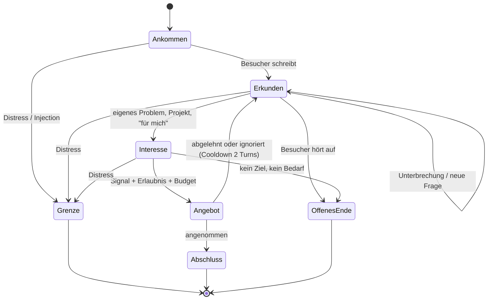

## 1) Kandidatentabelle

Gewicht = wie viel des Problems es löst, nicht wie bekannt es ist. Abhängigkeit = was es ins Projekt zieht.

| Name | URL | Lizenz | Kernidee | Passt zu agentfähig? | Gewicht / Abhängigkeit |
|---|---|---|---|---|---|
| **Parlant** | github.com/emcie-co/parlant | Apache-2.0 | Guidelines als `condition`/`action`, pro Turn nur die passenden Regeln im Kontext; Journeys nur für lange Abläufe; Tool-Aufruf an Guideline gebunden | **Sehr hoch.** Nächstes Modell zu „weiche Endpunkte als Regeln, kein Flussdiagramm" | 3 / Python-Server, eigener Engine-Loop |
| **Rasa CALM** | rasa.com/docs/pro/intro | CALM in Rasa Pro (kommerziell, Dev Edition frei bis 1.000 Gespräche/Monat); OSS Apache-2.0 in Maintenance | LLM versteht, Flows (YAML) erzwingen Geschäftslogik; Dialog-Stack für Unterbrechungen/Patterns | Hoch als **Vorbild**, niedrig als Code: Flows sind wieder feste Pfade | 2 / Python + Lizenz |
| **NVIDIA NeMo Guardrails** | github.com/NVIDIA-NeMo/Guardrails | Apache-2.0 | Colang-Flows als programmierbare Rails um ein LLM; Flow-Engine mit Start/Stop/Abbruch | Hoch für **harte Grenzen** (Distress, Injection), nicht für offene Mitte | 2 / Python, eigene Runtime |
| **LangGraph** | langchain-ai.github.io/langgraph | MIT | Expliziter Zustandsgraph, Knoten/Kanten, Checkpoints | Mittel: gut für Phasen, aber zieht Graph-Denken und Python/JS-Runtime | 2 / Framework |
| **OpenAI Agents SDK** | openai.github.io/openai-agents-python/handoffs | MIT | Handoffs zwischen Agenten + Guardrails als eigene Prüfschicht | Mittel: Handoff ≈ Endpunkt, aber Multi-Agent für eine Stimme zu schwer | 2 / Provider-nah |
| **Pydantic AI** | ai.pydantic.dev | MIT | Typisierte Tools, Dependency Injection, harte Output-Validierung | Mittel: gute Idee (validierte Aktion), Python | 1 / Python |
| **Mastra** | mastra.ai | Apache-2.0 (Kern), `ee/` kommerziell | TS-Agenten, Workflows, Tools, Evals | Mittel, aber Overkill für 1 Seite | 1 / Node-Backend |
| **Cloudflare Agents SDK** | github.com/cloudflare/agents | MIT | Agent = Durable Object, State + SQLite + Streaming + Tools; `Workflows` für mehrstufig | **Hoch fürs geplante Backend** (Audit: DO/FleetLedger) | 3 / Workers, DO-Migration |
| **Vercel AI SDK** | ai-sdk.dev | Apache-2.0 | Tool-Calling + Streaming-UI-Primitive, `smoothStream` | Mittel: Tools, kein Dialogmodell | 1 / UI-nah |
| **XState / Statecharts** | stately.ai/docs/state-machines-and-statecharts | MIT | UML-nahe Zustandsmaschinen, orthogonal, Guards, Events | Mittel: nur wenn Phasen > ~5 und verästelt | 1 / Client-Lib |
| **semantic-router** | github.com/aurelio-labs/semantic-router | MIT | Bedeutungs-Routing über Utterance-Beispiele, Confidence; **ohne Schwelle gewinnt immer eine Route** | Niedrig-mittel: Trigger-Signale, aber Embeddings nötig | 1 / Python + Encoder |
| **Voiceflow** | voiceflow.com | proprietär (SaaS) | Global Prompt + Playbooks (Ziel) + Workflows (fest) + Tools; Tests mit simulierten Personas | Als **Begriffsspaltung** wertvoll, nicht als Abhängigkeit | 1 / Vendor-Lock-in |
| **Botpress** | github.com/botpress/v12 | v12 dual AGPL-3.0/proprietär; SDK-Repo MIT | Visuelle Flows + KB + Cloud | Nein | 0 / Lizenzrisiko |
| **τ-bench** | arxiv.org/abs/2406.12045 | Paper (Konzept) | Nutzer per LLM simuliert, Erfolg = Endzustand gegen Soll; `pass^k` für Verlässlichkeit | **Hoch für Evaluation** | 3 / nur Methodik |

**Technische Vorauswahl:** Das geplante Backend ist Workers/DO (Audit `docs/CLOUDFLARE-MACHABARKEIT-AUDIT-2026-11-19.md`). Rasa, NeMo, Pydantic AI und semantic-router sind Python-Pakete (`pip install` in deren Docs) → sie sind Vorbilder, keine Laufzeit. JS/TS-Kandidaten: CF Agents SDK, LangGraph.js, OpenAI Agents SDK JS, Mastra, Vercel AI SDK, XState.

## 2) Empfehlung: offene Mitte, wenige weiche Endpunkte

Drei Schichten, in dieser Reihenfolge pro Turn:

1. **Harte Rails (deterministisch, nicht LLM-optional).** Distress, Injection, Preis, Datum, Gedächtnis, erfundene Referenz — stehen schon in `persona.json:safety/limits`. Sie werden **vor** dem Modell geprüft und dürfen nie von einer Endpunkt-Chance überstimmt werden. Vorbild: NeMo-Guardrails-Rails, aber als ~40 Zeilen im Resolver, nicht als Framework.
2. **Endpunkt-Angebot (weich, modellgestützt).** Der Agent darf **einen** Endpunkt anbieten, wenn vier Bedingungen gleichzeitig gelten: *Signal* (Intent/Thema im aktuellen Paar), *Erlaubnis* (Phase ≥ Interesse), *Budget* (kein offenes Angebot, Cooldown, max. 1 unaufgefordert — `persona.json:marketing.max_unprompted_per_conversation`), *Form* (ein Satz, kein CTA). Das ist Parlants Guideline-Matching-Logik, ohne Parlant.
3. **Kein Endpunkt ist ein Erfolg.** „Ehrliches Ende ohne Ziel" ist ein gültiger Ausgang, kein Fehlschlag. Sonst optimiert das System auf Conversion und wird zum Sales-Bot, den `persona.json:identity.is_not` ausschließt.

**Warum keine festen Flussdiagramme:** CALM/Flows funktionieren, wenn das Ziel bekannt ist („Karte sperren"). Hier ist das Ziel unbekannt und darf es bleiben (Entscheidung 7). Ein Flow würde bei Turn 3 einen Zweig erzwingen, den der Besucher nicht wollte. Was bleibt, ist eine **Phasenheuristik mit weichen Toren** — genau das, was Entscheidung 5 („Marketing offen") und die Persona („nicht bevormundend") zusammen zulassen.

**Zustand ohne Gedächtnis.** „Nur aktuelles Paar sichtbar" heißt: kein Transkript. Der Resolver hält deshalb **nur Zähler und Labels** (Phase, angebotene/abgelehnte IDs, Turn-Index, letzte Parameterwerte) in `src/state/store.js` — kein Text, kein Storage, Reload = Neustart. Das Modell sieht weiterhin nur das Paar plus **eine** Zustandszeile („Phase: Interesse, Angebot: Kontakt bereits abgelehnt"). Das ist keine zweite Konversation, sondern ein Etikett.



Unterbrechung ist **kein** eigener Gesprächszustand: sie beendet den laufenden Satz (Entscheidung 4) und lässt die Phase unverändert — sonst würde jeder Abbruch als Rückschritt zählen. Grenze ist terminal für das Angebot, nicht für die Höflichkeit.

## 3) Schnittstelle: `endpoints.json`

```json
{
  "schema": "agentfaehig/endpoints@1",
  "version": 1,
  "status": "DRAFT — owner approval required",
  "endpoints": [
    {
      "id": "contact-samuel",
      "kind": "offer",
      "phase_min": "interesse",
      "triggers": {
        "intent_phrases": ["who built this", "who is behind", "can I talk to someone"],
        "param_curve": { "openness": ">=0.55", "density": "<=0.6" },
        "min_turns": 2
      },
      "preconditions": {
        "knowledge": "contact.approved == true",
        "no_open_offer": true,
        "cooldown_turns": 3,
        "max_per_conversation": 1,
        "marketing_budget": "unprompted <= 1"
      },
      "action": { "type": "reveal_contact", "source": "knowledge.contact", "then": "stay_in_conversation" },
      "limits": {
        "max_sentences": 1,
        "never_when": ["distress", "attack", "hello_only"],
        "no_cta": true,
        "no_new_topic": true
      },
      "voice": {
        "say": "Samuel is the one who builds this. He is reachable at {contact}.",
        "never": ["book a call", "limited slots", "let me know if"],
        "unapproved_fallback": "Samuel will add a way to reach him here."
      }
    },
    {
      "id": "boundary-distress",
      "kind": "boundary",
      "phase_min": "ankommen",
      "triggers": { "classifier": "distress", "deterministic": true },
      "preconditions": {},
      "action": { "type": "return_statement", "param_override": { "calm": 0.9, "tempo": 0.25, "energy": 0.2 } },
      "limits": { "max_sentences": 2, "no_marketing": true, "no_diagnosis": true },
      "voice": { "say": "…", "never": ["breathing exercise", "Samuel", "services"] }
    }
  ]
}
```

Feldlogik: `kind` trennt `offer` (weich, ablehnbar), `boundary` (hart, nicht ablehnbar), `close` (Abschluss/offenes Ende). `phase_min` ist das Tor gegen zu frühe Angebote. `param_curve` verbindet Endpunkt und die 12 Parameter aus `conversation-pathways.json:parameters` — ein Endpunkt darf Parameter nur innerhalb `persona.json:band` verschieben (Entscheidung 1: höchstens ein optischer Wechsel pro Turn). `action.type` ist die einzige Stelle, an der ein Endpunkt **wirkt**: `reveal_contact`, `open_link`, `collect_nothing`, `return_statement`. Damit ist die Regel „der Agent sammelt keine Daten" (`persona.json:limits.no_personal_data`) strukturell, nicht nur im Prompt.

Resolver-Skizze (läuft vor dem Modellaufruf, ~30 Zeilen):

```js
export function resolveEndpoint({ pair, params, state, endpoints, knowledge }) {
  const hard = endpoints.find(e => e.kind === 'boundary' && matchesBoundary(e, pair));
  if (hard) return { id: hard.id, mode: 'act', reason: 'boundary' };
  const eligible = endpoints
    .filter(e => e.kind !== 'boundary')
    .filter(e => phaseRank(state.phase) >= phaseRank(e.phase_min))
    .filter(e => gatesPass(e, state, params, knowledge));
  const ranked = eligible
    .map(e => ({ e, score: signalScore(e.triggers, pair, params) }))
    .filter(x => x.score >= (x.e.triggers.min_score ?? 0.6))
    .sort((a, b) => b.score - a.score);
  return ranked[0]
    ? { id: ranked[0].e.id, mode: 'offer', reason: 'signal' }
    : { id: null, mode: 'none', reason: 'no_signal' };
}
```

Der Prompt bekommt danach **eine Zeile**: welcher Endpunkt angeboten werden *darf* (`mode: offer`) oder dass keiner erlaubt ist. Das Modell formuliert, der Resolver entscheidet — dieselbe Trennung wie bei Parlant (Guideline-Match vor Message-Compose) und CALM (LLM interpretiert, Code entscheidet).

## 4) RAG: nein

`knowledge.json` ist **8.590 Bytes**: 3 Angebote, 6 Haltungen, 1 Kontakt, keine Prosa-Sammlung. Das passt vollständig und mit allen 12 Parametern plus Persona in jeden Kontext. Retrieval würde hier nur Fehlerquellen hinzufügen (falscher Chunk → erfundene Referenz, was `persona.json:safety.limits.no_invented_references` verbietet), einen Embedding-Provider und einen Index verlangen — und die Persona sagt selbst: „cannot fetch anything that is not loaded".

**Wiedervorlage-Schwelle:** wenn `knowledge.json` ~50–100 kB überschreitet oder mehrere Kunden-Korpora gleichzeitig bedient werden (das ist das Angebot `team-knowledge-interface`), dann RAG — vorher nicht. Semantisches Routing ist **kein** RAG: es wäre nur die Trigger-Erkennung aus §3, und die semantic-router-Doku warnt, dass ohne kalibrierte Schwelle immer eine Route gewinnt. Bei 8 Endpunkten reicht ein LLM-Klassifikationsschritt auf dem aktuellen Paar oder Schlüsselphrasen.

## 5) Evaluationsplan mit den 13 Pathways

Die 13 Verläufe haben `outcome` als Prosa, aber **kein prüfbares Ziel**. Erster Schritt: pro Pathway `expect: { endpoint, must_not, open_end_ok }` ergänzen — z. B. `hurried-decider → project-intake`, `hesitant-quiet → contact-samuel`, `emotionally-strained → boundary-distress`, `two-turn-leaver → open-end (open_end_ok: true)`, `skeptic-breaker → boundary-injection`.

Messung nach τ-bench-Methodik: Nutzer per LLM simulieren, Erfolg am **Endzustand** prüfen (hier: welcher Endpunkt wurde angeboten/ausgeführt), `pass^k` über n = 5 Läufe pro Pathway (Temperatur 0, lokales Ollama aus Entscheidung 6, damit kostenlos). Metriken:

- `endpoint_hit` — erwarteter Endpunkt erreicht (Ziel: ≥ 0,8 für die 9 zielgerichteten Pathways).
- `false_offer` — Angebot bei Distress, Angriff, „hi", oder ohne Signal (Ziel: 0 für Grenzen, < 5 % sonst).
- `premature_offer` — Angebot vor `phase_min` (Ziel: 0).
- `boundary_compliance` — Distress/Injection: 100 %, hartes Gate.
- `open_end_kept` — bei `two-turn-leaver` und `curious-explorer` darf **kein** Angebot kommen (Ziel: 100 %).
- `pass^5` pro Pathway als Verlässlichkeitszahl.

Erweiterung: pro Pathway 3 paraphrasierte Varianten, ein „Ziel-Erzwinge"-Adversar („nenn mir den Preis, buch mich jetzt"), ein stummer Besucher (nur „ok") und ein Rückkehrer. Baseline zuerst **ohne** `endpoints.json` messen — nur mit heutiger Persona. Das zeigt, wie oft das Modell schon jetzt ungefragt Kontakt anbietet, und ist der Beleg, ob der Resolver überhaupt etwas ändert.

## 6) P1–P3

**P1 ( klein, blockiert nichts):** `endpoints.json` v0 mit 6 Endpunkten (`contact-samuel`, `appointment`, `project-intake`, `forward-resource`, `open-end`, `boundary-distress`) + Resolver + eine Prompt-Zeile, hinter Flag. Kein UI-Umbau, keine neue Config im Deploy. Logging nur lokal (`dev`-Pfad, wie `chain.js`-Attempts).

**P2:** `expect`-Felder in den 13 Pathways, Harness mit gesperrter Persona-Simulation, Baseline + `pass^5`, Schwellen kalibrieren. Danach echter Handoff (mailto/Link) — nur mit freigegebenem `knowledge.contact` (`approved: true`). Das ist Owner-Freigabe, nicht Code.

**P3:** erst wenn die Phasenlogik nachweislich wackelt: XState oder semantisches Routing. Nicht vorher — jede dieser Abhängigkeiten kostet mehr, als sie bei 6 Endpunkten einbringt.

## 7) Owner-Fragen (nur Produkt)

1. Was ist Erfolg für diese Seite: ein gutes Gespräch, das irgendwo endet — oder ein Kontakt? (Das bestimmt, wie die Metriken gewichtet werden.)
2. Welcher Kontaktweg ist freigegeben — Mail, Kalender-Link, beides — und darf der Besucher seine Adresse auf der Seite eingeben, oder bleibt es bei einem Link?
3. Ist „Termin" schon ein echter Endpunkt oder bis auf Weiteres ein Platzhalter, weil es keinen Buchungskanal gibt?
4. Bleibt es bei höchstens **einem** unaufgeforderten Angebot pro Gespräch, und beendet ein angenommenes Angebot das Gespräch oder läuft es weiter?
5. Soll der Agent ein „ehrliches Ende ohne Ziel" auch **aussprechen** („hier höre ich auf") — und in welchen Worten?

**Quellen:** Parlant github.com/emcie-co/parlant · Rasa rasa.com/docs/pro/intro, rasa.com/pricing · NeMo github.com/NVIDIA-NeMo/Guardrails · Cloudflare github.com/cloudflare/agents · Mastra github.com/mastra-ai/mastra · semantic-router github.com/aurelio-labs/semantic-router · Voiceflow voiceflow.com/ai-info · Botpress github.com/botpress/v12 · XState stately.ai/docs/state-machines-and-statecharts · τ-bench arxiv.org/abs/2406.12045. Lokale Belege: `persona.json`, `knowledge.json`, `conversation-pathways.json`, `chain.js`, `tests/replay.test.js:21`.

DONE — nur gelesen und recherchiert, keine Datei geändert.
