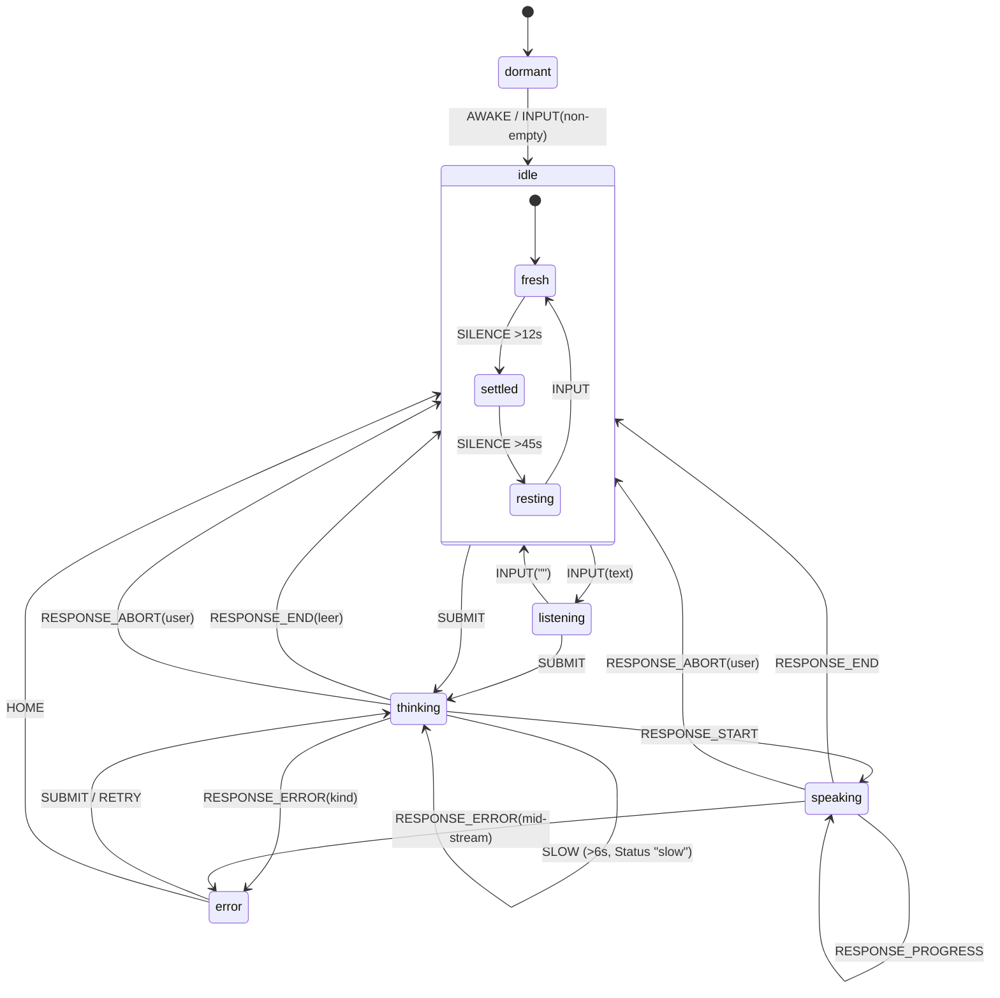

I'll start by reading the required documents and the existing state/conversation code.
## 1) Befunde

**B1 — Automat kennt nur fünf Phasen.** `PHASES = dormant|idle|listening|thinking|speaking` (`src/state/store.js:5`), Zustand nur `{phase,prompt,answer,turn,dev}` (`store.js:7-13`). Es gibt kein Feld für Verbindung, Fehler, Teilstrom, Sichtbarkeit. `tests/store.test.js:13` friert genau diese Liste ein.

**B2 — „verbindet“ existiert nicht.** `SUBMIT` springt direkt auf `thinking` (`store.js:31-36`). Die Augen behaupten Denken, bevor überhaupt eine Anfrage läuft; die reale Wartezeit bis zum ersten Byte ist unsichtbar.

**B3 — Stiller Ereignisverlust (latente Race).** `RESPONSE_START` verlangt `phase==='thinking'` (`store.js:39`), `PROGRESS`/`END` verlangen `'speaking'` (`:43,:47`); abgelehnte Events ändern nichts (`store.js:66`). `conversation.js:125` schreibt den Text aber unabhängig davon ins DOM und dispatcht erst danach (`:131`). Sobald ein künftiges Event (offline, visibility, timeout) die Phase während eines offenen Turns verschiebt, tippt die Oberfläche weiter, während der Store `answer=''` behält. Heute schützt nur `turn`.

**B4 — Fehler ist ein einziger Satz.** `RESPONSE_ERROR` hat keine Art, keinen Phasen-Guard und landet immer in `idle` (`store.js:50-52`); die Meldung ist hartkodiert (`conversation.js:147`), `store.answer` bleibt `''`, und `#live` wird nur bei Erfolg geschrieben (`conversation.js:136`) — ein Screenreader hört den Fehler nie. Status-/Fehlerzeile wurde in M1 bewusst ausgelassen (`docs/missions/…-M1-BERICHT.md:40,49`), `living-surface.html:44-68` hat kein solches Element.

**B5 — Unterbrechung ohne Spur.** `stopTurn()` bricht Abort + Typewriter ab (`conversation.js:77-86`), aber es gibt kein `RESPONSE_ABORT`; `SUBMIT` erzeugt sofort `turn+1` (`store.js:35`). Der abgebrochene Turn ist nirgends vermerkt; die Augen springen ohne jede Bestätigung in `thinking`.

**B6 — Nicht-leere Eingabe bei `idle`.** `INPUT` wird während `thinking/speaking` ignoriert (`store.js:26`), `RESPONSE_END` setzt `idle` (`:48`), das Feld behält aber den Tipptext (`conversation.js:153-155`). Ergebnis: Phase `idle`, Feld voll — bis zum nächsten Tastendruck.

**B7 — Fokusverlust/Tab-Wechsel unbehandelt.** Kein `visibilitychange`, kein `online/offline` irgendwo in `src/` (Grep leer). Typewriter timert weiter (`typewriter.js:206`), im Hintergrund drosseln Browser Timer → eine Antwort „hängt“ und läuft bei Rückkehr schubweise nach. EyeFace blinkt und blickt weiter (`EyeFace.js:176-198`).

**B8 — Stille hat keinen Verlauf.** `idle` hat genau eine visuelle Regel (Atmen, `presence.css:62-65`) plus Vendor-Zufall (Blinzeln 2–6 s, Umsehen 1,5–4 s, `EyeFace.js:179-196`). „Gerade geantwortet“ und „zehn Minuten still“ sind ununterscheidbar.

**B9 — Race beim Wegräumen des Paares.** Ein einziger `leaveTimer` (`conversation.js:18,74`), `animationend` ohne `animationName`-Prüfung (`:73`), und alle scheidenden Einträge sind `position:absolute; top:0` (`conversation.css:20-27`). Zwei schnelle Sends → zwei überlappende Scheide-Einträge, verwaiste Fallback-Timer überleben `destroy()`.

**B10 — `pause()` ist Nutzerabsicht.** `pause()` schreibt `aria-pressed`/Label (`presence.js:72-76,95-101`) und darf für „Tab verborgen“ nicht wiederverwendet werden, sonst kippt der sichtbare Schalter.

**B11 — Kein Kontingent-/Netzfall.** 402/429/offline werden zu „Something went wrong“ (`conversation.js:147`); der Dev-Badge ist immer sichtbar (`main.js:19`).

**B12 — Kein Tab-/Session-Bezug.** `AGENTS.md:25-29` warnt: zwei Tabs teilen eine Durable-Object-Konversation; der Zustand kennt keine Identität.

**B13 — Reload ist ehrlich flüchtig**, aber `AWAKE_AFTER_MS=5000` läuft bei jedem Laden neu (`main.js:7,26`), und es gibt keinen Pfad, der eine serverseitige Konversation zurücksetzt.

*Geprüft und unauffällig:* ein veralteter `aborter` kann den neuen nicht löschen (`conversation.js:149`), `turn`-Guards greifen (`:114,144`), `typewriter.stop()` räumt den Timer (`typewriter.js:222-228`).

## 2) Erweiterter Automat



Orthogonal, nicht als Phase: `connection: online|reconnecting|offline`, `visible: true|false`. Grund: offline darf jede Phase überlagern, ohne die Augenlogik zu verdoppeln.

## 3) Schnittstellen

```js
// store.js — additiv, PHASES + 'error'
state = { phase, prompt, answer, turn, dev,
          connection: 'online', error: null,      // {kind, retryable}
          streaming: false, interrupted: false,
          visible: true, since: 0 }

// Events (bestehende unverändert)
CONNECTION {status}
RESPONSE_ABORT {turn, by:'user'|'timeout'}
RESPONSE_ERROR {turn, kind:'network'|'quota'|'server'|'timeout'|'empty', retryable}
SLOW {turn}            // phase bleibt thinking, state.slow=true
SILENCE {ms}           // nur idle, treibt fresh|settled|resting
VISIBILITY {hidden}
RETRY {turn}           // nur error+retryable → thinking
```

```js
// main.js — einzige Spiegelstelle (heute main.js:14-16)
stage.dataset.phase      // unverändert
stage.dataset.connection // online|reconnecting|offline
stage.dataset.idle       // fresh|settled|resting
stage.dataset.slow       // "true"
stage.dataset.error      // kind oder ""
stage.dataset.visible    // true|false

// conversation.js
export function mountConversation({ root, store, agent, reducedMotion = false,
  slowAfterMs = 6000, clock = { setTimeout, clearTimeout } })
  → { destroy(), suspendTyping(), resumeTyping() }

// agent-Vertrag, rückwärtskompatibel (devAgent.respond heute devAgent.js:28)
respond(prompt, { signal, onToken }) → Promise<{text, dev}>
// onToken(textSoFar) → conversation dispatcht START lazy + PROGRESS

// typewriter.js — additiv
createTypewriter({...}) → { start, stop, pause, resume, append(chunk), end() }

// presence.js
mountPresence({...}) → { pause, resume,             // Nutzerabsicht (Toggle)
                         suspend, wake,            // visibility, ohne aria-pressed
                         acknowledgeInterrupt,     // ein kurzer Blink
                         destroy }
```

CSS (neuer Namensraum, **nicht** `--p-*`, da `applySurface` laut `…-PARAMETER-OBERFLAECHE.md:211` alle `--p-<id>` überschreibt):

```css
:root { --s-ink; --s-line; --s-dim; --stall-pulse-ms;
        --rest-lid-ratio; --error-opacity; --rest-breathe-ms }
[data-connection="offline"] .presence { --s-dim: .8 }
[data-phase="error"] .presence .eyes-container { opacity: .75 }
[data-phase="thinking"][data-slow="true"] .thinking-dots { animation-duration: 2.4s }
[data-idle="resting"] .presence .eyes-container { animation: none }
```

## 4) Visuelle Reaktion je Zustand

| Zustand | Augen | Fläche | Typewriter |
|---|---|---|---|
| dormant | Lider zu, 55 % (`presence.css:29-39`) | nichts | — |
| idle/fresh | neutral, Atmen | ruhig | — |
| idle/settled | Sakkade auf einen fernen Punkt, dann halten | ruhig | — |
| idle/resting | Atmen aus, halbe Lider, seltener Blink | ruhig, leicht gedimmt | — |
| listening | `listening`-Puls (`eyes.css:124`) | Fokuslinie | — |
| thinking/verbindet | `thinking`, Punkte **statisch** | Punkte | — |
| thinking/slow | Blick zurück zum Besucher, 1 Blink | Punkte halb so schnell | — |
| speaking | `happy` | Caret (`typewriter.css:29-37`) | Zeichen, Pausen |
| interrupted | 1 kurzer Blink, dann `thinking` | alter Eintrag löst sich auf | stop ohne Rest |
| error | `sad` (`eyes.css:107`), Lider 30 % | Statuszeile, Teiltext 60 % | stop, Caret weg |
| offline | halbe Lider, Blick zum Composer | Statuszeile | — |
| hidden | Timer aus | eingefroren | pausiert |
| reload | dormant, 5 s | leer | — |

## 5) Was die bestehende UI braucht

1. `living-surface.html`: eine Statuszeile (`#status`, `role="status"`, englisch) für Fehler/offline — fehlt heute vollständig (`:44-68`).
2. `store.js`: `PHASES` um `error`, neue Felder/Events; `tests/store.test.js:13` und die Fehlertests (`:115-125`) müssen mit.
3. `main.js`: statt nur `phase` fünf Attribute spiegeln.
4. `conversation.js`: `RESPONSE_ABORT` senden, Fehlerarten + Statuszeile, `suspend/resume`, `turn`-Guard vor jedem DOM-Schreiben (B3), `leaveTimer` pro Eintrag + `animationName==='pair-out'` (B9), `INPUT` nach `END` nachziehen (B6).
5. `presence.js`: `PHASE_MOOD` erweitern (`error:'sad'`), `suspend/wake` getrennt von `pause/resume` (B10), `acknowledgeInterrupt`.
6. `typewriter.js`: `pause/resume` + `append`; `stop()` bleibt ohne `onDone`.
7. CSS: `--s-*`-Variablen, `[data-idle]`, `[data-slow]`, `[data-connection]`, reduzierte Bewegung respektieren (`presence.css:84-90`).

## 6) Reihenfolge

**P1** Fehler als eigene Phase mit `kind` + Statuszeile + `aria-live`; `RESPONSE_ABORT`/Interrupt-Bestätigung; DOM-Schreiben nur nach akzeptiertem Store-Event; Streaming-Vertrag (`onToken`) jetzt festlegen, damit der Backend-Anschluss nicht den Automaten bricht; Sichtbarkeit pausiert Typewriter und Augen.
**P2** `SLOW`-Stufe, `offline`/`reconnecting`, `fresh|settled|resting`, B9 reparieren.
**P3** `RETRY`, Tab-/Session-Identität, Timing aus Gesprächsmetriken.

## 7) Owner-Fragen

1. Nach einem Fehler: bleibt der Agent sichtbar zurückgezogen, bis der Besucher wieder schreibt — oder wird er nach einigen Sekunden wieder neutral?
2. In langer Stille: darf der Blick wandern (zu Composer/zur Seite) oder soll er beim Besucher bleiben? Und ab wann darf der Agent „ruhen“ (Lider halb, Atmen aus)?
3. Tab-Wechsel: soll die Antwort im Hintergrund weiterlaufen und bei Rückkehr fertig sein — oder mitten im Satz anhalten („hat auf dich gewartet“)?
4. Unterbrechung: eine sichtbare Quittung (ein Blink) oder komplett stiller Wechsel? Und verschwindet der halbe Satz sofort oder verblasst er?
5. Reload: neues Gespräch auch serverseitig (Agent vergisst), oder darf er sich erinnern?

STOP.
