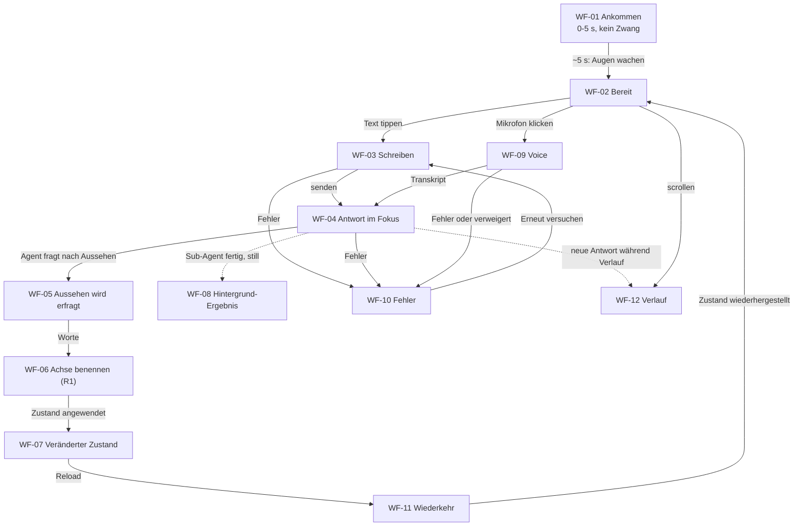
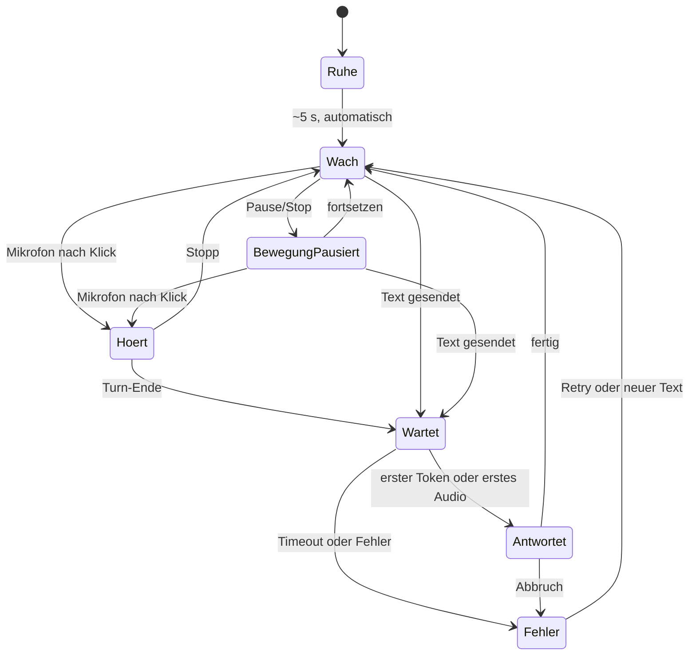

# 00 · Flows, Screens und Viewports

Grundlage: [`README.md`](README.md). Alle Flows sind aus den bestätigten
Designentscheidungen rekonstruiert; die IDs sind versioniert und brauchen
Owner-Freigabe (OD-00).

## 1 · Abgeleitete User Flows

### UF-01 · Ankommen und erster Text

| Feld | Wert |
|---|---|
| Auslöser | Besucher öffnet die URL, kein vorheriger Zustand |
| Schritte | 1. Ruhiges Feld, fast nichts. 2. Nach ~5 s wachen die Augen sanft auf. 3. Textfeld ist bedienbar. 4. Besucher schreibt einen Satz. 5. Senden. |
| Erfolg | Erste Antwort erscheint im Fokus (WF-04) |
| Fehler | App-Shell oder Zustand nicht ladbar → WF-10, Text bleibt erhalten |
| Requirements | F1, F2, F6, P4, Q4 |
| Screens | WF-01 → WF-02 → WF-03 → WF-04 |
| Offen | Darf das Textfeld schon vor dem Aufwachen sichtbar sein? (OD-14) |

### UF-02 · Antwort im Fokus

| Feld | Wert |
|---|---|
| Auslöser | Nachricht gesendet oder Voice-Turn beendet |
| Schritte | 1. Wartezustand ohne erfundenen Text. 2. Erster Token startet den Typewriter. 3. Antwort wächst im Fokus. 4. Ältere Antworten treten zurück. 5. Neue Antwort gewinnt den Fokus, auch wenn der Besucher im Verlauf liest. |
| Erfolg | Antwort vollständig, Eingabe wieder möglich; Verlauf bleibt erreichbar |
| Fehler | Strom bricht ab → WF-10, Teiltext bleibt sichtbar, Retry |
| Requirements | F2, T2, ADR-0002, Designentscheidung „Neue Antwort im Fokus" |
| Screens | WF-04, WF-12 |
| Offen | Verhalten bei sehr langen Antworten und Streaming-Pausen (OD-13) |

### UF-03 · Aussehen erfragen und verändern

| Feld | Wert |
|---|---|
| Auslöser | Der Agent stellt die Frage nach seinem Aussehen |
| Schritte | 1. Frage erscheint als Antwort im Fokus, **noch ohne Regler** (R0). 2. Besucher antwortet in Worten. 3. Der Agent benennt die Achse; der Regler erscheint benannt und passiv (R1). 4. Besucher darf ziehen (R2). 5. Oberfläche **und** Antwort-Haltung ändern sich. 6. Der Zustand bleibt bedienbar und überlebt Reload. |
| Erfolg | Sichtbare Änderung von Palette/Dichte/Rhythmus **und** nachweisbar andere Formulierung in der nächsten Antwort |
| Fehler | Zustandssync schlägt fehl → WF-10, Regler springt auf letzten bestätigten Wert zurück |
| Requirements | F3, T3, ADR-0004, D6 |
| Screens | WF-05 → WF-06 → WF-07 → WF-11 |
| Offen | Achse, Startwert und R1/R2 (D6/OD-08); Zeitpunkt der Frage (OD-02) |

### UF-04 · Stilles Hintergrund-Ergebnis

| Feld | Wert |
|---|---|
| Auslöser | Front-Agent startet den einen Sub-Agenten |
| Schritte | 1. Sub-Agent arbeitet. 2. Ergebnis kommt über State-Sync. 3. Eine leise Zeile erscheint. 4. Kein Fokuswechsel, kein Scroll, kein Ton, keine Unterbrechung. 5. Besucher kann die Zeile aufklappen, muss aber nicht. |
| Erfolg | Ergebnis ist auffindbar, ohne den Hauptfokus zu verschieben |
| Fehler | Sub-Agent scheitert → leise, aber sichtbare Fehlerzeile (Q1: kein stiller Fehlschlag) |
| Requirements | F4, T4, Q1 |
| Screens | WF-08 (überlagert WF-04) |
| Offen | Immer sichtbar oder eingeklappt? (OD-03) |

### UF-05 · Voice nach Klick

| Feld | Wert |
|---|---|
| Auslöser | Besucher klickt das Mikrofon |
| Schritte | 1. Browser-Permission wird angefragt. 2. Bei Erlaubnis: Zuhören mit sichtbarem Pegel. 3. Turn-Ende erkannt. 4. Transkript erscheint. 5. Antwort als Text (und Audio, sofern verfügbar). 6. Stopp ist jederzeit möglich. |
| Erfolg | Ein vollständiger englischer Voice-Turn, Text bleibt als Fallback lesbar |
| Fehler | Verweigert, kein Gerät, kein Ton erkannt, TTS nicht verfügbar → WF-10, Textweg bleibt offen |
| Requirements | F5, T5, Q4, D4, D7 |
| Screens | WF-09 → WF-04, WF-10 |
| Offen | Transkript sichtbar? gemeinsamer Verlauf mit Text? (OD-05); Datenschutzhinweis (OD-11) |

### UF-06 · Wiederkehr und Reload

| Feld | Wert |
|---|---|
| Auslöser | Reload, Zurück-Navigation oder erneutes Öffnen im selben Browser |
| Schritte | 1. Zustand wird vom Server geladen. 2. Augen sind sofort wach, nicht erneut 5 s passiv. 3. Aussehen, Reglerwert und letzte Antwort werden wiederhergestellt. 4. Bei fehlendem Zustand beginnt WF-01. |
| Erfolg | Server-autoritativer Zustand überlebt Reload (Q2) |
| Fehler | Zustand nicht ladbar → frischer Start plus leiser Hinweis, kein Dead End |
| Requirements | Q2, T6 |
| Screens | WF-11 → WF-02 |
| Offen | Was genau wird wiederhergestellt, für wen und wie lange? (OD-06) |

### UF-07 · Fehler und Wiederaufnahme

| Feld | Wert |
|---|---|
| Auslöser | Modell nicht verfügbar, Netz weg, Zustandssync fehlgeschlagen, Mikrofon verweigert, TTS fehlt, **Kontingent erschöpft** |
| Schritte | 1. Fehler wird sichtbar und in verständlicher Sprache benannt. 2. Eingabe und Teilantwort bleiben erhalten. 3. Eine konkrete Aktion wird angeboten. 4. Keine rohen Fehlercodes, kein Modal, kein Auto-Dismiss. |
| Erfolg | Besucher kann ohne Neuladen weiterarbeiten oder den Textweg nutzen |
| Requirements | Q1, Q5 |
| Screens | WF-10 (Varianten), inline in WF-04/WF-06/WF-09 |
| Offen | Copy, Retry-Politik, Abbruchschwelle (OD-10/OD-13) |

### UF-08 · Verlauf lesen und neuer Fokus

| Feld | Wert |
|---|---|
| Auslöser | Besucher scrollt zu älteren Antworten; währenddessen kommt eine neue Antwort |
| Schritte | 1. Ältere Antworten sind gedämpft und kleiner. 2. Neue Antwort trifft ein. 3. Visuell springt der Fokus zur neuen Antwort. 4. Screenreader und Tastatur erhalten eine Ankündigung und eine Sprungmarke, aber keinen erzwungenen Fokuswechsel. |
| Erfolg | Neue Antwort ist sichtbar; Lesende werden nicht aus dem Kontext gerissen |
| Requirements | Designentscheidung „Neue Antwort im Fokus", ADR-0002, WCAG 2.2 |
| Screens | WF-12, WF-04 |
| Offen | Tiefe und Inhalt des Verlaufs (OD-09) |

## 2 · Screen-Flow

Durchgezogene Pfeile sind reguläre Wege. Gestrichelte Pfeile sind Zustände, die
den Hauptfokus nicht unterbrechen dürfen. Jeder Fehlerpfeil endet bei einer
ausführbaren Aktion, nie in einem Dead End.

## 3 · Präsenzzustände der Augen

Die Augen sind Ausdruck, nicht Bedienelement und nicht einzige
Bedeutungsträger. Jeder Zustand hat eine Textentsprechung für Screenreader und
für `prefers-reduced-motion`.

| Präsenz | Augen | Textentsprechung | Auslöser |
|---|---|---|---|
| Ruhe | geschlossen / Feld | keine | Ankunft bis ~5 s |
| Wach | offen, ruhig | keine (Default) | nach ~5 s |
| Hört | zugewandt, Pegel | „Zuhören" | Mikrofon nach Klick |
| Wartet | ruhig, fokussiert | „antwortet" erst nach Schwelle | Nachricht gesendet |
| Antwortet | spricht / pulsiert | Antworttext selbst | erster Token oder Audio |
| Fehler | gedämpft, nicht alarmierend | Fehlertext | Timeout, Abbruch, Kontingent |
| Bewegung pausiert | statisch offen, gleicher Zustand | „Bewegung pausiert" | Pause-/Stop-Steuerung |

**Hintergrund** ist kein Präsenzzustand. Ein Sub-Agent-Ergebnis darf die Augen
nicht auf „spricht" schalten und keinen Ton auslösen.

**WCAG 2.2.2 (Level A):** Die Augen bewegen sich automatisch und länger als
fünf Sekunden. Deshalb gibt es eine **dauerhaft erreichbare Pause-/Stop-
Steuerung** (C-15), nicht nur `prefers-reduced-motion`. Die pausierte Fassung
trägt dieselbe Information; sie ist kein „totes" Bild.

## 4 · Screen-Inventar

| ID | Name | Typ | V1 | Requirements | Flows |
|---|---|---|---|---|---|
| WF-01 | Ankommen | Surface (t=0–5 s) | ja | F1, P4 | UF-01 |
| WF-02 | Bereit | Surface (Default) | ja | F1, F2, F5, F6 | UF-01, UF-05 |
| WF-03 | Schreiben | Zustand von WF-02 | ja | F2, P4 | UF-01 |
| WF-04 | Antwort im Fokus | Zustand von WF-02 | ja | F2, T2, Q1 | UF-01, UF-02, UF-05 |
| WF-05 | Aussehen wird erfragt (R0) | Zustand von WF-02 | ja | F3, ADR-0004 | UF-03 |
| WF-06 | Regler benennen/bewegen (R1→R2) | Zustand von WF-05 | ja | F3, T3 | UF-03 |
| WF-07 | Veränderter Zustand | Zustand von WF-02 | ja | F3, T3, Q2 | UF-03 |
| WF-08 | Hintergrund-Ergebnis | Overlay-frei, inline | ja | F4, T4 | UF-04 |
| WF-09 | Voice nach Klick | Zustand von WF-02 | ja | F5, T5, Q4 | UF-05 |
| WF-10 | Fehler | Zustand, mehrere Varianten | ja | Q1, Q5 | UF-07 |
| WF-11 | Wiederkehr | Surface (Reload) | ja | Q2, T6 | UF-06 |
| WF-12 | Verlauf | Zustand von WF-04 | ja | ADR-0002 | UF-08 |

**Die zwölf IDs sind Prüfanker, keine zwölf Bausteine.** Es gibt genau eine
Fläche (`S1`). WF-03/04/05/06/07/09/10/12 sind Zustände dieser Fläche, keine
Routen. Diese Zählung dient Review und Abnahme; sie ist keine Bauanleitung für
zwölf Seiten.

**Es gibt keine Seiten-Navigation und keine Routen.** WF-01 bis WF-12 sind
Zustände einer einzigen Oberfläche. Das ist die Umsetzung von „die Seite ist der
Agent", nicht ein Chat-Fenster mit Unterseiten.

## 5 · Viewports aus dem Nutzungskontext

### 5.1 Herleitung

| Kontext | Beleg | Folge |
|---|---|---|
| Link-basierter Besuch, kein Login | F7, P1, D2 | Eine Oberfläche, kein Onboarding, kein Konto |
| 20-Sekunden-Fremdtest | ADR-0005, P1 | Desktop muss ohne Erklärung funktionieren |
| Links werden auch auf dem Telefon geöffnet | Nutzungskontext Website; nicht explizit zugesagt | Mobile muss zumindest Text und Voice tragen (OD-01) |
| Voice braucht Mikrofon und Touch | F5, Q4 | 44-px-Ziele, klare Berechtigungszustände |
| Antwort ist Lesetext | F2, ADR-0002 | Lesespalte 65–75 Zeichen, 16 px Minimum |
| Kein Hover-Wissen vorausgesetzt | P4, „nicht bevormundend" | Alle Aktionen auch per Tastatur und Touch erreichbar |

**Mobile ist im Repo nicht als Pflicht belegt.** Ich entwerfe es mit, weil ein
geteilter Link auf dem Telefon landen kann. Ob Mobile V1-Pflicht oder
„darf nicht brechen" ist, entscheidet OD-01.

### 5.2 Breiten und Testgrößen

| Viewport | Testgröße | Spalte | Augen | Composer | Regler | Ergebniszeile |
|---|---|---|---|---|---|---|
| Desktop groß | 1440 × 900 | 640 px zentriert | 112 px | unten, 40 px Abstand | 640 px | in der Spalte |
| Laptop | 1280 × 800 | 600 px | 96 px | unten, 32 px | 600 px | in der Spalte |
| Tablet | 768 × 1024 | 560 px | 88 px | unten, 24 px | 560 px | in der Spalte |
| Mobile | 390 × 844 | fluid, 20 px Rand | 72 px | unten, Safe-Area | volle Breite | volle Breite |
| Mobile klein | 360 × 640 | fluid, 16 px Rand | 56 px | unten, Safe-Area | volle Breite | volle Breite |
| Reflow | 320 CSS px bei 400 % Zoom | fluid | 48 px | unten | volle Breite | umbricht |

**Harte Regeln:**

- Kein horizontaler Scroll bei 320 CSS px.
- Der Composer bleibt bei geöffneter Bildschirmtastatur erreichbar; die
  Antwortfläche schrumpft und scrollt, der Composer nicht.
- Die Augen werden kleiner, verschwinden aber nicht.
- Die Pause-/Stop-Steuerung (C-15) bleibt auch auf Mobile erreichbar, ohne den
  Composer zu verdecken. Sie ist ein leiser Textknopf, kein Einstellungsmenü.
- Der Regler bleibt ein einzeiliger, vollflächiger Streifen; keine zwei Zeilen
  aus Label und Wert, wenn dadurch das Thumb-Ziel unter 44 px fällt.
- Die Ergebniszeile bricht um; sie wird kein Modal und keine zweite Spalte.

### 5.3 Content-Hierarchie je Viewport

| Rang | Desktop | Mobile |
|---|---|---|
| 1 | Aktuelle Antwort | Aktuelle Antwort |
| 2 | Composer | Composer (Daumenbereich) |
| 3 | Regler | Regler (über Composer) |
| 4 | Hintergrund-Ergebnis | Hintergrund-Ergebnis (einklappbar) |
| 5 | Augen / Präsenz | Augen / Präsenz (kleiner) |
| 6 | Verlauf | Verlauf |

Die Reihenfolge ist identisch; nur Größe und Abstand ändern sich. Damit bleibt
die Bedienlogik beim Wechsel des Geräts gleich.

## 6 · Navigationsmodell

- **Keine Kopfzeile, kein Menü, keine Tabs, keine Routen.** Navigation ist
  Scrollen und Fokussieren.
- **Skip-Links** (nur bei Tastaturfokus sichtbar): „Zur Eingabe", „Zur aktuellen
  Antwort".
- **Tab-Reihenfolge:** Skip-Links → Sprungmarke „Neue Antwort" (falls sichtbar)
  → Hintergrund-Ergebnis (falls vorhanden) → Regler (falls vorhanden) →
  Texteingabe → Senden → Mikrofon.
- **Escape** schließt ein aufgeklapptes Hintergrund-Ergebnis und stoppt Zuhören.
  Escape löscht niemals den Text.
- **Enter** sendet in der einzeiligen Eingabe; während einer IME-Komposition
  nicht.
- **Pfeiltasten, Home, End** bedienen den Regler.
- **Kein Fokusklau:** Neue Antworten werden höflich angekündigt, nicht per
  `focus()` angesprungen.

Browser-Zurück ist nicht spezifiziert. Solange keine Routen existieren, verlässt
Zurück die Seite. Ob Regleränderungen History-Einträge erzeugen, ist OD-06.

## 7 · Tastatur- und Touch-Matrix

| Element | Tastatur | Touch | Mindestziel |
|---|---|---|---|
| Textfeld | Tab, tippen, Enter sendet | tippen | volle Breite × 48 px |
| Senden | Tab, Enter/Space | tippen | 44 × 44 px |
| Mikrofon | Tab, Enter/Space | tippen | 48 × 48 px |
| Regler | Pfeile, Home/End, PageUp/Down | ziehen, tippen | Thumb-Hitfläche 44 × 44 px |
| Hintergrund-Ergebnis | Tab, Enter/Space | tippen | Zeile 44 px hoch |
| Verlauf | scrollen, Sprungmarke | scrollen | – |
| Fehleraktion | Tab, Enter/Space | tippen | 44 × 44 px |

## 8 · Was der Flow bewusst nicht tut

- Er fragt nicht „Wie kann ich helfen?".
- Er zeigt keine Feature-Liste, keine Tour, keine Tooltips.
- Er öffnet kein Modal beim Ankommen.
- Er spielt keinen Ton vor der ersten Nutzeraktion.
- Er verlangt keinen Klick vor der ersten Texteingabe.
- Er simuliert keine Denk-Schleife mit Text.
- Er schiebt das Hintergrund-Ergebnis nicht in den Fokus.
