# Agentfähig — Skizze vom 12.11.2026

Handschriftliche Skizze vom reMarkable, übertragen in Klartext und in
Ausschnitte zerlegt. Die Reihenfolge folgt der Seite von oben nach unten.

| | |
|---|---|
| Quelle | reMarkable Paper Pro, Notizbuch **„Agentfähig"** (UUID `c705c041-beea-465b-a779-8536bcfda4c5`) |
| Seite | 1 Seite, sehr lang: 685 × 7595 pt |
| Export | HTTP-Export der Tablet-Firmware (`/download/<uuid>/pdf`), gerastert mit pypdfium2 |
| Rohdaten | [`raw/`](raw/) — `.rm`, `.content.json`, `.metadata.json` |
| Bilder | [`blocks/`](blocks/) — 10 Ausschnitte in Seitenreihenfolge |

> Die Skizze mischt Deutsch und Englisch. Die Wiedergabe unten hält sich an die
> Vorlage, ohne zu glätten. Unsichere Lesarten sind mit `⟨…⟩` markiert und am
> Ende gesammelt.

---

## 1 · Einstieg — „Not a website"

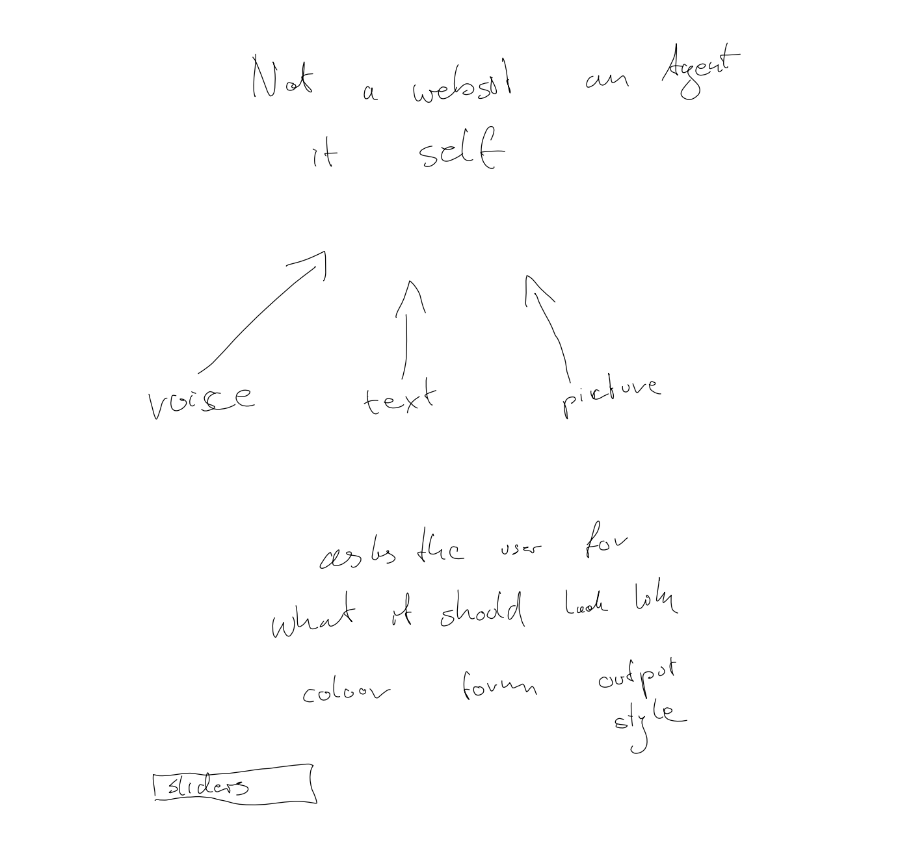

- **„Not a website — an Agent itself"**
- Drei Eingänge mit Pfeil nach oben: `voice`, `text`, `picture`
- Der Agent **„asks the user for what it should look like"**:
  `colour` · `form` · `output style`
- Einziges sichtbares Bedienelement: `sliders`

## 2 · Vom User zum Agenten

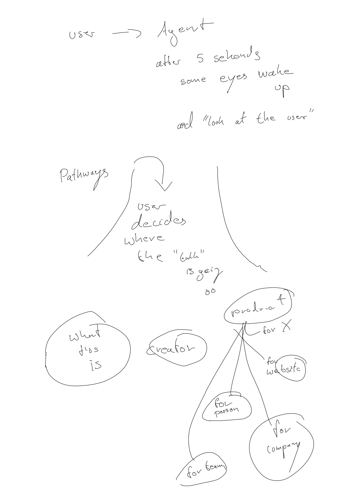

- `user → Agent`
- „after 5 seconds some eyes wake up **and 'look at the user'**"
- Über der Verzweigung steht **`Pathways`**:
  „user decides where the 'call' is going to"
- Zwei Achsen, aus denen sich alles ableitet:
  - **„What this is"** (linke Blase)
  - **„creator"** (mittlere Blase)
- Rechts: **`product`** mit dem Ast `for X`, der sich auffächert in
  `for website` · `for person` · `for team` · `for company`

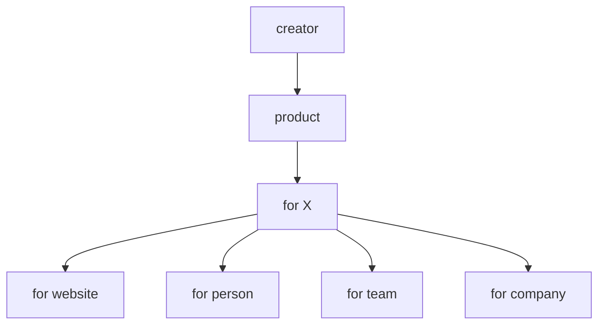

## 3 · Gefühl und Textur

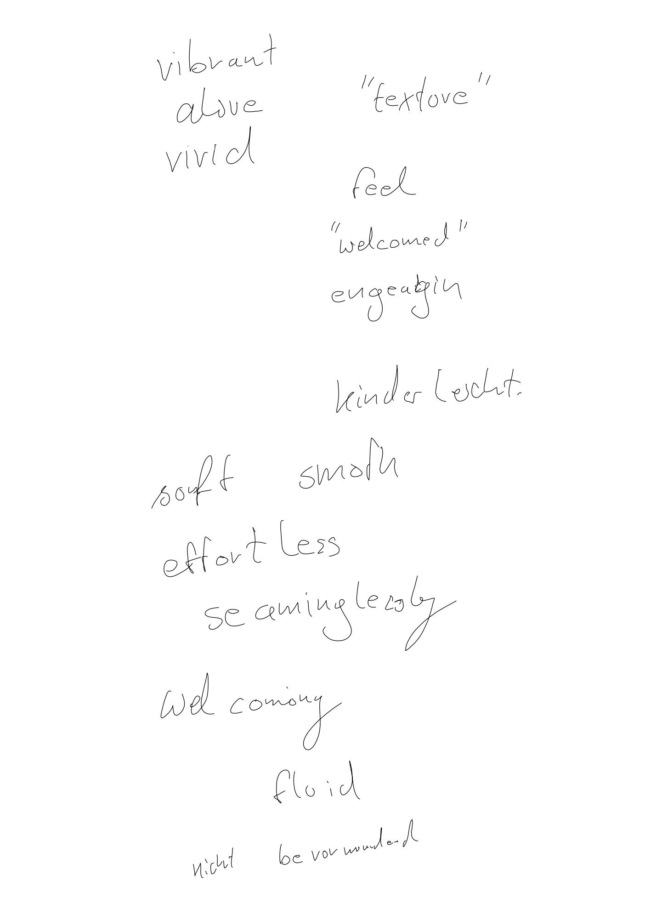

Wortfeld, mit dem die Wirkung beschrieben wird:

- vibrant · alive · vivid — **„texture"**
- feel **„welcomed"** · engaging
- kinder leicht
- soft smooth · effortless · seamlessly
- welcoming · fluid
- **nicht bevormundend**

## 4 · Screens: Ruhe und Bewegung

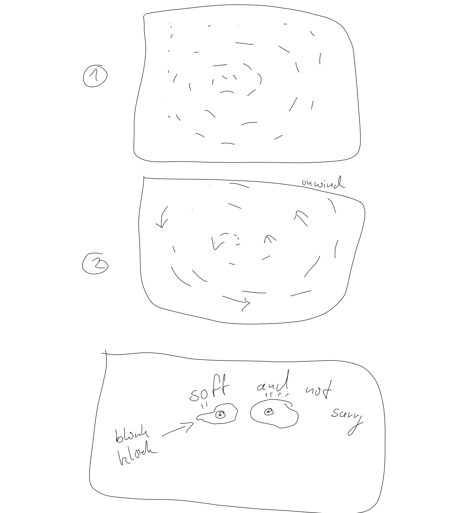

- **①** Ruhiges Feld: dichtes, kurzes Gekritzel — Textur ohne lesbaren Inhalt.
- **②** Dasselbe Feld, Striche lösen sich, Pfeile zeigen nach außen:
  **„on wind"**.
- **③** Zwei Blöcke (`block block`) wandern zusammen und werden zu Augen:
  **„soft and not scary"**.

## 5 · Screens: Input und Slider

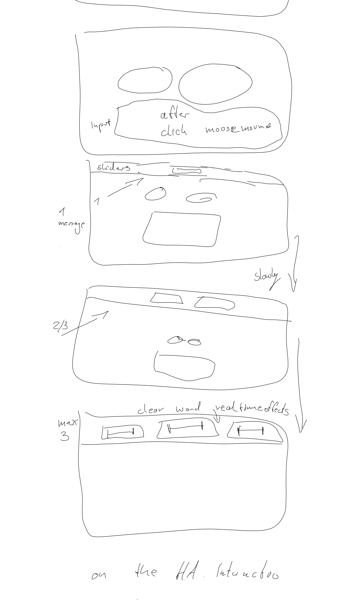

- Karte **„input"** mit Augen — Beschriftung **„after click"**, **„mouse move"**
- Karte mit **`sliders`** oben, **„1 message"**, Augen, Texteingabefeld
- Karte **„2/3"** (zwei Tabs/Slider oben)
- Karte **„max 3"** (drei Slider) — Stichworte **„clear word"**, **„real time effects"**
- Unterschrift der Serie: **„on the HAI Interaction"**

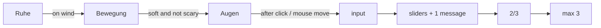

## 6 · HAI-Interaction und Design

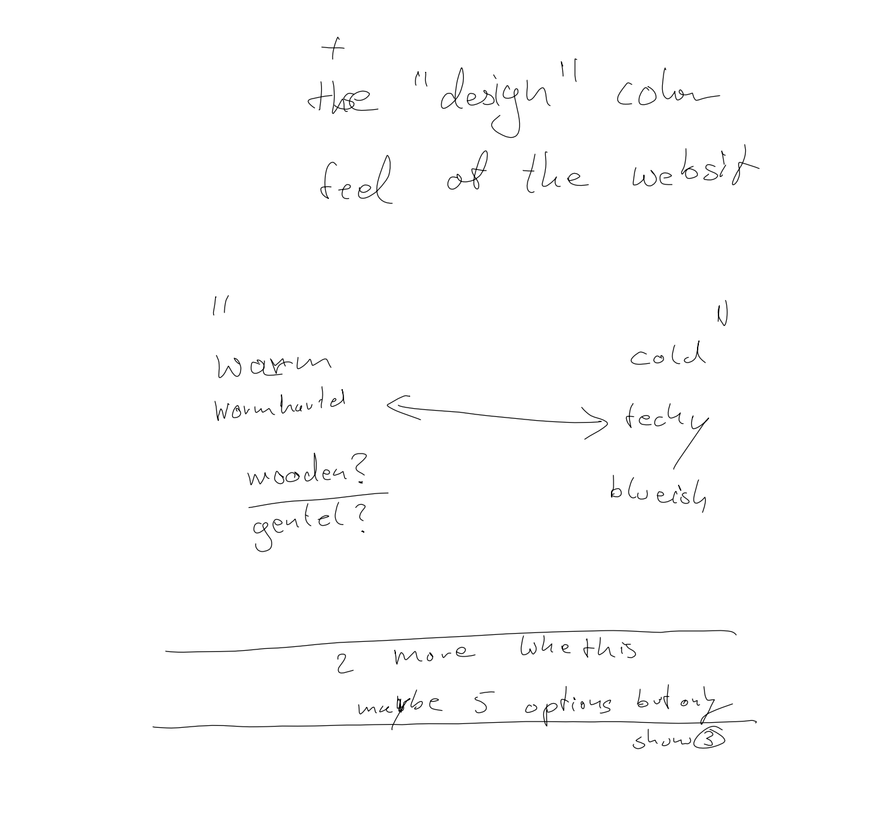

- **„on the HAI-Interaction + the 'design' colour feel of the website"**
- Achse **warm ↔ cold**:
  - warm: `warmhearted`, `wooden?`, `gentel?` (gentle)
  - cold: `techy`, `blueish`
- **„2 more when this"** — **„maybe 5 options but only show 3"**

## 7 · Was der Agent können muss

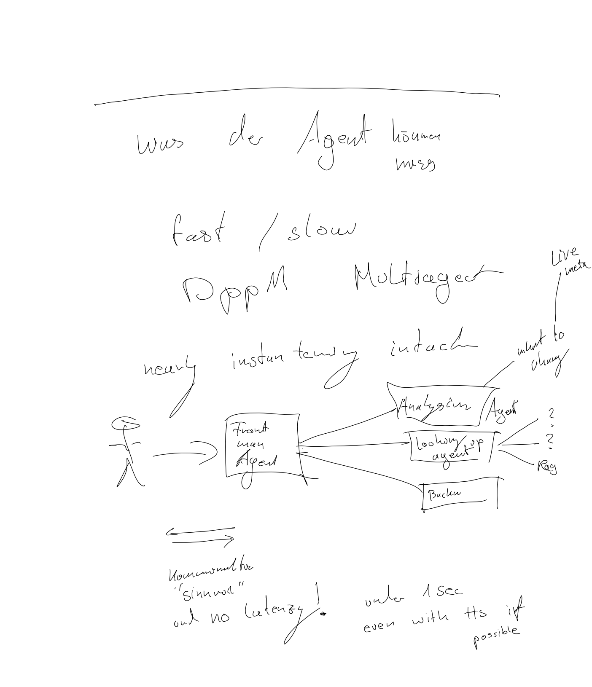

- **„Was der Agent können muss"**: `fast / slow`
- Zwei große Begriffe: `⟨Opp M⟩` und `⟨Moltdegect⟩` (vermutlich „Multiagent")
- Qualitäten: `nearly` · `⟨instantly⟩` · `⟨in touch⟩` — Pfeil auf den Front-Agenten
- Rechte Seite: `live meta` · `want to change` — Pfeil auf den Analysis-Agenten
- Architektur: **User → Front man Agent** → drei nachgelagerte Agenten:
  **Analysing Agent**, **Looking up agent**, **⟨Backup⟩**;
  rechts zwei Fragezeichen und `⟨Pay⟩`
- Doppelpfeil **Kommunikation**: „⟨Sinnvoll⟩" und **no latency!** —
  **„under 1 sec even with TTS if possible"**

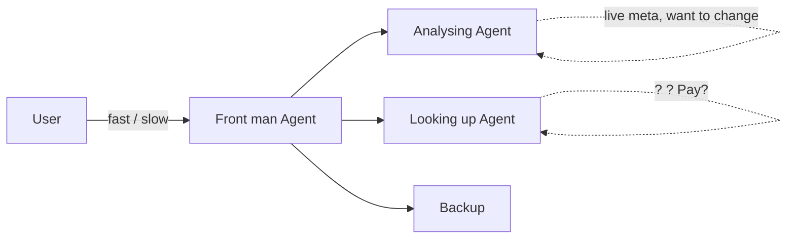

## 8 · Meta und Philosophie

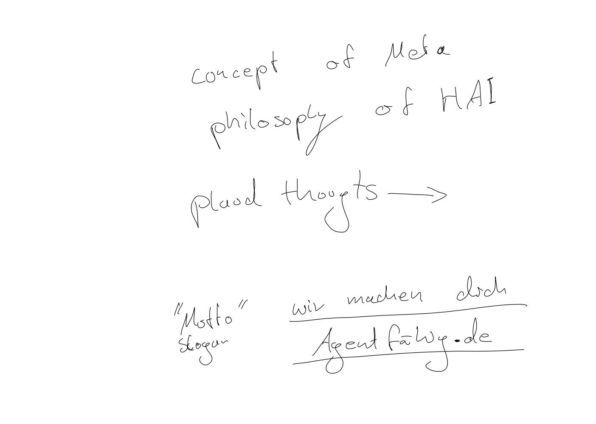

- **Concept of Meta** · **philosophy of HAI**
- `plaud thoughts →` (Gedanken aus Plaud-Aufnahmen einspielen)
- **„Motto" / Slogan**: **„wir machen das! — Agentfähig.de"**

## 9 · Steps und Recherche

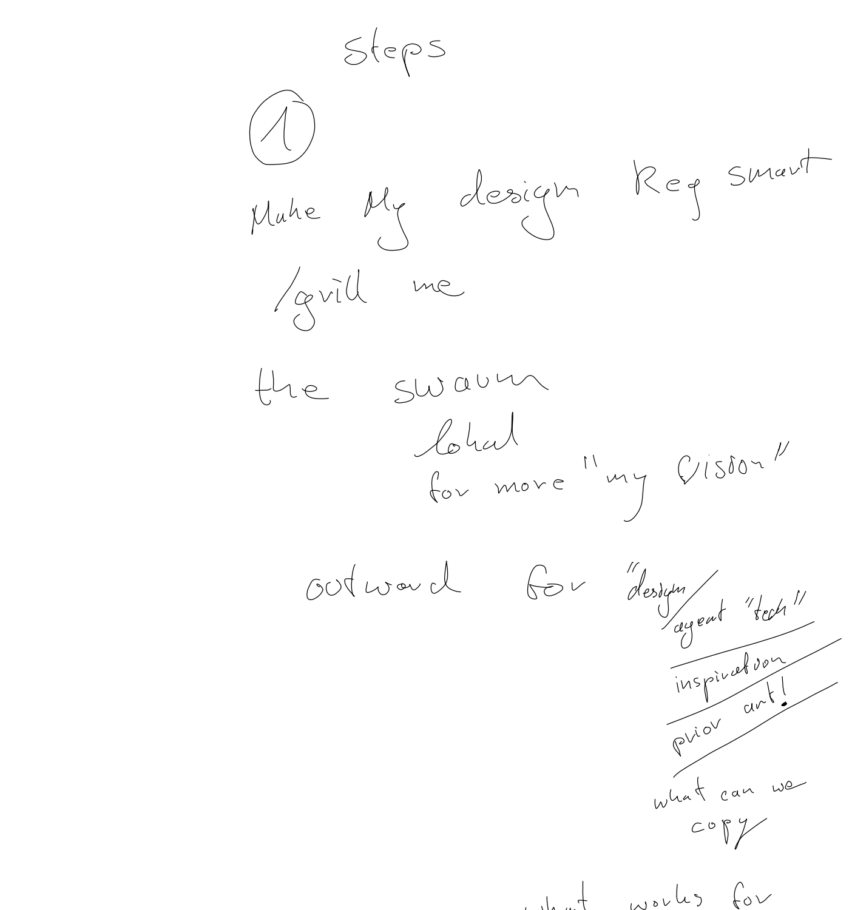

- **Steps ①** „Make my design ⟨Reg⟩ smart" — „grill me" —
  „the swarm ⟨lokat⟩" — „for more 'my vision'"
- **„outward for 'design / agent tech'"**: `inspiration` · `prior art!` ·
  `what can we copy`

## 10 · Technik und Ausblick

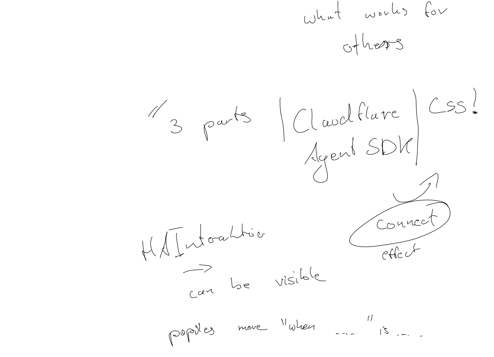

- `what can we copy` · `what works for others`
- **„// 3 parts | Cloudflare Agent SDK | CSS!"**
- **„HAI Interaction → can be visible"** mit beschriftetem **„Connect effect"**
- **„popups move 'when … is …'"**

---

## Unsichere Lesarten

| Stelle | transkribiert | möglich |
|---|---|---|
| `⟨Opp M⟩` | Opp M | Ppp M, ppm — Bedeutung unklar |
| `⟨Moltdegect⟩` | Moltdegect | „Multiagent", „Modelagent" |
| `⟨instantly⟩` | instan tany | „instantany", „instantly" |
| `⟨in touch⟩` | intack | „intact" |
| `⟨Backup⟩` | Bachw | Backup, „Bachw" |
| `⟨Pay⟩` | Pay | Ray |
| `⟨Sinnvoll⟩` | Sinnvoll | sinnvoll |
| `⟨Reg⟩` | Reg Smart | „Real(ly) smart" |
| `⟨lokat⟩` | lakat / lokat | „look at", „lokal" |

## Wie die Datei entstanden ist

1. Rohkopie vom Tablet per SSH, Export als PDF über die USB-Webschnittstelle
   (die Tablet-Firmware rendert; `rmc` 0.3.0 versteht das Paper-Pro-Format nicht).
2. PDF mit pypdfium2 in ein PNG (1404 × 15567 px) gerastert.
3. Seite an Leerzeilen in zehn Ausschnitte zerlegt (`blocks/`).
4. Ausschnitte gelesen und hier als Klartext notiert.

Nicht korrigiert: Rechtschreibung, Grammatik und der Wechsel zwischen Deutsch
und Englisch bleiben so, wie sie auf der Seite stehen.
