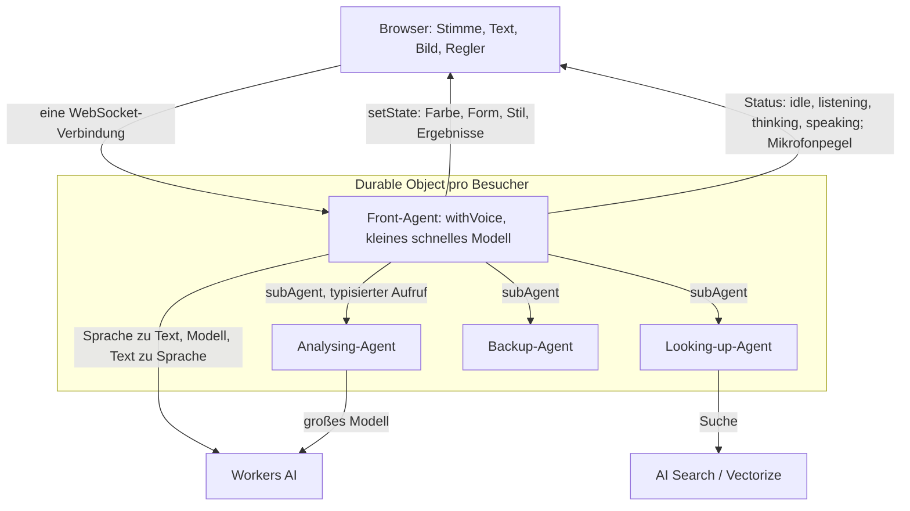

# Agentfähig auf Cloudflare — Machbarkeit

Stand: 12.11.2026 · HAI-Mission `M-20261112T230610-fd237a98`

## Urteil

Agentfähig lässt sich auf Cloudflare bauen, und fast alles davon mit einem
einzigen Upstream: dem Agents SDK. Offen ist genau eine Anforderung der
Skizze — „under 1 sec even with TTS". Cloudflares eigene Zahlen liegen bei
800 bis 950 ms und damit an der Grenze; ob das hält, lässt sich nur messen.

Grundlagen: [`INTENT.md`](INTENT.md) (Fragen T1–T9),
[`research/cloudflare-bausteine.md`](research/cloudflare-bausteine.md),
[`research/konkurrenz.md`](research/konkurrenz.md),
[`UPSTREAM_SEARCH.md`](UPSTREAM_SEARCH.md).

**Zur Beleglage:** „geprüft" heißt, ich habe die Aussage am 12.11.2026 selbst
gegen die genannte Seite abgleichen lassen. „Worker" heißt, sie stammt aus dem
Recherchebericht eines freien Modells (GLM 5.3 Flash oder MiniMax M3.1 Flash)
und ist nicht gegengeprüft.

## Wie es zusammenläuft

In Worten: Jeder Besucher bekommt einen eigenen Agenten. Der Browser hält eine
einzige WebSocket-Verbindung zu ihm. Darüber laufen Audio in beide Richtungen,
Text, der Agent-Zustand (Reglerwerte, Farben, Ergebnisse) und die Signale für
die Animation. Der Front-Agent antwortet sofort mit einem kleinen Modell und
ruft die drei nachgelagerten Agenten als Sub-Agenten auf. Deren Ergebnisse
kommen über die Zustands-Synchronisation im Browser an, ohne neue Anfrage.

## Urteil je Baustein

| Frage | Baustein | Urteil | Beleg | Lücke |
|---|---|---|---|---|
| T1 Stimme | Agents SDK `withVoice` aus `agents/voice`; Workers AI `@cf/deepgram/flux` (Sprache zu Text), `@cf/deepgram/aura-1` (Text zu Sprache) | **machbar** | geprüft: [Voice-Doku](https://developers.cloudflare.com/agents/agent-class/communication-channels/voice/) | Als **Beta** markiert. Ob die Stimmen Deutsch können, ist nicht geprüft. |
| T1 Text | `sendText` umgeht die Spracherkennung | **machbar** | Worker, gleiche Seite | — |
| T1 Bild | Vision-Modelle in Workers AI (z. B. `llama-3.2-11b-vision-instruct`) | **machbar**, nicht gegengeprüft | Worker: [Modellkatalog](https://developers.cloudflare.com/workers-ai/models/) | Kein fertiges Beispiel für Bild-Eingang im Sprach-Agenten gefunden. |
| T2 unter 1 s mit Sprachausgabe | Satzweises Vorlesen, während das Modell noch schreibt | **unklar** | geprüft, siehe Abschnitt Latenz | Keine echte Messung vorhanden. |
| T3 Front-Agent → drei Agenten | `this.subAgent(Klasse, name)`, Kinder auf derselben Maschine mit eigenem Speicher | **machbar** | geprüft: [Sub-Agents-Doku](https://developers.cloudflare.com/agents/agent-class/sub-agents/) | — |
| T4 schnell / langsam | Kleines Modell vorn, großes hinten; Ergebnis per Zustands-Sync nachreichen | **machbar** für sichtbare Ergebnisse, **unklar** für gesprochene | Sync geprüft ([README](https://github.com/cloudflare/agents)); Modellnamen Worker | Ob der Agent von sich aus nachträglich *sprechen* kann, wenn der langsame Pfad fertig ist, steht in keiner geprüften Quelle. |
| T5 Regler in Echtzeit | Agent-Zustand synchronisiert an alle verbundenen Browser (`setState`, `useAgent`) | **machbar** | geprüft: README | Wie der Zustand zur Oberfläche wird, ist Frontend; Kandidat `json-render`. |
| T6 Augen, Effekte | Status `idle / listening / thinking / speaking`, `audioLevel` 0–1, Teiltranskript | **machbar** | geprüft: Voice-Doku | Die Animation selbst ist Design. |
| T7 ein Agent pro Besucher / Mandant | Durable Object mit eigenem Namen | **machbar** | Worker: [Durable Objects](https://developers.cloudflare.com/durable-objects/) | Aufteilung „for website / person / team / company" ist eine Namensfrage, noch nicht entschieden. |
| T8 Wissensquelle | AI Search, darunter Vectorize | **machbar**, nicht gegengeprüft | Worker: [AI Search](https://developers.cloudflare.com/ai-search/) | Für wenig Wissen reicht die bestehende `llms.txt`-Lösung aus `claudeflareworkerhaus`. |
| T9 Bezahlen | x402 im Agents SDK, Beispiele `x402`, `x402-mcp` | **vorhanden** | geprüft: Beispielordner im Repo | Nicht vertieft, Lesart „Pay" in der Skizze ist unsicher. |

## Latenz: die eine offene Frage

Was Cloudflare selbst sagt (alles geprüft):

| Quelle | Aussage |
|---|---|
| [Blog 29.08.2025](https://blog.cloudflare.com/cloudflare-realtime-voice-ai/) | Eine Antwort muss „in under 800 milliseconds" kommen. Budget: 40 ms Mikrofon, 300 ms Spracherkennung, 400 ms Modell, 150 ms Sprachausgabe. |
| [Voice-Doku, Stand 29.10.2026](https://developers.cloudflare.com/agents/agent-class/communication-channels/voice/) | Codebeispiel mit `llm_ms: 850`, `tts_ms: 200`, `first_audio_ms: 950`, `total_ms: 1200`. Die Seite sagt nicht, ob das gemessen oder nur ein Beispiel ist. |
| Gleicher Blog | Für Echtzeit-Gespräche sei WebRTC „the better choice" gegenüber WebSocket. |
| [Blog 15.04.2026](https://blog.cloudflare.com/voice-agents/) | Das Agents SDK nutzt trotzdem WebSocket als „simplest path for 1:1 voice agents". Der Beitrag nennt keine Millisekunden. |

Drei Dinge fallen auf:

1. **Cloudflares Budget geht nicht auf.** 40 + 300 + 400 + 150 sind 890 ms, nicht unter 800.
2. **Das Modell ist der größte Posten.** 400 bis 850 ms entfallen auf die erste Modellantwort. Der Hebel ist also die Wahl des Front-Modells, nicht der Transport.
3. **Stille-Erkennung kommt obendrauf.** Der Client wartet standardmäßig 500 ms Stille ab (`silenceDurationMs`), bevor er das Sprechende als beendet meldet. Wie sich das mit der modellgestützten Erkennung von `flux` verrechnet, steht nicht in der Doku.

Zum Vergleich von außen (Worker, nicht gegengeprüft): Pipecat nennt 500–800 ms
für den ganzen Durchlauf, Hume rund 300 ms als Zielwert, das Ende-zu-Ende-
Sprachmodell Moshi etwa 200 ms.

**Folgerung:** Für Text ist „unter 1 s bis zur ersten Antwort" unkritisch, weil
Spracherkennung und Sprachausgabe wegfallen. Für Stimme ist es mit dem
Standardweg an der Grenze. Wenn die Messung über 1 s landet, gibt es zwei
Ausweichpfade: ein kleineres Front-Modell, oder Cloudflare Realtime Agents
(WebRTC, offene Beta seit August 2025).

## Risiken

- **Beta.** Die Sprach-Pipeline des Agents SDK ist Beta; Schnittstellen können sich ändern. Das Paket `@cloudflare/voice` ist bereits abgekündigt zugunsten von `agents/voice` (ab Version 0.23.0).
- **Modell-Limits.** Laut Worker-Bericht gelten für bezahlte Textmodelle 20 Anfragen pro Minute je Konto und Modell (50 mit vorausbezahlten Credits). Für eine öffentliche Startseite wäre das eng. Nicht gegengeprüft; vor dem Bau klären, welche Modelle darunter fallen.
- **Deutsch.** Keine geprüfte Quelle sagt, ob `flux` und `aura-1` Deutsch beherrschen. Der Slogan ist deutsch.
- **Nachträgliches Sprechen.** Ob der Front-Agent von sich aus weitersprechen kann, wenn ein Sub-Agent später fertig wird, ist offen (siehe T4).
- **Keine Vorlage für den Kern der Idee.** Die Konkurrenz-Recherche fand kein Projekt, bei dem der Agent die eigene Seite per Regler live umgestaltet. Der technische Unterbau existiert, die Oberfläche dazu nicht.

## Nächster Schritt

Eine Messung, kein Bau: das Beispiel `examples/voice-agent` aus
`cloudflare/agents` lokal starten und zwanzig Sprach-Wechsel auf Deutsch
aufzeichnen. Der Client liefert `first_audio_ms` je Wechsel. Damit sind T2,
die Deutsch-Frage und die Stille-Erkennung in einem Durchgang beantwortet.
Das braucht einen Klon und damit Plan-Modus und Freigabe des Owners.

## Offen für den Abgleich mit Requirements und Design

Sobald der Owner pusht, gegen T1–T9 legen. Schon jetzt zu entscheiden:

- Eigener Worker oder Teil der Flotte `claudeflareworkerhaus`?
- Ein Agent pro Besucher oder pro Mandant (T7)?
- Reicht „unter 1 s" für Text, oder ist es für Stimme hart?
